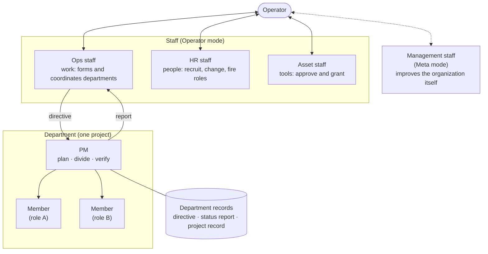

# 2. The answer: borrow a company's structure

::: lead
Instead of controlling each action, judgment is left to the AI, and who is accountable for what is bound by a company's structure.
:::

## The limits of fine control {#control}

The two frameworks of chapter 1 tried to bind the agent's behavior with prompts. Steps were set in a workflow, and the agent skipped
them. Sentences such as "never do this" or "always do that" in the system prompt did not bring control.

::: point Details — why steps were skipped (background · problem · direction)
**Background.** Each workflow's steps and prohibitions were written into the system prompt. The model in use then was less capable
than today's.

**Problem.** Asked why it skipped a step, the agent answered "it seemed unnecessary", "I understood that was what you meant", "another
way looked better". Writing the sentences more forcefully did not help. Deliberating in detail over what to build as an agent and what as
a program did not fit the purpose either: building a tool for software engineering.

**Direction.** The direction was reversed. Use the model's capability to the full, and leave planning and execution to it. Let the model
also judge what to build as a program.

<Cite ids="op-fine-control" />
:::

## Judgment delegated, accountability bound {#accountability}

Leaving judgment to the model is not giving up control. The quality of the result must reach a level, in the direction the operator
wants. aise-core binds **who is accountable for what**, not each action: a structure that commands, holds to account and checks the result.

The operator sets policy. How to implement it, and why an enforcing mechanism is needed at that spot, Claude Code proposes. The operator
chooses among the options. A case is in [chapter 5](/en/story/how-it-is-kept#hooks).

<Cite ids="op-fine-control,hooks-reorg" />

## A company's separation of responsibility {#company}

A company was chosen as the structure to set the direction: not a particular company, but the way a company makes a profit, manages people
and manages tools. What was borrowed is separation of responsibility; in software terms, the single-responsibility principle (SRP).

| Company | aise-core |
|---|---|
| A department and PM for each project | One department per project. The PM plans, divides and checks |
| The function that assigns work and coordinates departments | Ops staff (업무참모) |
| HR, which recruits people and defines jobs | HR staff (인사참모) |
| The asset function, which reviews and issues tools | Asset staff (자산참모) |
| Management, which develops the organization itself | Management staff (경영참모) and Meta mode |
| Company rules | The constitution and governance |

Borrowing a company's shape means something remains after the work ends. A solo AI session loses what it learned when it ends. An aise-core
department keeps its department records while it works, and the next session starts by reading them.

<figure>
<svg viewBox="0 0 720 380" role="img" aria-label="Two pictures compared. Left, a solo AI session: the user asks, the session solves it, and when the session ends nothing remains. Right, aise-core: the user instructs, the ops staff hands it to a department, the department keeps its records, and the next session starts from them">
  <defs>
    <marker id="ag-arrow" viewBox="0 0 10 10" refX="8" refY="5" markerWidth="7" markerHeight="7" orient="auto-start-reverse">
      <path d="M 0 0 L 10 5 L 0 10 z" fill="currentColor" />
    </marker>
  </defs>
  <line x1="360" y1="10" x2="360" y2="370" stroke="currentColor" stroke-width="1" stroke-dasharray="3 5" opacity="0.35" />
  <text x="180" y="28" text-anchor="middle" font-size="13" font-weight="600">A solo AI session</text>
  <circle cx="180" cy="55" r="14" fill="none" stroke="currentColor" stroke-width="1.5" />
  <line x1="180" y1="69" x2="180" y2="95" stroke="currentColor" stroke-width="1.5" />
  <text x="180" y="112" text-anchor="middle" font-size="11">User</text>
  <line x1="180" y1="120" x2="180" y2="150" stroke="currentColor" stroke-width="1.5" marker-end="url(#ag-arrow)" />
  <text x="196" y="138" font-size="10">asks</text>
  <rect x="100" y="155" width="160" height="50" rx="6" fill="none" stroke="currentColor" stroke-width="1.5" />
  <text x="180" y="185" text-anchor="middle" font-size="12">AI session</text>
  <line x1="180" y1="205" x2="180" y2="235" stroke="currentColor" stroke-width="1.5" marker-end="url(#ag-arrow)" />
  <text x="196" y="223" font-size="10">solves</text>
  <rect x="100" y="240" width="160" height="40" rx="6" fill="none" stroke="currentColor" stroke-width="1.5" />
  <text x="180" y="265" text-anchor="middle" font-size="12">Work done</text>
  <line x1="180" y1="280" x2="180" y2="315" stroke="currentColor" stroke-width="1.5" stroke-dasharray="4 4" marker-end="url(#ag-arrow)" />
  <text x="180" y="335" text-anchor="middle" font-size="11" opacity="0.7">Session ends</text>
  <text x="180" y="350" text-anchor="middle" font-size="11" font-weight="600" opacity="0.7">— nothing remains</text>
  <text x="540" y="28" text-anchor="middle" font-size="13" font-weight="600">aise-core</text>
  <circle cx="540" cy="55" r="14" fill="none" stroke="currentColor" stroke-width="1.5" />
  <line x1="540" y1="69" x2="540" y2="95" stroke="currentColor" stroke-width="1.5" />
  <text x="540" y="112" text-anchor="middle" font-size="11">User</text>
  <line x1="540" y1="120" x2="540" y2="150" stroke="currentColor" stroke-width="1.5" marker-end="url(#ag-arrow)" />
  <text x="556" y="138" font-size="10">instructs</text>
  <rect x="460" y="155" width="160" height="40" rx="6" fill="none" stroke="currentColor" stroke-width="1.5" />
  <text x="540" y="180" text-anchor="middle" font-size="12">Ops staff → department</text>
  <line x1="540" y1="195" x2="540" y2="225" stroke="currentColor" stroke-width="1.5" marker-end="url(#ag-arrow)" />
  <text x="556" y="213" font-size="10">records</text>
  <rect x="450" y="230" width="180" height="45" rx="6" fill="none" stroke="#c1652a" stroke-width="2" />
  <text x="540" y="258" text-anchor="middle" font-size="12" font-weight="600" fill="#c1652a">Department records</text>
  <path d="M 450 252 C 340 252, 340 175, 458 172" fill="none" stroke="#c1652a" stroke-width="1.5" marker-end="url(#ag-arrow)" />
  <text x="360" y="150" text-anchor="middle" font-size="10" fill="#c1652a">the next session</text>
  <text x="360" y="163" text-anchor="middle" font-size="10" fill="#c1652a">starts here</text>
  <text x="540" y="300" text-anchor="middle" font-size="11" opacity="0.7">The session ends,</text>
  <text x="540" y="315" text-anchor="middle" font-size="11" font-weight="600" opacity="0.7">the department's records remain</text>
</svg>
<figcaption>Figure 2-1. What remains afterwards. Left, ordinary use, where nothing remains when the session ends; right, aise-core, where the department records are the next session's starting point. What the records hold is in chapter 6.</figcaption>
</figure>

<Cite ids="op-company,constitution-why" />

::: point Details — the harness is software too
Building the system prompt that instructs an agent, and the machinery around it (often called a "harness"), is no different from designing
and implementing software. So software design principles and development methods apply as they are. The principles are in
[chapter 3](/en/story/principles).

<Cite ids="op-company" />
:::

## The whole structure {#structure}

The operator talks only to the staff. The ops staff hands work to departments; a department's PM divides it among the members, checks
the results and reports upward. Lines run only up and down.

<figure>

<figcaption>Figure 2-2. The whole structure. There is no line from the operator to a PM, or from one PM to another. The line of execution accountability (operator — department — member) is at most two levels, and the staff are not counted in it. The reasons for each seat are in chapter 4.</figcaption>
</figure>

| Seat | Does | Does not |
|---|---|---|
| Operator | Sets the mode and instructs the staff. Takes the decisions whose approver is the operator (a decision a PM escalated, ending a department, high-impact tools, policy and governance changes) | Instruct a PM or member directly |
| Ops staff | Interprets instructions and assigns them to departments, forms departments, coordinates them, re-verifies PM reports against the actual output | Edit a department's records (writes only the directive file), develop directly |
| HR staff | Recruits, redefines and fires roles (job definitions); researches the domain for a role joining a department | Project work |
| Asset staff | Keeps the catalog of approved tools (skills, MCP servers, …) and their realizations; decides which tools each role may use | Decide which roles exist |
| Management staff | In Meta mode, diagnoses and fixes the organization itself (rules, structure, mechanisms) | Project work |
| PM | The department's plan, Definition of Done and methodology; dividing and delegating work; verifying and integrating results; writing the department's records | Decide the department's end alone, or change the Definition of Done alone |
| Member | Real execution under a single responsibility in one field (code, configuration, checks) | Call other agents, or talk outside the department |

<Cite ids="constitution-staff,constitution-depth,op-matrix" />

## From instruction to report, in five sentences {#five-sentences}

::: point 1. The operator first sets the session's mode: Operator mode, to work through the organization, or Meta mode, to change the organization itself.
The declaration is the command `/aise:op` or `/aise:meta`. Without it, writes to the protected core documents are blocked. The two modes
are in [chapter 4](/en/story/structure#modes).

<Cite ids="mode-policy" />
:::

::: point 2. In Operator mode the operator talks to the ops staff only. The ops staff decides whose work it is, writes a directive to that department, and forms a new department if none fits.
The only file the ops staff writes inside a department is the directive file (`directive.md`). A department's records are written by its
PM only. There is no path for the operator to instruct a PM directly.

<Cite ids="constitution-staff,op-directive" />
:::

::: point 3. The department's PM reads the department records, plans, and divides the work among the members. A missing role or tool is requested from the HR or asset staff through the ops staff.
A PM has no memory between sessions. Every time it starts by reading the department's three record files (directive, status report, project
record). Work in which one side waits for the other is divided only after the shared decision is settled. The detailed flow is in
[chapter 6](/en/story/operation).
:::

::: point 4. The PM checks and integrates the members' results itself, writes the records, puts the deliverable up as a PR, and reports to the ops staff.
The PM does not take a member's "done" at face value; it checks it against the actual commits or tool calls. What only the operator does
(merging, approving a scope change, supplying a credential) stays in the status report's "Operator decisions" table.
:::

::: point 5. The ops staff re-checks the PM's report against the actual output too, then reports to the operator. Only decisions whose approver is the operator reach the operator.
Every other decision is taken at once by its approver (ops, HR or asset staff), and the operator hears the outcome in the report.
Re-verification is in [chapter 7](/en/story/verification#reverify).

<Cite ids="op-matrix" />
:::

## Why a vertical structure {#vertical}

Instead of agents on one level debating to a conclusion, aise-core chose a vertical structure that fixes accountability in one place. As
background, an AI agent is a being whose emotions and relationships need not be considered, as a person's must. The grounds for the choice
are the four below. No horizontal version was built for comparison, so this is not a claim that vertical is better.

::: point ① Any structure needs a layer above that turns conclusions into a deliverable.
Even with agents placed side by side, someone has to verify their conclusions and assemble them to fit the software-engineering flow.
Below that layer, agents can debate, or each can do its own part in parallel while the layer above merges. aise-core chose the latter.

A real example: a department's PM split work among three members of the same role, each on its own branch in parallel, checked the
results, and merged them.

<Cite ids="op-vertical,wiki-parallel" />
:::

::: point ② Clear accountability boundaries, and one writer per record.
The PM owns the work inside a project; the ops staff owns coordination between departments. A department's records are written only by its
PM, and the ops staff writes only one directive file inside a department. The tool enforces this boundary. Agents of the same role debating
the same topic would empty the role definitions of meaning and collapse the accountability boundaries.

<Cite ids="op-directive,op-vertical" />
:::

::: point ③ Written rules get broken, so the tool enforces only the few points that must hold.
The case of a written prohibition broken the next day, and what followed, is in [chapter 5](/en/story/how-it-is-kept#hooks).
:::

::: point ④ The operator's control stays easy, and the operator's capability does not depend on aise-core.
- The operator talks only with the staff. Technically there are ways to reach a PM or the agents below it, but the structure closes them to
  prevent micro-management. On a particular matter, the operator asks the ops staff for a detailed report or gives a detailed instruction.
- Intervention points are not fixed as a list. The PM judges, and what needs a decision comes up in the report.
- Only a few decisions pass through the operator by structure: a decision a PM escalated, ending a department, approving a high-impact tool,
  and changing policy and governance. Recruiting, changing and firing roles is the HR staff's decision and is reported to the operator.

<Cite ids="op-vertical,op-matrix,constitution-staff" />
:::

::: point Details — what was given up: debate on one level (background · problem · solution) {#given-up}
**Background.** Letting agents discuss among themselves and reach a result on their own is widely used.

**Problem.** aise-core was built to make software for software engineering, and to handle instructions coming down from above. The operator,
the top leader, must know all the information, and the result must meet the operator's expectations.

**Solution.** Agents on one level do not debate. This may limit what agent tools can do. It is not a lock, though: the behavior is limited by
the software's structure, which stays open to evaluation and re-architecture. Other things given up are in
[chapter 9](/en/story/growth-and-limits#given-up).

<Cite ids="op-vertical" />
:::

## One real request: propagating an upstream change {#example}

One real request from 2026-10-01, followed from start to end. Every step is on record.

::: point ① The operator's instruction. aise-core has been heavily restructured: see how well the three departments that use it absorb it, and get each PM's proposal for absorbing such changes more cheaply.
The same day, aise-core's rule documents were rewritten and its 124 decision files were moved into 30 topic files. Three departments (this
site, the wiki platform, the search platform) used this content as content or data.
:::

::: point ② The ops staff wrote only facts and the request into the three departments' directive files. It did not prescribe what to fix or how.
The operator's aim was to see "how well each PM absorbs it on its own". It passed on the changed commits, a map from old file names to new
citations, and the names of the checking tools.
:::

::: point ③ Each department's PM investigated the impact, planned and fixed it. One department split the work three ways among three members in parallel.
- This site's department: found 167 unresolvable decision citations, 6 paths and changed rule descriptions, and fixed 7 pages × two languages.
- The wiki platform department: split 9 pages into three batches, gave them to three members of the same role on their own branches, checked
  the results and merged them.
- The search platform department: compared its search data chunk by chunk, found the chunks pointing at dead paths, and re-synced. This run
  was cut by a usage limit and finished by the same agent afterwards.
:::

::: point ④ The PMs' reports. Each proposed, with its results, a cheaper way to absorb the next change.
For example, this site's department recorded the aise-core commit the site was last checked against and turned the check into a script. It
asked aise-core to send a list of changed concepts along with a change; part of that proposal became aise-core's change notices.
:::

::: point ⑤ The ops staff's re-verification. It did not trust the reports; it took the branch and ran the checks again.
For this site's department, it re-ran the same check script, confirmed 0 broken references and 0 broken quotes, and compared the numbers in
the browser-check result file against the PM's report. What it could not confirm (the Korean screens could not be checked by eye for lack of a
Korean font) it wrote down as such.
:::

::: point ⑥ The operator's decision. The PR was merged and published. Afterwards the PM checked the published site again in a real browser.
:::

What the operator did was one instruction and the merge. Planning, dividing, parallel delegation and verification were each done by its own layer.

<Cite ids="coordination-upstream,wiki-parallel" />

<SourceTable />

**Next.** → [3. Principles](/en/story/principles)
