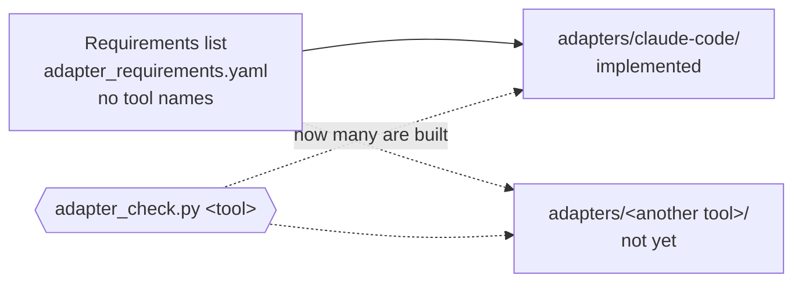

# 8. Distribution and many tools

::: lead
What is distributed is policy, hooks and tools, not an organization; the organization is shaped by whoever uses it. Use with many tools is designed, but implemented only for Claude Code, and not yet tested with other tools.
:::

## Distribute policy, not the organization {#policy}

One reason for building aise-core is that others could use it too. But an AI agent never gives the same answer every time, however the system
prompt is written. So what must be the same, keeping the policy, is enforced by hooks, the scripts the hooks run, and policy documents. Within
that, what organization to build is left to the user.

- The organization's actual data (which departments and roles exist and what they did) lives in a repository separate from aise-core.
- A new deployment starts with an empty organization. At the first entry into Operator mode only the essential starting files are created;
  roles and retrospectives start empty ([chapter 4](/en/story/structure#schema-instance)).
- The organization itself would be worth distributing, but it was left out. Instead the use is split into "start without an organization" and
  "reuse an existing organization", open for each user to change to their own preferences.

<Cite ids="op-distribution,instance-location,instance-skeleton" />

::: point Details — not yet distributed to anyone else {#not-yet-distributed}
One person uses this organization today: the operator. The procedure for a new person to start with an empty organization is not complete
either. Status: **designed · partly implemented · not yet tested with another user**.
:::

## Requirements and adapters {#adapters}

Rules are written without any tool's vocabulary. What a tool must do (check, block, remind, record, answer) is gathered in one tool-neutral
requirements list. Each tool's adapter implements it, and a check script reports how many the adapter provides. How policy becomes requirements
and goes down to the adapter is in [chapter 5](/en/story/how-it-is-kept#requirements).

<figure>

<figcaption>Figure 8-1. One requirements list, many adapters. A new tool adds one adapter instead of rewriting the rules. Today there is one, for Claude Code.</figcaption>
</figure>

| Status | Content |
|---|---|
| Designed | Rules are tool-neutral; tool-specific mechanisms live only in adapters |
| Implemented in Claude Code | 37 of 39 requirements built. One does not apply to this tool; one (secrets intake) is deferred to "build when first needed" (checked 2026-10-27) |
| Not yet tested with other tools | aise-core has never been run with another tool |

<Cite ids="adapter-requirements,adapter-check" />

::: point Details — opening it in a new tool
The tool-neutral guide at the front of the repository (`AGENTS.md`) has any AI tool run the adapter check before anything else. If there is no
adapter, or items needed before the first run are missing, that tool proposes to the operator to build them before starting work. A tool that can
read the rules but has no mechanism to enforce them could break them silently.

<Cite ids="agents-md" />
:::

::: point Details — experience from the earlier frameworks
The two earlier frameworks were also used with other tools, and their limits and problems were noted then. aise-core uses that experience to
anticipate likely problems and prepare solutions; the adapter structure and the list of requirements an adapter must implement are examples.

<Cite ids="op-multi-tool" />
:::

::: point What trying another tool found — **(to be filled after the experiment)**
When aise-core is actually run with another tool, the results go here. Until then, no problems or solutions are written from guesses.
:::

## This site is in progress too {#in-progress}

aise-core has not reached an end or a maintenance stage. By order it is early to build this site, but the two were judged able to proceed
together, the same judgment as designing to extend from "a start without a known end" in [chapter 3](/en/story/principles#stance). So this
site changes when aise-core changes. The site records the aise-core commit it was last checked against, and a script finds rule documents changed
since then and broken quotes.

<Cite ids="op-multi-tool" />

<SourceTable />

**Next.** → [9. Growth, results, limits](/en/story/growth-and-limits)
