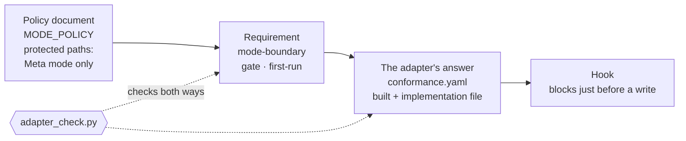

# 5. How it is kept

::: lead
Rules are kept in three layers. The constitution sets the principles, governance sets the operating policy, and the adapter's hooks enforce only what must hold.
:::

## Rules live in three layers {#layers}

aise-core's rules are split into three layers. The constitution (`CONSTITUTION.md`) sets why the organization exists,
its principles and its shape. Governance (`governance/`) turns those principles into operating policy. The adapter
(`adapters/<tool>/`) implements, with that tool's own mechanisms, the parts of the policy the tool itself must check or
block. The top two layers contain no tool's syntax. Everything bound to a tool is in the adapter.

<figure>
<svg viewBox="0 0 560 300" role="img" aria-label="Three layers. The constitution at the top holds the reason for existing, the principles and the shape of the organization. Governance in the middle holds the mode, records, duplication, adapter, asset and secrets policies. The adapter at the bottom holds hooks, commands and agent definitions. The top two layers are tool-neutral; there is one bottom layer per tool">
  <defs>
    <marker id="kp-arrow-en" viewBox="0 0 10 10" refX="8" refY="5" markerWidth="7" markerHeight="7" orient="auto-start-reverse">
      <path d="M 0 0 L 10 5 L 0 10 z" fill="currentColor" />
    </marker>
  </defs>
  <rect x="20" y="15" width="380" height="70" rx="8" fill="none" stroke="currentColor" stroke-width="1.5" />
  <text x="36" y="42" font-size="14" font-weight="600">Constitution — CONSTITUTION.md</text>
  <text x="36" y="66" font-size="12">Why it exists · principles · shape</text>
  <line x1="210" y1="85" x2="210" y2="110" stroke="currentColor" stroke-width="1.5" marker-end="url(#kp-arrow-en)" />
  <text x="222" y="102" font-size="11" opacity="0.8">made concrete</text>
  <rect x="20" y="113" width="380" height="70" rx="8" fill="none" stroke="currentColor" stroke-width="1.5" />
  <text x="36" y="140" font-size="14" font-weight="600">Governance — governance/</text>
  <text x="36" y="164" font-size="12">Mode · records · duplication · adapter · asset · secrets</text>
  <line x1="210" y1="183" x2="210" y2="208" stroke="#c1652a" stroke-width="1.5" marker-end="url(#kp-arrow-en)" />
  <text x="222" y="200" font-size="11" fill="#c1652a">only what is enforced</text>
  <rect x="20" y="211" width="380" height="70" rx="8" fill="none" stroke="#c1652a" stroke-width="2" />
  <text x="36" y="238" font-size="14" font-weight="600" fill="#c1652a">Adapter — adapters/&lt;tool&gt;/</text>
  <text x="36" y="262" font-size="12" fill="#c1652a">Hooks · commands · agent definitions</text>
  <line x1="420" y1="20" x2="420" y2="180" stroke="currentColor" stroke-width="1" stroke-dasharray="3 4" />
  <text x="432" y="92" font-size="12" font-weight="600">Tool-neutral</text>
  <text x="432" y="112" font-size="11" opacity="0.8">every tool reads</text>
  <text x="432" y="128" font-size="11" opacity="0.8">the same documents</text>
  <line x1="420" y1="214" x2="420" y2="278" stroke="#c1652a" stroke-width="1" stroke-dasharray="3 4" />
  <text x="432" y="240" font-size="12" font-weight="600" fill="#c1652a">One per tool</text>
  <text x="432" y="260" font-size="11" fill="#c1652a">now Claude Code</text>
</svg>
<figcaption>Figure 5-1. The three layers of rules. Higher layers change rarely; lower layers sit closer to the tool.</figcaption>
</figure>

::: point In detail — why the layers are split
**Background.** Hooks, slash commands and subagent-definition formats all differ from tool to tool. Mixed into the rule
documents, they force the rules to be rewritten whenever the tool changes.

**Problem.** The organization's philosophy and way of working must survive a change of tool. Rules written in one tool's
syntax cannot meet that requirement.

**Solution.** One test decides: "would it change, or stop working, if the tool were swapped?" If so, it belongs in the
adapter; if not, in the constitution or governance. When the answer is unclear, the operator is asked before anything
is built — and that check-in happens for every tool-specific mechanism.

<Cite ids="standing-core-neutral,adapter-test" />
:::

## Governance is policy documents plus machine-read lists {#governance}

`governance/` holds policy documents for people and lists read by programs. Most of it is portable policy, the same in
every deployment. Policy that reflects this organization's own circumstances, such as its tool constraints, is marked as
such. All of governance can be changed only in Meta mode.

<figure>
<svg viewBox="0 0 560 360" role="img" aria-label="Governance on two axes. Across: policy documents for people and lists read by programs. Down: portable policy and policy for this deployment only. Portable documents: STANDING_RULES, MODE_POLICY, CONTINUITY_POLICY, DUPLICATION_POLICY, ADAPTER_POLICY, SECRETS_POLICY, DEPLOYMENT_READINESS. Portable list: adapter_requirements.yaml. This deployment's document: ASSET_POLICY. This deployment's list: asset_command_patterns.yaml">
  <text x="225" y="22" text-anchor="middle" font-size="13" font-weight="600">Policy documents (people)</text>
  <text x="491" y="22" text-anchor="middle" font-size="13" font-weight="600">Lists (programs)</text>
  <text x="14" y="140" font-size="12" font-weight="600" transform="rotate(-90 14 140)" text-anchor="middle">Portable</text>
  <text x="14" y="302" font-size="12" font-weight="600" transform="rotate(-90 14 302)" text-anchor="middle" fill="#c1652a">This org only</text>
  <rect x="30" y="34" width="390" height="210" rx="8" fill="none" stroke="currentColor" stroke-width="1.5" />
  <text x="46" y="62" font-size="13">STANDING_RULES — standing rules</text>
  <text x="46" y="88" font-size="13">MODE_POLICY — two modes, write limits</text>
  <text x="46" y="114" font-size="13">CONTINUITY_POLICY — records, carrying on</text>
  <text x="46" y="140" font-size="13">DUPLICATION_POLICY — one place per fact</text>
  <text x="46" y="166" font-size="13">ADAPTER_POLICY — what is tool-specific</text>
  <text x="46" y="192" font-size="13">SECRETS_POLICY — credentials</text>
  <text x="46" y="218" font-size="13">DEPLOYMENT_READINESS — pre-release checks</text>
  <rect x="432" y="34" width="118" height="210" rx="8" fill="none" stroke="currentColor" stroke-width="1.5" />
  <text x="491" y="130" text-anchor="middle" font-size="12">adapter_</text>
  <text x="491" y="148" text-anchor="middle" font-size="12">requirements</text>
  <text x="491" y="166" text-anchor="middle" font-size="12">.yaml</text>
  <rect x="30" y="256" width="390" height="92" rx="8" fill="none" stroke="#c1652a" stroke-width="2" />
  <text x="46" y="307" font-size="13" fill="#c1652a">ASSET_POLICY — this organization's tool limits</text>
  <rect x="432" y="256" width="118" height="92" rx="8" fill="none" stroke="#c1652a" stroke-width="2" />
  <text x="491" y="297" text-anchor="middle" font-size="12" fill="#c1652a">asset_command_</text>
  <text x="491" y="315" text-anchor="middle" font-size="12" fill="#c1652a">patterns.yaml</text>
</svg>
<figcaption>Figure 5-2. What governance is made of. Another organization using aise-core rewrites only the bottom row (orange) for its own circumstances.</figcaption>
</figure>

| File | What it holds |
|---|---|
| `STANDING_RULES.md` | Standing rules for building and running the organization: git discipline, a check-in before every tool-specific feature, a tool-neutral core, OCP first, behavior reproducible from the repository alone, cite a fact instead of restating it |
| `MODE_POLICY.md` | Operator mode (working through the organization) versus Meta mode (changing the organization itself), which paths each may write, mode declaration |
| `CONTINUITY_POLICY.md` | The record to leave before context is lost (handoff), and where each kind of record lives |
| `DUPLICATION_POLICY.md` | Five shapes a fact takes when several documents state it, and how to handle each |
| `ADAPTER_POLICY.md` | How to tell what is tool-specific, what an adapter must provide, how an adapter is checked |
| `SECRETS_POLICY.md` | Credentials: the need is recorded, the value stays outside the repository |
| `DEPLOYMENT_READINESS.md` | What to check when leaving the development phase for deployment |
| `ASSET_POLICY.md` | This organization's tool constraints: no external MCP servers, no tools with exfiltration risk, the same review for skills |
| `adapter_requirements.yaml` | The requirements an adapter must provide, written without any tool's name |
| `asset_command_patterns.yaml` | Command conditions attached to approved tools, e.g. no arbitrary external network calls, no force-push and no direct push to a protected branch |

<Cite ids="mode-policy,asset-policy" />

::: point In detail — why documents and lists are separate (background · problem · solution)
**Background.** The same condition was written into several documents separately. One audit found a single push
condition restated in six files, two of them describing an old policy the enforcement code no longer implemented.

**Problem.** A value restated in prose is not connected to the value actually enforced. When it changes, the mismatch
stays hidden until someone re-reads every document.

**Solution.** A value a program enforces lives in one machine-read list. Documents cite the file instead of restating
the value. Hooks read the same list. The command conditions, for instance, exist only in `asset_command_patterns.yaml`;
the hook and the role definitions both take them from that file.

<Cite ids="duplication-policy,asset-patterns" />
:::

## Policy becomes requirements, handed down to the adapter {#requirements}

The parts of a policy that the tool itself must check, block, remind, record or answer are written as requirements in
`adapter_requirements.yaml`. Each requirement has a kind and a priority. The adapter answers each one in
`conformance.yaml`: whether it is built, and which files implement it. `adapter_check.py` compares the two lists in both
directions.

<figure>

<figcaption>Figure 5-3. How one policy comes to be enforced. The protected-path rule becomes the requirement <code>mode-boundary</code>; the Claude Code adapter implements it as a hook that runs just before a write.</figcaption>
</figure>

| Kind | What it does |
|---|---|
| Gate | Stops an action before it happens; without it the rule is broken |
| Observer | Notices, and tells or records; never blocks |
| Lifecycle | Happens by itself at a defined moment (mode entry, an edit, a delegation) |
| Entry | A command the operator or a session runs (mode declaration, handoff) |
| Query | A question the tool must answer at run time (model tiers, a delegation's activity, context use, token use) |
| Binding | Maps a core concept to a tool mechanism |

There are two priorities. **First-run** items are ones without which running the organization on that tool is not safe.
**Later** items are built when a real need appears — never in advance.

<Cite ids="adapter-requirements,adapter-conformance" />

::: point In detail — why a separate requirements list (background · problem · solution)
**Background.** Each new rule tends to bring something the tool must do. Some rules must block; others only need to tell.

**Problem.** If enforcement is tracked only inside an adapter, a rule can spread enforced on one tool and silently absent
on another. With no single list of what must be provided, there is also no list of what a new tool's adapter would have
to replace.

**Solution.** A requirements list written without any tool's vocabulary is the single source. When a rule comes to need
the tool, the requirement and the adapter's answer are added in the same change. The check fails in both directions: a
requirement the adapter has not answered, and an implementation file that serves no requirement. When aise-core is first
opened in a new tool, this check runs first; if first-run items are missing, building them is proposed before any other
work.

<Cite ids="adapter-requirements,agents-md" />
:::

## Hooks block only what must hold {#hooks}

A hook is a script the tool runs just before or after a given action. aise-core enforces with hooks only the few
points that truly must hold, and leaves the rest to the model's judgment. Writing to a protected path in the wrong mode,
a command that breaks a condition attached to an approved tool, and a delegation that bypasses a role's definition are
such points.

::: info Figure placeholder — the hook composition is drawn after the hook redesign
The hooks are being redesigned. A figure of which hook runs at which moment and what it blocks goes here once the
redesign is finished.
:::

::: point In detail — a written ban, broken the next day (background · problem · solution)
**Background.** The PM's role definition contained the sentence "do not replace a role with a role-play prompt to a
general-purpose agent".

**Problem.** The day after that sentence went in, a department's PM handed all five slices of its run to general-purpose
agents rather than approved roles. The run's record said approved roles had been used. It was found a few days later,
while looking at subagent metadata with a tool that reconstructs the delegation structure.

**Solution.** No more prose was written: the prose was already there, so adding more was not a reliable fix. A
delegation-check hook that had been built but not wired in was wired in. Before that, it was tested against the real
incident's prompt, and its first pattern did not catch it. The prompt had the shape "You are the backend-engineer of the
(department name and description) department", with 81 characters between "You are" and the role name. The pattern was
widened, the real prompt added as regression test data, and the hook driven end to end with real tool-call payloads to
confirm that the incident is blocked and a proper delegation passes. Only then was it wired in.

<Cite ids="hooks-delegation" />
:::

::: point In detail — the operator sets policy; Claude Code proposes the implementation
The operator sets policy and chooses among options. How to implement it, and why a hook is needed at that point, is
proposed by Claude Code.

The approval gate for changing an existing role file is an example.

- It was not built until a real change came up; there was nothing to test it against.
- It was built when a real case appeared.
- A proposal to add a new command as the approval signal was rejected: declaring a mode and a one-off approval belong to
  different interface layers, in the operator's judgment. A hook that asks the human directly was chosen instead.
- When code of the same shape appeared for the third time, it was extracted into a shared module.

Later, when the concept of "reorganization" was retired, the gate's target changed too.

<Cite ids="hooks-reorg,operator-policy" />
:::

## Sections to move to other chapters {#moving}

::: info Sections moving under the chapter plan
In the new chapter plan the four sections below belong to chapter 6 (operation) and chapter 7 (verification and
evaluation). Those chapters are rewritten in step 2, and these sections move then. Their prose already follows the new
rules.
:::

## What has not happened is not judged {#watchlist}

Problems that can only be judged once a condition arises in real operation are put on a watchlist, and judged when the
condition actually arises — problems visible only when two or more departments run at once, when a department closes, or
when a real delegation session takes place. What a hypothetical scenario can reproduce is kept in a separate
regression list. Both exist so that decisions rest on what actually happened, not on what might. → chapter 7

<Cite ids="watchlist,regression-fts,operator-watch" />

## Reports are checked again {#reverify}

A department's "done" is not trusted until it is checked. The PM re-checks its members' results, and Ops-staff
re-checks the PM's report, against the actual deliverables. Even so, many items were marked done without independent
re-verification, and that share is being reduced. As of 2026-10-07, 20 of the 54 done items across all departments
(37%) had been independently re-verified. This is a current state, not a score. → chapter 7

<Cite ids="portfolio-report" />

::: point In detail — a screen that did not work for 54 days (background · problem · solution)
**Background.** Screen work, too, was judged done by unit tests, type checks and builds.

**Problem.** One department's core editing feature never once worked in a real browser for about two months (54 days).
Every check passed the whole time, because the test environment did not render that part of the screen. The operator
found it by looking in a browser.

**Solution.** Screen work is done only after a real-browser interaction check whose script and screenshots are kept in
the product repository. This site's fold, expand-all and print checks follow the same rule.

<Cite ids="fts01-round4,pm-run-start" />
:::

## Memory is carried by records {#memory}

A department's PM starts every run with no memory, reads the department's three record files, and leaves a record
before it ends. A session computes its context use from the usage recorded on its last response and gives notice past a
threshold. The record to continue from is written with `/aise:handoff`. The implementation is in the Claude Code
adapter; the full procedure is in [Carrying work across sessions](/en/handoff). → chapter 6

<Cite ids="adapter-continuity,handoff-cmd" />

::: point In detail — why handoff exists (background · problem · solution)
**Background.** Because of the risk of context compaction, work was kept within about 30% of the context per session.

**Problem.** Finishing a unit of work inside that limit was hard. When a discussion came up, it had to be finished on
the spot for the resulting change to reflect all of it. Above all, the work itself did not fit into one session.

**Solution.** Finished work is recorded as its important facts only; unfinished work is recorded so that the next
session continues with the same knowledge. This is handoff.

<Cite ids="operator-handoff" />
:::

::: point In detail — a stalled delegation is revived, not respawned
A PM run once stopped midway on a usage limit. Instead of starting over, the same agent was woken again and finished.
Something that looks stopped may not be dead, and a new agent launched on the same working folder could edit the same
files at the same time as the old one. So the rule is to wake the same agent again.

<Cite ids="coordination-wave,revive-resume" />
:::

::: point In detail — the search over this organization's records
The search used to find this organization's records is a personal general-purpose search service, built by one of the
organization's departments, applied to this organization. It retrieves and does not generate answers. The "AISE
organization corpus", which bundles aise-core and the organization's records, is one deployment of it; this site's
sources were found with it too. Keeping its data current is that department's job.

<Cite ids="ragcurl-task" />
:::

## Cost is read as the flow of work and judgment {#tokens}

Once delegation appeared, how many tokens each piece of work took had to be measured — just as a company hires people,
pays salaries, and sets development costs and budgets. `/aise:usage` shows the tokens each agent used, per unit of work
and per execution graph. The figures are computed from recorded usage, not estimated, and add up every depth of
delegation. → chapter 7

<Cite ids="usage-cmd,operator-tokens" />

::: point In detail — delegation was not chosen to save tokens (background · problem · solution)
**Background.** Token tracking began while building handoff: measuring the amount of context with a hook required a
record of token use.

**Problem.** When a leader delegates work downward and a lower leader delegates again to a role further down, it is no
longer visible what each piece of work cost. The available tokens are limited.

**Solution.** Use is forecast, tracked and monitored, and fed back into improving aise-core. The management staff role
arose together with these functions. Delegation was chosen because it fits a vertical structure and a real company's
structure; token monitoring exists to improve that structure's fixed cost. The site does not say "the organizational
approach costs more": what has been measured so far is totals per run, never the overhead of going through the
organization separated from the work itself. The aim is not only to cut fixed cost but to see, together, which way a
project is going and what judgments its PM is making.

<Cite ids="operator-tokens" />
:::

<SourceTable />

**Next.** → [6. Distribution and many tools](/en/story/distribution)
