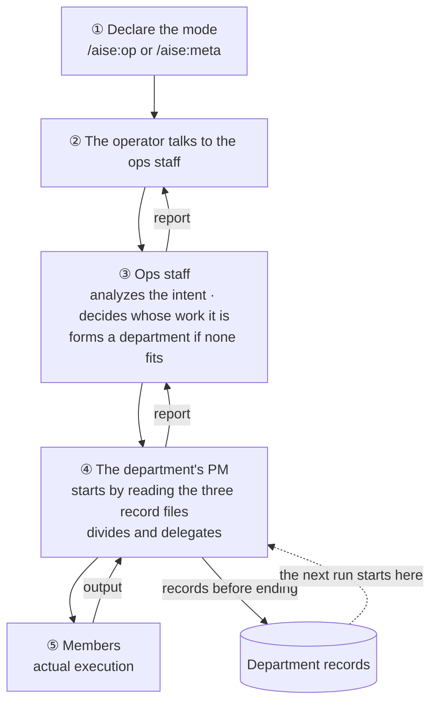
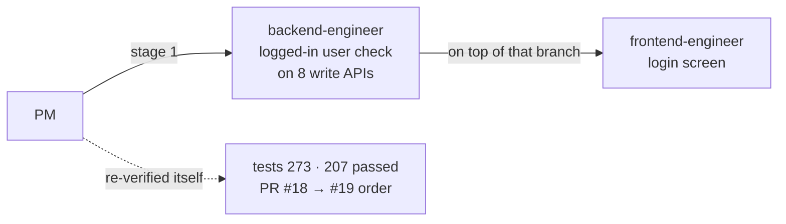
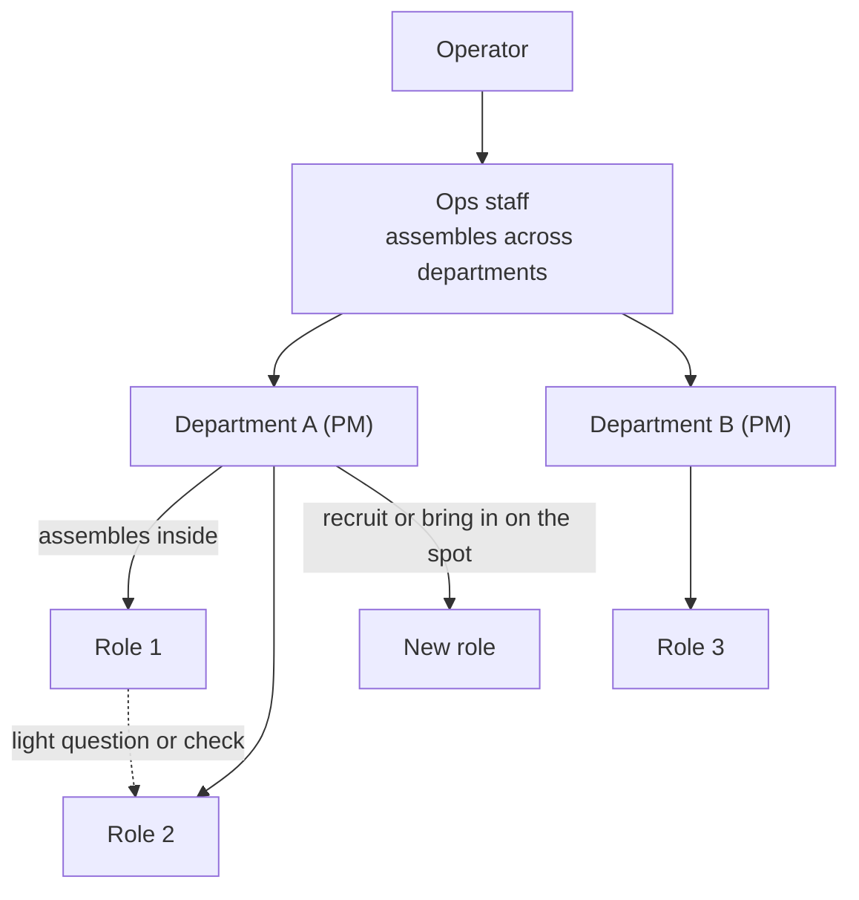
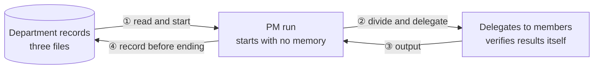
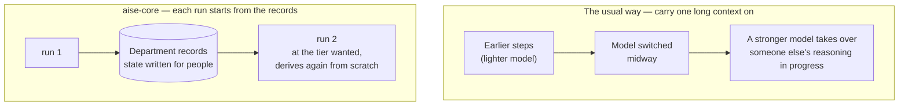

# 6. Operation: how work flows

::: lead
The operator sets the mode and talks to the ops staff. The organization handles the rest by its own rules, and memory lives not in people but in a department's three record files.
:::

## How work is handed over {#flow}

One instruction goes down, and the result comes back up the same way. No line skips a level.

<figure>

<figcaption>Figure 6-1. How work is handed over. The operator's own actions are ① and ②, and the decisions after the report.</figcaption>
</figure>

| When | What the operator does |
|---|---|
| Start | Choose `/aise:op` or `/aise:meta` |
| Instruct | Tell the ops staff what is wanted. No need to name a department |
| Start of work | Answer when the ops staff asks "do you approve starting this for real?" |
| Decide | Take the decisions whose approver is the operator (a decision a PM escalated, ending a department, high-impact tools, policy changes) and the hard-to-undo actions (publishing, merging into `main`) |
| Judge | Judge whether the deliverable meets the intent. The AI does not do this in the operator's place |

The rest (which roles to use, in what order to divide, what to record) is handled inside the organization. Each seat's role is in the table
in [chapter 2](/en/story/at-a-glance#structure); what to type now is in the [Quick Guide](/en/quick-guide).

<Cite ids="cmd-op,op-matrix" />

## Declaring the mode {#mode}

`/aise:op` and `/aise:meta` do more than record the session's mode. They run the entry tools (regenerating role definitions, entry checks,
the model-tier query), and the session reads in full the document of the staff it will be. The top-level session in Operator mode *is* the
ops staff; in Meta mode it *is* the management staff.

::: point Details — the staff had never read its own document (background · problem · solution)
**Background.** Other roles get their definitions built into an agent definition, loaded when they run. The ops and management staff existed
only by the convention that "the top-level session that declared the mode is them".

**Problem.** Two new rules were added to the ops staff's document and were followed zero times in the next Operator-mode session. Its actual tool
calls showed it never read the staff document. The session worked by imitating the conventions soaked into department records, so old rules
survived and new rules silently dropped out.

**Solution.** The mode commands gained a step to read the staff document in full, as the operating manual the session follows, not as a
reference. Checking from the session's own record that "a rule was written" and "a rule was followed" are different things also became the
practice then.

<Cite ids="persona-never-read,cmd-op" />
:::

## Only the ops staff {#one-staff}

The operator always speaks to one counterpart, the ops staff. Even trivial matters do not go straight to a department. Letting trivial requests
go directly was considered and rejected, because the ops staff would lose sight of the whole organization. One level down it is the same: the
PM divides work among members, and the operator has no path to a member. The reasons for this choice are in
[chapter 2](/en/story/at-a-glance#vertical).

<Cite ids="line-staff,constitution-staff" />

## How a department forms {#forming}

The ops staff decides whose work a request is, and forms a new department if none fits. Forming a department is not recruitment, so it needs no
HR approval. A new department usually starts as `draft`, where research and proofs of concept are possible. If the intent is already clear and
sized, it starts as `active`.

::: point Details — a place to ask, instead of an automatic switch (background · problem · solution)
**Background.** While the first department ran in `draft`, background research, scoping, a trial implementation and two role recruitments were
all done.

**Problem.** No one noticed that a formal start had never been approved. A rule "recruitment automatically promotes to `active`" was rejected:
exploratory recruitment is legitimate in `draft`, and automating it would remove the one place a person is sure to weigh in. The operator had
not judged wrongly; nothing signaled that there was a judgment to make.

**Solution.** The state rules stayed, and a duty to ask was added. The moment a PM judges that recruitment is for a real deliverable rather than
exploration, the ops staff asks the operator whether to start. It neither stays silently in `draft` nor promotes on its own.

<Cite ids="activation-prompt,schema-lifecycle" />
:::

## Delegation and parallel work inside a department {#within}

When work arrives, the PM first reads the department's three record files, then divides the work and delegates it to members. A member's
"done" is not taken at face value; it is checked against the actual commits or tool calls before being reported up. Work in which one side waits
on the other is divided only after the shared decision is settled.

<figure>

<figcaption>Figure 6-2. Delegation inside one department (2026-08-20, a login feature). The frontend depended on the backend's contract, so the work went sequentially, not in parallel, and the PM re-ran both sides' tests itself.</figcaption>
</figure>

In this case the PM set the order first. When the frontend delegation was cut by a usage limit, the PM saved the remaining changes in a
checkpoint commit and delegated again with "do not rebuild what is already done". It also reproduced that 5 failing E2E tests failed the same
way on `dev`, unrelated to this change.

<Cite ids="sfr-auth" />

::: point Details — delegated in parallel, and both stalled (background · problem · solution)
**Background.** In one department, frontend and backend work were delegated in parallel.

**Problem.** Wherever the two roles' work met a shared interface, each waited for the other's decision, and a person resolved them one by one.
Heavily interdependent work does not resolve by running in parallel and hoping it fits.

**Solution.** The constitution's rule "collaboration among members is assembled by the PM" was made executable. If two roles hang on a shared
decision (interface, contract, premise), the PM settles it first in a short sequential step, then delegates the independent work in parallel.
No new channel for peers to talk directly was created.

<Cite ids="interface-first,constitution-assembly" />
:::

::: point Details — non-overlapping files are not independence (background · problem · solution)
**Background.** PMs were delegating even work with no shared decision sequentially.

**Problem.** In a real repository, two roles touching the same working tree at once cause git state races, half-written files and each other's
broken builds. The first isolation mechanism isolated only the caller's own repository, and a member once committed to the wrong repository.

**Solution.** This was recorded as a separate failure, physical collision rather than logical dependency. Parallel delegations on one
repository each create their own branch's working tree (`git worktree`) and work only inside it. In this site's department too, the content
side and the multilingual scaffold side touched different files, but the content's diagram syntax did not work without the scaffold's rendering
support. The question is not "do the files overlap?" but "does one side's result work as intended without the other?"

<Cite ids="isolation" />
:::

## Collaboration between departments {#across}

Collaboration between departments is assembled by the ops staff. Light questions and confirmations flow freely between peers, but actually
handing off work is always reflected into the execution graph by that level's manager (the PM inside a department, the ops staff between them).

<figure>

<figcaption>Figure 6-3. Three levels of collaboration: inside a department, between departments, and dynamic, adding a needed capability on the spot.</figcaption>
</figure>

Three things actually passed between departments.

- **Reused role definitions.** `backend-engineer` and `frontend-engineer` were first recruited for one department's trial implementation, and two
  other departments took them as they were. Over the same `devops-engineer`, one department declined ("no CI/CD need") and this site used it
  ("Pages deployment is a real need"); both records give the reason the judgments differed.
- **Tools consumed.** The search service built by the search platform department was used by this site to find sources and by the wiki
  department as its collection agent's search tool. Every access-key request went through the ops staff.
- **One department's output shaking another's evaluation.** The case below.

<Cite ids="constitution-assembly,portfolio-roles" />

::: point Details — why an evaluation score fell (background · problem · solution) {#eval-case}
**Background.** The search platform department scored its search quality on 12 questions: mean recall 0.694, with two questions (q3, q10) at 0.

**Problem.** The easy guess was "the answer documents are missing". The PM first confirmed they were all ingested and dropped that hypothesis.
Re-running the two questions and comparing rankings showed the cause was in another department: 9 summaries from the wiki department in the
corpus mapped almost one-to-one onto the 12 questions and ranked in the top 5 for every question. Questions with 5–6 answer documents scored 0
because the summaries took every slot.

**Solution.** The corpus scope spanned two departments, so the PM escalated it rather than deciding; the operator decided to drop the summaries
from the corpus. Removing them from the manifest and re-ingesting did not delete the 117 chunks already in; this was found by direct query and
they were deleted separately. Re-evaluation gave mean recall 0.744 and q3 0.600. q10 stayed at 0, recorded as such, because a separate embedding
weakness identified earlier remained as predicted. The same day the ops staff re-ran the evaluation script and reproduced the same numbers
([chapter 7](/en/story/verification#reverify)).

<Cite ids="ragcurl-eval" />
:::

## A department's three record files {#records}

A department's continuity is not a chat history but three files in its folder. Each file has exactly one writer.

| File | Writer → reader | Holds |
|---|---|---|
| `directive.md` | ops staff → PM | Directives, decisions and re-verification results not yet absorbed |
| `execution.md` | PM → ops staff | The current status: Definition of Done, operator-decision table, recent runs |
| `project-record.md` | PM → PM | The department's main record: task, plan, invariants, decisions, history (Ledger), next steps |

<figure>

<figcaption>Figure 6-4. The cycle of a PM run. Memory lives in files, not in a person, so starting fresh every time loses nothing.</figcaption>
</figure>

<Cite ids="record-files,schema-storage" />

::: point Details — rules alone did not hold, so a gate was added (background · problem · solution)
**Background.** At first a department's record was one large file, written by the PM, the ops staff and the HR staff alike.

**Problem.** The ops staff kept writing directly into a department's main record. When a decision came up in conversation with the operator and
no PM run was alive, that seemed the only place to put it. A real company's staff do not edit a team's working documents. The cause was not one
lapse but the structure: one large document with many writers.

**Solution.** It was split into three files with one writer each. The only file the ops staff writes inside a department is the directive
inbox, which keeps no archive; when the PM absorbs an entry it leaves one Ledger line quoting it. On the very day the rule was made, the ops staff
again wrote directly into another department's main record. The rule's wording was fine, but in-context habit beat a rule made minutes before. So
instead of restating the rule, a gate was added that refuses writes from anything but a PM.

<Cite ids="record-split" />
:::

::: point Details — the organization's memory lives in the repository (background · problem · solution)
**Background.** Early on, operating rules were written into an AI tool's personal memory feature.

**Problem.** Personal memory lives on one person's machine, against the aim that the organization behave the same on another computer and for
another operator. Moving its location through project settings is deliberately ignored, for security.

**Solution.** Facts about the person stay in personal memory; how aise-core is built and run goes into files committed to the repository. One
test: if something a clone cannot rebuild governs how the organization behaves, it is in the wrong place. Credentials are the one intended
exception.

<Cite ids="memory-local" />
:::

## Starting fresh every time {#stateless}

A PM run does not inherit the previous run's reasoning. It reads the three record files and derives again from scratch. Even "done" in the
records is not taken at face value: the real repository state (branches, commits, PRs) is checked first. When records and reality disagree,
reality wins.

<figure>

<figcaption>Figure 6-5. Taking over vs. starting fresh. An aise-core run starts from a state document, not a reasoning trajectory, so the model tier can be chosen anew for each run.</figcaption>
</figure>

::: point Details — the advantage of starting fresh (background · problem · solution)
**Background.** It is sensible to use a stronger model for hard stretches and a lighter one for mechanical stretches.

**Problem.** May the model change in the middle of work? The common practice fixes each role's model at the start and does not change it
midway. According to research cited in the decision record, a stronger model taking over a weaker model's reasoning in progress recovers less
than half of the advantage it would have had from the start, because it is bound to someone else's half-built plan and possibly wrong interim
conclusions.

**Solution.** aise-core already avoided this. A run inherits no reasoning; it starts from records written for people to read. This was not a
separate measure but a consequence of the principles that tools are replaceable members and that memory lives in records. In return, the
problem statements a previous run left are not taken as answers either; they are derived again. No quality comparison against other approaches
was measured.

<Cite ids="stateless-pm" />
:::

::: point Details — times the records disagreed with reality
- **Edited but never committed.** A PM run finished four pages, marked the plan "done" and was cut by a usage limit. The next run found no
  commits at all. Since then this department trusts only a "done" that carries a commit hash. The same check found, in a member's output, a
  temporary block literally marked "remove before commit", and a diagram contradicting a constitution clause that had changed meanwhile. Trusting
  the self-report alone would have published both.
- **Checkpoints behind reality.** The records said "PR awaiting merge" four times when the repository showed it already merged. So the run-start
  procedure checks the real state first.
- **Records do not execute themselves.** The operator's feedback reached the directive inbox and nothing happened for five days. The inbox was
  intact, but no PM run read it through to the end. Records keep what the next run must know, not when the next run will happen.

<Cite ids="site-ledger" />
:::

## Handoff {#handoff}

A session computes its context use from the last response's usage record and warns past a set level. A continuity record is written with
`/aise:handoff`: in Operator mode into the department's directive inbox, in Meta mode into a separate handoff record. The implementation is in the
Claude Code adapter.

<Cite ids="adapter-continuity,handoff-cmd" />

::: point Details — why handoff came about (background · problem · solution)
**Background.** Because of the risk of context compaction, work was done keeping one session's context use within 30%.

**Problem.** Finishing a unit of work within that was hard. When a discussion arose, it had to be finished on the spot for the fix to reflect all
of it. Above all, the work itself did not fit in one session.

**Solution.** Record only the important facts of finished work, and record unfinished work so the next session can carry it on with the same
knowledge. That is a handoff.

<Cite ids="operator-handoff" />
:::

::: point Details — filtering instead of summarizing (background · problem · solution)
**Background.** The early handoff procedure asked for a summary of the whole conversation.

**Problem.** One handoff record, compared with the original conversation, had silently lost content: an earlier discussion compressed away, and a
narrow item overwritten under the same label by a larger later topic. The summary is made once, at the worst moment, when context has run out,
by an exhausted executor that cannot verify its own compression. Any session would eventually fail the same way.

**Solution.** Summarizing was replaced by filtering. What is decided and applied is only pointed at (a commit or decision record); full text is
written only for what has no other record (open questions, completions with caveats). Each open item gets a fixed label so it cannot be
overwritten. Before finishing, the actual conversation is re-read and compared with the draft. When the signal comes, writing the record goes
before other work.

<Cite ids="handoff-filter" />
:::

::: point Details — two kinds of "memory"
"Memory" covers both the organization's lasting capability and the state of work in progress. The operator pointed out that calling both by one
word would bake the ambiguity into the organization's vocabulary. So accumulated capability goes into `knowledge/`, and work-in-progress state
(handoff records) into `continuity/`. A handoff record that turns out to be a recurring lesson is later moved into a decision record or a
retrospective.

<Cite ids="knowledge-continuity" />
:::

## Waking a stalled delegation {#revive}

Stalled does not mean dead. An agent can be silent for as long as the tool's longest single wait, so instead of watching files, the adapter is
asked for the delegation's activity. A stalled delegation is not relaunched; the same agent is resumed. A new agent on the same working tree
could edit the same files at the same time as the old one. When a PM run was cut midway by a usage limit, the same agent was resumed to finish.

<Cite ids="coordination-wave,revive-resume" />

## Searching the organization's records {#search}

The search used to find this organization's records is a personal general-purpose search service, built by one of the organization's
departments and applied to the organization. It searches and does not generate answers. The "AISE organization corpus", which bundles
aise-core and the organization's records, is one deployment of it, and this site found its sources with it. Keeping its data current is that
department's job.

<Cite ids="ragcurl-task" />

<SourceTable />

**Next.** → [7. Verification and evaluation](/en/story/verification)
