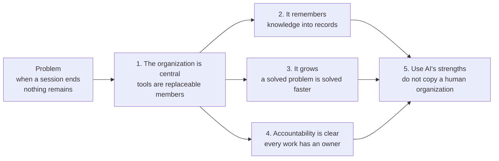
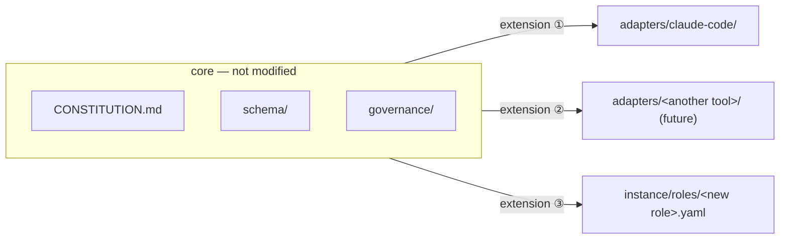
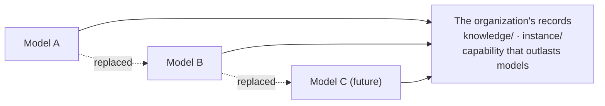
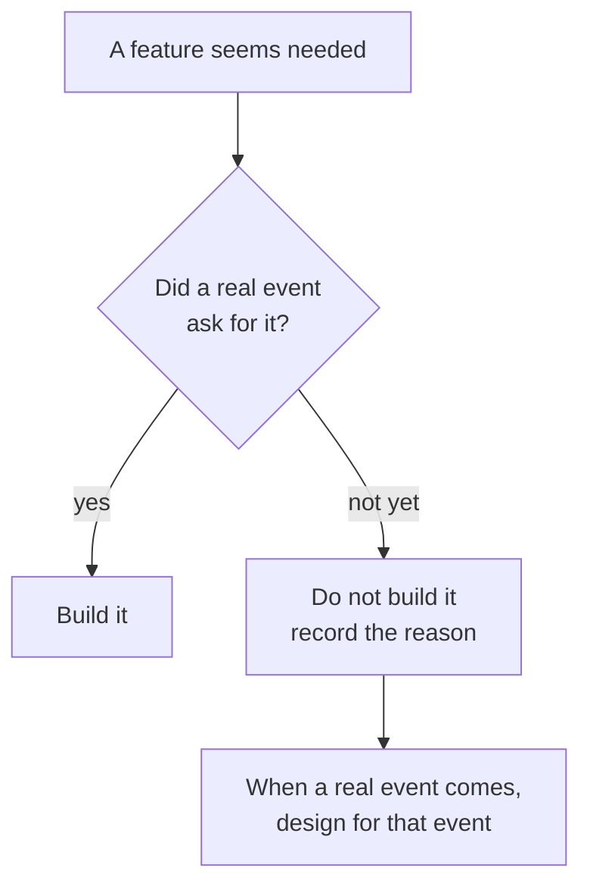

# 3. Principles

::: lead
Principles and boundaries are decided first; features are left open. The two axes are SRP and OCP; the other principles are listed apart as intended or as having fallen into place.
:::

## The design stance {#stance}

"Decide principles and boundaries first; leave features open." What is decided early: principles, responsibility boundaries, architectural
risks and requirement risks. What stays open: the implementation of detailed features. aise-core is a project with a start and no known
end, and once a company became its model, it became software that has to be maintained and developed until the company closes.

::: point Details — "90% decided" and "much left open" (background · problem · solution)
**Background.** The operator worked as an architect who decides about 90% of principles, values and design before proceeding, drawing out
architectural and requirement risks first at the start of a design.

**Problem.** Software was often given a start and no end, and many times feature extensions were asked for later. "Decide 90%" and "leave
much open" look as if they clash.

**Solution.** What is decided is principles; what is left open is detailed features. The design lets features extend as long as the design
principles hold and the software stays within its responsibility boundaries. This came from experience.

<Cite ids="op-stance" />
:::

## The constitution's five principles {#five}

The five principles of the constitution (`CONSTITUTION.md` §2) branch from one problem: when a session ends, the AI does not remain part of
the organization.

<figure>

<figcaption>Figure 3-1. How the five principles follow. Choosing to build an organization (1) brings the conditions for calling it one (2–4), and the direction of not doing it by imitating people (5).</figcaption>
</figure>

| Principle | Meaning | Where it shows in the structure |
|---|---|---|
| 1. The organization is central | AI tools are members that can be replaced at any time. What must persist is the organization's philosophy and way of operating | Adapters kept apart ([chapter 5](/en/story/how-it-is-kept#layers), [chapter 8](/en/story/distribution)) |
| 2. The organization remembers | Knowledge and experience used repeatedly are kept as knowledge assets | Department records and handoff ([chapter 6](/en/story/operation#records)) |
| 3. The organization grows | A problem solved once is solved faster and more accurately next time | Retrospectives and the portfolio ([chapter 9](/en/story/growth-and-limits#growth)) |
| 4. Accountability is clear | Every piece of work has an accountable party. Collaboration is free; accountability does not blur | Line and staff, two kinds of accountability ([chapter 4](/en/story/structure#staff)) |
| 5. Make the most of AI's strengths | Keep human organizations' strengths, remove human constraints | ["Designed differently for AI"](#ai-native) in this chapter |

::: point Details — what "accountable party" means
An AI agent cannot be the subject of legal or ultimate accountability. Here the "accountable party" is a label on the audit trail: which role
should have reviewed it if something went wrong with the deliverable. Ultimate accountability rests with the human operating the organization.

<Cite ids="constitution-accountability" />
:::

<Cite ids="constitution-philosophy" />

## Two axes: SRP and OCP {#axes}

All of SOLID matters, but in aise-core SRP and OCP are the two axes. Both were the problems the operator ran into most directly when
designing and developing with many people. It is a judgment from experience, not a general law.

<Cite ids="op-solid" />

## SRP: one responsibility each {#srp}

Who does what must not mix. The ops staff owns work, the HR staff people (roles), the asset staff tools, the management staff the
improvement of the organization itself, and the PM only the work inside its department. Each record has one writer, and the tool enforces
the boundary. The HR staff exists as a separate seat because SRP was applied to managing people ([chapter 4](/en/story/structure#staff)).

::: point Details — refactoring to keep SRP (background · problem · solution)
**Background.** As rule documents, schema, adapters and staff documents grew, the same responsibility spread over several places.

**Problem.** A repository-wide duplication audit on 2026-09-30 exposed defects caused by responsibilities and sources not being single
(see [SSOT](#ssot) below).

**Solution.** On 2026-10-01 the rule documents, schema and adapters were rewritten and the staff documents brought into one format. The 124
decision files were moved into 30 topic files. The staff's files were gathered in one folder, and each record's writer now commits its own unit.

<Cite ids="ssot-audit,refactor-commits" />
:::

## OCP: open to extension, closed to modification {#ocp}

Because the project's end is unknown, OCP became the most important design principle. Open: new tools (added to the approved catalog),
new roles (recruitment), new tool environments (adapters). Closed: governance and accountability boundaries.

<figure>

<figcaption>Figure 3-2. The core and its extension points. A new tool adds one adapter; a new role adds one role file. The core is not modified.</figcaption>
</figure>

OCP is applied to two things: the organization's growth and people's growth. The organization is open to new tools while governance is
applied strongly, and at the end of each project its insights are grown into the organization's capability in Meta mode. How people's growth
was actually modeled is in [chapter 9](/en/story/growth-and-limits#growth).

::: point Details — extract the shared module at the third repetition
When the same shape of code repeated twice, no shared module was built ahead of time. It was extracted when the same shape appeared a third
time. Extend freely, but do not lay down structure early. The case is in [chapter 5](/en/story/how-it-is-kept#hooks).

<Cite ids="hooks-reorg" />
:::

<Cite ids="constitution-ocp,op-ocp" />

## The rest of SOLID {#solid}

The other principles are listed apart: applied by intent, or having fallen into place.

| Principle | Applied | In aise-core | Strength of evidence |
|---|---|---|---|
| I — interface segregation | intended | Each role gets only the tools it needs. Every role definition has a `provisioning` list (e.g. seven for backend-engineer), and conditions attach to each tool | medium–strong |
| D — dependency inversion | intended | Rules sit in an abstraction written without any tool's vocabulary (the adapter requirements list), and each tool's adapter implements it. The operator insisted on handling a switch of tools | strong in structure; one adapter so far |
| L — Liskov substitution | fell into place | An adapter's conformance to the requirements is checked mechanically, so an adapter that meets them can stand in for another. With one implementation, no swap has actually been made | weak–medium |

<Cite ids="op-solid,role-provisioning,adapter-requirements" />

::: point Details — the role templates are the template-method pattern {#template}
A common base (the members' base template, the PM's template) sets the skeleton and the common rules, and each role's definition fills in
what differs on top of it: an abstract base and concrete definitions.

The original plan was to put basic attributes in an abstract template and make domain knowledge a strategy. The design went elsewhere. A role
definition carries no department's domain background. When a role first joins a department, the HR staff researches a domain profile for that
department and records it in that department's records. It is closer to injecting context per department than to swapping strategies.

<Cite ids="op-template,member-template" />
:::

## SSOT: each fact in one place {#ssot}

The same content in several places, drifting apart, is removed. A fact already written is cited, not restated. Values a program enforces
live in one machine-read list ([chapter 5](/en/story/how-it-is-kept#governance)).

::: point Details — the functional defects a duplication audit found (background · problem · solution)
**Background.** On 2026-09-30 the whole repository was read in seven parallel tracks for duplication.

**Problem.** About 250 findings came out. After merging duplicates there remained 12 functional defects where enforcement actually worked
wrongly, about 20 matters needing the operator's decision, and about 140 clear fixes such as stale descriptions and broken references. It was
defects, not tidiness.

**Solution.** The defects were fixed, decision records moved into topic files, and a rule against restating values was placed in governance.

<Cite ids="ssot-audit,duplication-policy" />
:::

## Layered architecture {#layered}

The vertical hierarchy takes layered architecture as its model: not only because an organization is being modeled, but to separate concerns
and gain maintainability and readability.

| Layered architecture | aise-core |
|---|---|
| Talk only to the adjacent layer | operator ↔ staff ↔ PM ↔ member; no skipping |
| An upper layer knows only the lower layer's interface | The PM is the department's only interface |
| A limited number of layers | The line of execution accountability is at most two levels |
| Wider concerns higher up | department → between departments → the whole organization |

The names come from organizational vocabulary (staff, department, PM, recruit, fire), with the design intent that a newcomer can guess the
structure. It is an intent, not a result checked with users. That is also why this site writes a plain-language gloss beside aise-core's
actual names ([glossary](/en/glossary)).

<Cite ids="op-layered,constitution-depth" />

## Designed differently for AI {#ai-native}

Following a human organization's principles is not the same as inheriting its limits. The constitution's §7 says the capabilities below are
used actively rather than restricted.

- **Parallel collaboration.** Several roles handle different work at the same time.
- **Dynamic composition.** A team forms when needed and disperses when not.
- **Sub-agents.** Large work is split and delegated, and only the results come back.
- **Real-time knowledge sharing.** What one role found, another can use at once.
- **Continuous organizational learning.** Retrospectives feed the portfolio and the templates.
- **Persistent organizational memory.** Department records remain after the session ends.
- **AI-tool independence.** The organization's identity is not tied to a particular model or tool.

<figure>

<figcaption>Figure 3-3. Models are replaced; capability remains. The decisions and experience accumulated in the organization's records outlast any model.</figcaption>
</figure>

<Cite ids="constitution-ai,constitution-goal" />

::: point Details — the model is not a provisioned asset (background · problem · solution) {#model}
**Background.** At first, the asset staff's grants listed four things: "tools, MCP, models, skills".

**Problem.** A test showed that a running session has no means to change its own model. Model choice happens in the tool's own settings, so
no one inside aise-core could decide and carry it out. The nearest capability was naming a model for a newly created sub-agent.

**Solution.** Models were removed from the grant list. Instead, choosing a model tier when delegating (ops staff → PM, PM → member) was
defined as a management act. There are two tiers: baseline inherits the delegator's model; elevated is one family above the session's model.
A PM may be run elevated for planning and project management, but a member does unit work and never runs above baseline. The tiers were first
pinned to particular model names; when the available models changed, they were redefined relative to the session's model.

<Cite ids="model-not-asset,model-tiers" />
:::

## Where it differs from the usual way {#different}

Starting from the same principles, aise-core parts from the usual way in what it chose not to build. The comparisons on the seven axes below
are not invented; aise-core wrote them into its own decision records when it made each decision.

| Axis | The usual way | aise-core |
|---|---|---|
| 1. Organizational memory | People's heads, scattered chat logs, a tool's personal memory | Files committed to the repository. Anything a clone cannot rebuild is in the wrong place |
| 2. When the chart is drawn | Choose a domain, design the roles, fill the seats | Start empty. Recruit only when real work reveals a gap |
| 3. A member's identity | One person holds one seat | A role is a class. Not tied to a department; used in several places at once |
| 4. Where experience builds up | Individuals become skilled | In the organization. Individual proficiency was reviewed twice and deferred twice |
| 5. Reporting line | Urgent matters go straight to the person in charge | Always through the staff, no exceptions |
| 6. Permissions | A fine-grained access matrix | Coarse approval plus judgment. The strong boundary is the OS and infrastructure |
| 7. Carrying a session on | Hand the running context to the next run | Not handed on. Re-derived from the records each time |

Four of the seven (2, 4, 6, 7) are decisions not to build something. When a feature seems needed but no real event has asked for it, it is not
built, and the reason is written down.

<figure>

<figcaption>Figure 3-4. Deciding when a feature comes to mind. The cases for each axis are in chapter 4 (empty chart, classes), chapter 5 (permissions), chapter 6 (starting fresh) and chapter 9 (individual proficiency).</figcaption>
</figure>

<Cite ids="constitution-why,memory-local,recruit-on-demand,role-class,role-proficiency,line-staff,grant-scope,folder-access,stateless-pm" />

<SourceTable />

**Next.** → [4. Structure](/en/story/structure)
