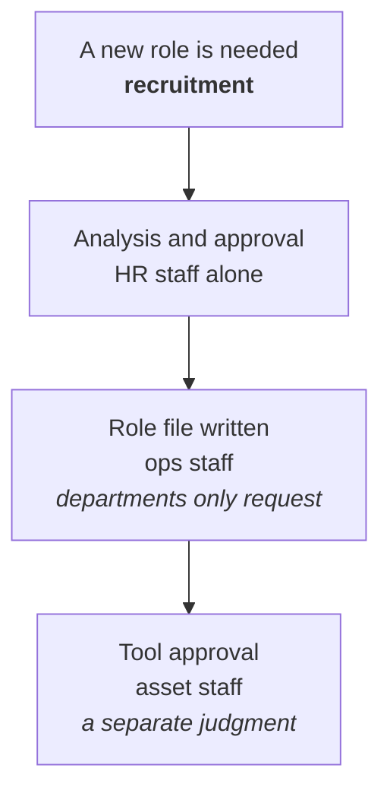
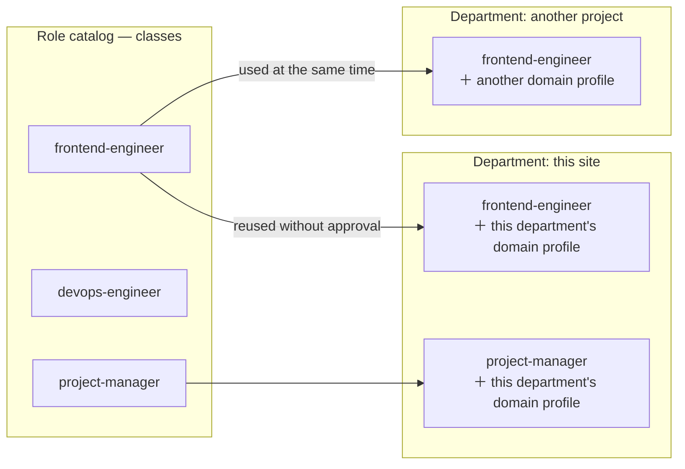

# 4. Structure

::: lead
The line of execution accountability is two levels, operator — department — member; the staff sit outside it, each answering one question. A role is a class, a department is one project, and the organization's shape is kept apart from its current make-up.
:::

## Organization chart and execution graph {#chart}

There are two pictures. The **organization chart** is the fixed accountability structure: roles, responsibilities, authority and reporting
lines. It says who is accountable to whom, not how collaboration actually happens. The **execution graph** is the collaboration structure
formed while work is carried out: parallel work, temporary sub-agents and work across departments happen there.

<figure>
<svg viewBox="0 0 640 380" role="img" aria-label="A depth-2 organization chart (solid lines): the operator above departments A and B, each with two members. Overlaid, an execution graph (dashed): collaboration between members of different departments and a temporary sub-agent">
  <defs>
    <marker id="st-arrow" viewBox="0 0 10 10" refX="8" refY="5" markerWidth="6" markerHeight="6" orient="auto-start-reverse">
      <path d="M 0 0 L 10 5 L 0 10 z" fill="currentColor" />
    </marker>
  </defs>
  <circle cx="320" cy="30" r="14" fill="none" stroke="currentColor" stroke-width="1.5" />
  <text x="320" y="62" text-anchor="middle" font-size="12" font-weight="600">Operator</text>
  <line x1="320" y1="68" x2="320" y2="78" stroke="currentColor" stroke-width="1.5" />
  <line x1="320" y1="78" x2="172" y2="94" stroke="currentColor" stroke-width="1.5" marker-end="url(#st-arrow)" />
  <line x1="320" y1="78" x2="468" y2="94" stroke="currentColor" stroke-width="1.5" marker-end="url(#st-arrow)" />
  <rect x="100" y="95" width="140" height="40" rx="6" fill="none" stroke="currentColor" stroke-width="1.5" />
  <text x="170" y="120" text-anchor="middle" font-size="12">Dept A — PM</text>
  <rect x="400" y="95" width="140" height="40" rx="6" fill="none" stroke="currentColor" stroke-width="1.5" />
  <text x="470" y="120" text-anchor="middle" font-size="12">Dept B — PM</text>
  <line x1="170" y1="135" x2="112" y2="173" stroke="currentColor" stroke-width="1.5" marker-end="url(#st-arrow)" />
  <line x1="170" y1="135" x2="228" y2="173" stroke="currentColor" stroke-width="1.5" marker-end="url(#st-arrow)" />
  <line x1="470" y1="135" x2="412" y2="173" stroke="currentColor" stroke-width="1.5" marker-end="url(#st-arrow)" />
  <line x1="470" y1="135" x2="528" y2="173" stroke="currentColor" stroke-width="1.5" marker-end="url(#st-arrow)" />
  <rect x="60" y="175" width="100" height="40" rx="6" fill="none" stroke="currentColor" stroke-width="1.5" />
  <text x="110" y="200" text-anchor="middle" font-size="11">Member A1</text>
  <rect x="180" y="175" width="100" height="40" rx="6" fill="none" stroke="currentColor" stroke-width="1.5" />
  <text x="230" y="200" text-anchor="middle" font-size="11">Member A2</text>
  <rect x="360" y="175" width="100" height="40" rx="6" fill="none" stroke="currentColor" stroke-width="1.5" />
  <text x="410" y="200" text-anchor="middle" font-size="11">Member B1</text>
  <rect x="480" y="175" width="100" height="40" rx="6" fill="none" stroke="currentColor" stroke-width="1.5" />
  <text x="530" y="200" text-anchor="middle" font-size="11">Member B2</text>
  <path d="M 280 195 C 320 235, 320 235, 360 195" fill="none" stroke="#c1652a" stroke-width="1.5" stroke-dasharray="4 4" marker-end="url(#st-arrow)" />
  <text x="320" y="248" text-anchor="middle" font-size="10" fill="#c1652a">work across departments</text>
  <line x1="110" y1="215" x2="110" y2="250" stroke="#c1652a" stroke-width="1.5" stroke-dasharray="4 4" marker-end="url(#st-arrow)" />
  <rect x="40" y="250" width="140" height="40" rx="6" fill="none" stroke="#c1652a" stroke-width="1.5" stroke-dasharray="4 4" />
  <text x="110" y="275" text-anchor="middle" font-size="11" fill="#c1652a">sub-agent (temporary)</text>
  <text x="320" y="335" text-anchor="middle" font-size="11" opacity="0.7">solid = organization chart (fixed accountability)</text>
  <text x="320" y="353" text-anchor="middle" font-size="11" fill="#c1652a">dashed = execution graph (assembled per task)</text>
</svg>
<figcaption>Figure 4-1. Organization chart and execution graph. On the depth-2 chart (solid), an execution graph (dashed) forms with each task. A real execution graph is in chapter 7.</figcaption>
</figure>

<Cite ids="constitution-chart" />

## Depth 2 {#depth}

The line organization, which bears execution accountability, never exceeds two levels: operator — department — member. One human operator must
be able to see the whole organization at a glance and decide; the deeper it goes, the more layers a person has to review.

A department is a PM and its members. The PM knows each member's role, responsibility and capability, and splits large work into pieces the
members can handle. A member is a specialist with a single responsibility in one field.

<Cite ids="constitution-depth" />

## Line and staff {#staff}

Between the operator and the PM sit the staff. The staff bear no execution accountability and are not counted in depth, the way a staff office
or a chief of staff in a real organization is not counted in the hierarchy. The three staff are peers and do not report to one another.

| Staff | Question it answers | Does |
|---|---|---|
| Ops staff (업무참모) | What happens | Turns the operator's intent into executable work, forms departments, coordinates them |
| HR staff (인사참모) | Who exists | Owns the role catalog: recruiting, redefining, firing |
| Asset staff (자산참모) | What can be used | Owns provisioning: which tools, MCP servers and skills a role may use |

Meta mode has the management staff (경영참모). It analyzes and proposes the evolution of the organization itself (constitution, schema,
governance) and runs the organization's self-diagnosis (audits). It takes no part in Operator-mode work, and actual changes go through the
operator's confirmation.

<figure>
<svg viewBox="0 0 640 300" role="img" aria-label="Left: the depth-2 line, operator to department to member. Upper right: the ops, HR and asset staff, peers outside the depth. Lower right: the management staff, active only in Meta mode">
  <defs>
    <marker id="st-arrow2" viewBox="0 0 10 10" refX="8" refY="5" markerWidth="6" markerHeight="6" orient="auto-start-reverse">
      <path d="M 0 0 L 10 5 L 0 10 z" fill="currentColor" />
    </marker>
  </defs>
  <text x="160" y="18" text-anchor="middle" font-size="12" font-weight="600">Line (depth 2)</text>
  <circle cx="160" cy="34" r="12" fill="none" stroke="currentColor" stroke-width="1.5" />
  <text x="160" y="65" text-anchor="middle" font-size="11">Operator</text>
  <line x1="160" y1="70" x2="160" y2="83" stroke="currentColor" stroke-width="1.5" marker-end="url(#st-arrow2)" />
  <rect x="100" y="85" width="120" height="40" rx="6" fill="none" stroke="currentColor" stroke-width="1.5" />
  <text x="160" y="110" text-anchor="middle" font-size="12">Department (PM)</text>
  <line x1="160" y1="125" x2="160" y2="158" stroke="currentColor" stroke-width="1.5" marker-end="url(#st-arrow2)" />
  <rect x="100" y="158" width="120" height="40" rx="6" fill="none" stroke="currentColor" stroke-width="1.5" />
  <text x="160" y="183" text-anchor="middle" font-size="12">Member</text>
  <text x="495" y="18" text-anchor="middle" font-size="12" font-weight="600">Staff — outside the depth</text>
  <rect x="392" y="65" width="86" height="40" rx="6" fill="none" stroke="currentColor" stroke-width="1.5" />
  <text x="435" y="90" text-anchor="middle" font-size="11">Ops staff</text>
  <rect x="486" y="65" width="86" height="40" rx="6" fill="none" stroke="currentColor" stroke-width="1.5" />
  <text x="529" y="90" text-anchor="middle" font-size="11">HR staff</text>
  <rect x="580" y="65" width="52" height="40" rx="6" fill="none" stroke="currentColor" stroke-width="1.5" />
  <text x="606" y="90" text-anchor="middle" font-size="10">Asset<tspan x="606" dy="11">staff</tspan></text>
  <line x1="478" y1="85" x2="486" y2="85" stroke="currentColor" stroke-width="1.5" stroke-dasharray="2 3" />
  <line x1="572" y1="85" x2="580" y2="85" stroke="currentColor" stroke-width="1.5" stroke-dasharray="2 3" />
  <text x="512" y="122" text-anchor="middle" font-size="10" opacity="0.7">peers · no execution accountability · no reporting to each other</text>
  <path d="M 435 105 C 400 135, 260 130, 222 108" fill="none" stroke="#c1652a" stroke-width="1.5" stroke-dasharray="4 4" marker-end="url(#st-arrow2)" />
  <text x="330" y="150" text-anchor="middle" font-size="10" fill="#c1652a">forms departments, directs</text>
  <rect x="452" y="200" width="178" height="52" rx="6" fill="none" stroke="#c1652a" stroke-width="1.5" stroke-dasharray="4 4" />
  <text x="541" y="221" text-anchor="middle" font-size="11" fill="#c1652a">Management staff</text>
  <text x="541" y="238" text-anchor="middle" font-size="9" fill="#c1652a">Meta mode only · outside the depth</text>
</svg>
<figcaption>Figure 4-2. Line and staff. Left, the depth-2 line that bears execution accountability; upper right, the three peer staff outside the depth; lower right, the management staff, working only in Meta mode.</figcaption>
</figure>

Accountability is split two ways too. **Execution accountability** is the department's (PM and members): the technical correctness of the
deliverable. **Operational accountability** is each staff's, in its own domain: the ops staff for choosing the right department, catching
bottlenecks and reporting accurately; the HR staff for sound recruiting, redefining and firing; the asset staff for grants that fit the
organization's real constraints. Mixing the two blurs "whose responsibility is it" again when something goes wrong. The staff are not above
the departments; it is a different kind of accountability, not a higher one.

<Cite ids="constitution-staff,constitution-two-accountability,constitution-mg" />

::: point Details — why there are three staff (background · problem · solution) {#three-staff}
**Background.** At first there was one staff. It assigned work, created roles and set tool permissions. The operator modeled the operator's
own seat as a company leader who manages and supervises, and wanted organizational change such as hiring and firing modeled too.

**Problem.** A single staff that can reshape the organization at will is a problem. Asking the operator to approve every hire brings approval
fatigue. An attempt to tell recruitment from other changes automatically, by file changes, kept being bypassed: create a new file and delete the
old, or just rename. "Does this operation need extra scrutiny" is a semantic judgment no path matching can settle. Tools had the same problem.
The means a role actually acts with (tools, MCP, skills) belong to the organization, the way a company issues a laptop. Handing that to an
ordinary department raises a loop: who approves that department's own tools?

**Solution.** Structure instead of detection.

- Managing people is a different responsibility from work (SRP), so a separate HR staff owns the role catalog. Recruitment splits analysis and
  approval (HR staff) from execution (the ops staff writes the role file). A department can only request a new role.
- The asset staff comes from the way companies review and approve high-impact tools before introducing them: a newcomer learns the basic
  rules from HR and receives tools from the asset team. To break the loop it is a staff defined by the constitution, not a recruited department.
  What gets approved differs per deployment, so the function is in the constitution and the concrete constraints in that deployment's
  governance (`ASSET_POLICY.md`).
- Approval to recruit does not mean approval of tools. The three are independent gates.

<Cite ids="hr-split,as-split,op-hr,op-assets" />
:::

::: point Details — changing and firing roles: "reorganization" abolished (background · problem · solution) {#role-change}
**Background.** For a time, any edit to an existing role file was treated as a "reorganization" needing the operator's approval.

**Problem.** Grant results are written into the same file, so approval requests appeared at every edit. More basically, "reorganization"
assumed a role belongs to a department, but a role is a class shared by every department. The one harmful case was changing a role another
department is using.

**Solution.** The concept was abolished. Recruiting, redefining and firing are all the HR staff's authority, with no operator approval. Only
the harmful case is blocked mechanically: narrowing or firing a role is allowed only when no department other than the requester uses it.
"In use" is read from each department's `roles:` list in the department index. Whether a change narrows a role cannot be judged by a machine,
so every role-definition change is put in the ops staff's report, where the operator sees it.

<Cite ids="reorg-abolished,constitution-role-change" />
:::

## The PM is a recruited role {#pm}

The PM is not a fourth staff; it is a role recruited from the catalog. When departments became project-scoped, there was no reason to keep a
fixed head-of-department seat. The PM has the authority of "the department's only interface", and members exist only when the PM delegates.
The ops staff's only path into a department is the PM.

::: point Details — skipping blocked by structure (background · problem · solution)
**Background.** The ops staff skipping the PM and giving work to members directly had to be prevented.

**Problem.** The first attempt was a directory structure, members' files nested under the head's folder. Anything that already knew the target's
name went straight through.

**Solution.** It was solved by the role's nature. The PM is the department's only interface, and members come into being only within the PM's
execution. With the PM as the ops staff's only path, skip-level has no way to happen: a structural guarantee, not a documented courtesy.

<Cite ids="pm-recruited" />
:::

## A role is a class {#roles}

A role file is a class: no department membership, no instance that rests while remembering. Several departments use one class at the same
time, and what differs per department is the domain profile the HR staff adds when the role first joins it. Using an already recruited class in
a new department needs no approval.

<figure>

<figcaption>Figure 4-3. The role catalog. One class placed in two departments at once does not interfere with itself; the difference comes from the domain profile added on joining.</figcaption>
</figure>

::: point Details — classes instead of instances (background · problem · solution)
**Background.** The same role was needed in several departments at once. The first picture was a human one: a role type (class) and
instances assigned to departments that build experience and move around, a "talent pool".

**Problem.** It did not fit how execution actually works. A sub-agent call always runs the class definition afresh, and nothing keeps an
instance's memory between assignments. Simulating instances would have meant inventing a ledger of idle and assigned states.

**Solution.** Only classes remain. The fields that tied a role to a department were removed from role files. Experience accumulates not in an
instance but in the organization's retrospectives and portfolio ([chapter 9](/en/story/growth-and-limits#growth)). Since nothing is ever
"checked out", concurrency problems vanished too.

<Cite ids="role-class" />
:::

::: point Details — starting with an empty chart (background · problem · solution)
**Background.** Starting seemed to need an initial organization chart. But the operator's real work ranged widely, from embedded software to
general software engineering, CI/CD and service development.

**Problem.** Picking one domain and drawing a chart would have to be undone by the operator later if the pick was wrong: a structure fitted to
a guess.

**Solution.** The role list started empty. A role is created only when real work reveals a capability the organization lacks. All five current
roles came about that way, and recruitment became a working function rather than a diagram.

<Cite ids="recruit-on-demand,constitution-recruitment" />
:::

## One department, one project {#departments}

Each project gets one department. Projects differ in kind and character and must be independent of each other. The PM owns the work inside a
project, the ops staff owns coordination between projects, and the view widens toward the top. A department lives through
`draft → active → ended → closed`.

<figure>
<svg viewBox="0 0 560 130" role="img" aria-label="One department's life: draft, active, ended, closed. Active once the intent is clear, ended by the operator's decision, closed after the retrospective and promotion review">
  <defs>
    <marker id="st-arrow3" viewBox="0 0 10 10" refX="8" refY="5" markerWidth="6" markerHeight="6" orient="auto-start-reverse">
      <path d="M 0 0 L 10 5 L 0 10 z" fill="currentColor" />
    </marker>
  </defs>
  <rect x="10" y="30" width="110" height="40" rx="6" fill="none" stroke="currentColor" stroke-width="1.5" />
  <text x="65" y="55" text-anchor="middle" font-size="12">draft</text>
  <line x1="120" y1="50" x2="150" y2="50" stroke="currentColor" stroke-width="1.5" marker-end="url(#st-arrow3)" />
  <rect x="150" y="30" width="110" height="40" rx="6" fill="none" stroke="#c1652a" stroke-width="2" />
  <text x="205" y="55" text-anchor="middle" font-size="12" fill="#c1652a">active</text>
  <line x1="260" y1="50" x2="290" y2="50" stroke="currentColor" stroke-width="1.5" marker-end="url(#st-arrow3)" />
  <rect x="290" y="30" width="110" height="40" rx="6" fill="none" stroke="currentColor" stroke-width="1.5" />
  <text x="345" y="55" text-anchor="middle" font-size="12">ended</text>
  <line x1="400" y1="50" x2="430" y2="50" stroke="currentColor" stroke-width="1.5" marker-end="url(#st-arrow3)" />
  <rect x="430" y="30" width="110" height="40" rx="6" fill="none" stroke="currentColor" stroke-width="1.5" />
  <text x="485" y="55" text-anchor="middle" font-size="12">closed</text>
  <text x="65" y="95" text-anchor="middle" font-size="10" opacity="0.8">shaping the intent</text>
  <text x="205" y="95" text-anchor="middle" font-size="10" opacity="0.8">delegation and work</text>
  <text x="345" y="95" text-anchor="middle" font-size="10" opacity="0.8">operator decides the end</text>
  <text x="485" y="95" text-anchor="middle" font-size="10" opacity="0.8">after retrospective</text>
</svg>
<figcaption>Figure 4-4. One department's life. The operator decides the end; the department closes only after the retrospective, the portfolio promotion review and the HR staff's review of its roles.</figcaption>
</figure>

With responsibility divided this way, a member handles only its single task, so no unneeded or confusing information reaches it. The PM does
not develop, so it avoids development's trial and error and concentrates on the execution plan and on assembling the outputs into the final
deliverable. The grounds are not result quality but separation of responsibility: maintainability and predictability.

<Cite ids="op-department,schema-lifecycle,op-close" />

::: point Details — what "department" means changed (background · problem · solution)
**Background.** At first a department was a permanent organizational unit.

**Problem.** Two frictions appeared: the ops staff tended to skip the reporting line and contact members directly, and a department could
handle only one task at a time, which clashed with the principle that AI works in parallel. Under the old model, ending a department was an
exceptional reorganization needing the operator's approval.

**Solution.** The name and rules stayed; what it means to exist as a department changed. A department forms the moment a role actually has to
execute, and ends when the work ends. Forming and dissolving are routine execution-graph assembly. The very idea of "merging two departments"
disappeared.

<Cite ids="department-project" />
:::

## Two modes {#modes}

The operator moves between two roles, even within a day. **Operator mode** works through the organization; **Meta mode** changes the
organization itself. Operator mode keeps the organization's shape and changes only its make-up (recruitment, role changes, tool grants). Meta
mode changes the constitution, schema, governance and adapters. Each session declares its mode first; there is no default that grants write
access to the core documents without a declaration.

<figure>
<svg viewBox="0 0 720 300" role="img" aria-label="Left, Operator mode: the depth-2 pyramid keeps its shape and only its members change (a new hire is a change of make-up). Right, Meta mode: the pyramid's shape itself changes, always after the operator's confirmation">
  <line x1="360" y1="10" x2="360" y2="290" stroke="currentColor" stroke-width="1" stroke-dasharray="3 5" opacity="0.35" />
  <text x="180" y="24" text-anchor="middle" font-size="13" font-weight="600">Operator mode</text>
  <path d="M 180 55 L 110 175 L 250 175 Z" fill="none" stroke="currentColor" stroke-width="1.5" />
  <line x1="156.7" y1="95" x2="203.3" y2="95" stroke="currentColor" stroke-width="1" opacity="0.6" />
  <line x1="133.3" y1="135" x2="226.7" y2="135" stroke="currentColor" stroke-width="1" opacity="0.6" />
  <text x="266" y="72" font-size="9" opacity="0.7">operator</text>
  <text x="266" y="112" font-size="9" opacity="0.7">department</text>
  <text x="266" y="152" font-size="9" opacity="0.7">member</text>
  <circle cx="205" cy="163" r="9" fill="none" stroke="#c1652a" stroke-width="1.5" stroke-dasharray="3 3" />
  <text x="205" y="166" text-anchor="middle" font-size="9" fill="#c1652a">+1</text>
  <text x="180" y="200" text-anchor="middle" font-size="9" fill="#c1652a">a new hire = a change of make-up</text>
  <text x="180" y="270" text-anchor="middle" font-size="11" opacity="0.8">the shape (schema) stays,</text>
  <text x="180" y="286" text-anchor="middle" font-size="11" font-weight="600" opacity="0.8">only the make-up changes</text>
  <text x="540" y="24" text-anchor="middle" font-size="13" font-weight="600">Meta mode</text>
  <path d="M 540 55 L 470 175 L 610 175 Z" fill="none" stroke="#c1652a" stroke-width="1.5" stroke-dasharray="5 4" />
  <path d="M 450 175 L 630 175 L 650 215 L 430 215 Z" fill="none" stroke="#c1652a" stroke-width="1.5" stroke-dasharray="5 4" />
  <text x="540" y="235" text-anchor="middle" font-size="9" fill="#c1652a">a new layer = the schema itself changes</text>
  <text x="540" y="270" text-anchor="middle" font-size="11" fill="#c1652a">the shape itself changes —</text>
  <text x="540" y="286" text-anchor="middle" font-size="11" font-weight="600" fill="#c1652a">always after the operator confirms</text>
</svg>
<figcaption>Figure 4-5. Two modes. Operator mode keeps the organization's shape and changes its make-up; Meta mode changes the shape itself.</figcaption>
</figure>

Meta mode is not a superset of Operator mode either. Meta mode cannot write this deployment's make-up records (role files, department records,
staff records). Changing the organization's portable shape and changing the current organization's state are kept apart.

<Cite ids="mode-policy,constitution-schema-instance" />

::: point Details — why Meta mode came about
A company has, besides the axis that makes a profit through projects, a management axis on which the chief executive develops the organization
itself: buying a building, adopting a tool such as AI, merging with a company. The single role of the ops staff could not hold this, so Meta
mode was created. At first Meta mode was used with no particular role; the management staff was added later, as token tracking and
organizational diagnosis became necessary ([chapter 7](/en/story/verification#tokens)).

<Cite ids="op-meta" />
:::

## Schema and instance {#schema-instance}

aise-core keeps the organization's **shape** apart from its current **make-up**. The shape is the templates and rules in `schema/`: depth 2,
line and staff, the role templates, the format of department records. The make-up is this deployment's data in `instance/`: the roles that
exist now, departments and their records, the staff's records, the portfolio. `instance/` does not travel with aise-core; each deployment keeps
it in its own repository.

<figure>
<svg viewBox="0 0 640 330" role="img" aria-label="Left, the templates in schema/: PM and member templates, the department record format, staff templates, the instance skeleton. Right, the actual data in instance/: role files, each department's three record files, staff records, the department index and portfolio. Arrows mean a template sets the shape of the actual file; the skeleton is created as empty files at the first Operator-mode entry. Only Meta mode writes the left, only Operator mode the right">
  <defs>
    <marker id="st-arrow4" viewBox="0 0 10 10" refX="8" refY="5" markerWidth="6" markerHeight="6" orient="auto-start-reverse">
      <path d="M 0 0 L 10 5 L 0 10 z" fill="currentColor" />
    </marker>
  </defs>
  <text x="150" y="22" text-anchor="middle" font-size="13" font-weight="600">schema/ — shape (templates)</text>
  <text x="150" y="40" text-anchor="middle" font-size="10" opacity="0.75">ships with aise-core · Meta mode writes</text>
  <text x="490" y="22" text-anchor="middle" font-size="13" font-weight="600" fill="#c1652a">instance/ — make-up (actual data)</text>
  <text x="490" y="40" text-anchor="middle" font-size="10" fill="#c1652a">per deployment · Operator mode writes</text>
  <rect x="20" y="55" width="260" height="44" rx="6" fill="none" stroke="currentColor" stroke-width="1.5" />
  <text x="150" y="82" text-anchor="middle" font-size="12">PM · member templates</text>
  <rect x="360" y="55" width="260" height="44" rx="6" fill="none" stroke="#c1652a" stroke-width="1.5" />
  <text x="490" y="82" text-anchor="middle" font-size="12" fill="#c1652a">role files roles/&lt;role&gt;.yaml</text>
  <line x1="280" y1="77" x2="356" y2="77" stroke="currentColor" stroke-width="1.5" marker-end="url(#st-arrow4)" />
  <rect x="20" y="115" width="260" height="44" rx="6" fill="none" stroke="currentColor" stroke-width="1.5" />
  <text x="150" y="142" text-anchor="middle" font-size="12">department record format</text>
  <rect x="360" y="115" width="260" height="44" rx="6" fill="none" stroke="#c1652a" stroke-width="1.5" />
  <text x="490" y="135" text-anchor="middle" font-size="12" fill="#c1652a">workspace/&lt;department&gt;/</text>
  <text x="490" y="151" text-anchor="middle" font-size="10" fill="#c1652a">directive · status report · project record</text>
  <line x1="280" y1="137" x2="356" y2="137" stroke="currentColor" stroke-width="1.5" marker-end="url(#st-arrow4)" />
  <rect x="20" y="175" width="260" height="44" rx="6" fill="none" stroke="currentColor" stroke-width="1.5" />
  <text x="150" y="202" text-anchor="middle" font-size="12">staff definitions and templates</text>
  <rect x="360" y="175" width="260" height="44" rx="6" fill="none" stroke="#c1652a" stroke-width="1.5" />
  <text x="490" y="202" text-anchor="middle" font-size="12" fill="#c1652a">staff/ the staff's records</text>
  <line x1="280" y1="197" x2="356" y2="197" stroke="currentColor" stroke-width="1.5" marker-end="url(#st-arrow4)" />
  <rect x="20" y="235" width="260" height="44" rx="6" fill="none" stroke="currentColor" stroke-width="1.5" stroke-dasharray="5 4" />
  <text x="150" y="262" text-anchor="middle" font-size="12">instance skeleton</text>
  <rect x="360" y="235" width="260" height="44" rx="6" fill="none" stroke="#c1652a" stroke-width="1.5" />
  <text x="490" y="255" text-anchor="middle" font-size="12" fill="#c1652a">department index · portfolio</text>
  <text x="490" y="271" text-anchor="middle" font-size="10" fill="#c1652a">empty at first</text>
  <line x1="280" y1="257" x2="356" y2="257" stroke="currentColor" stroke-width="1.5" stroke-dasharray="4 4" marker-end="url(#st-arrow4)" />
  <text x="318" y="300" text-anchor="middle" font-size="10" opacity="0.75">solid = the template sets the shape · dashed = created empty at the first Operator-mode entry</text>
</svg>
<figcaption>Figure 4-6. Templates (schema/) and instance (instance/). Changing the left changes the shapes the organization may take; changing the right changes the organization as it is now.</figcaption>
</figure>

A new deployment starts with an empty organization. At the first entry into Operator mode the instance skeleton is created as empty files, and
departments and roles fill in as real work arrives. That is why what is distributed is policy and tools, not an organization
([chapter 8](/en/story/distribution)).

<Cite ids="constitution-schema-instance,instance-skeleton,instance-location" />

<SourceTable />

**Next.** → [5. How it is kept](/en/story/how-it-is-kept)
