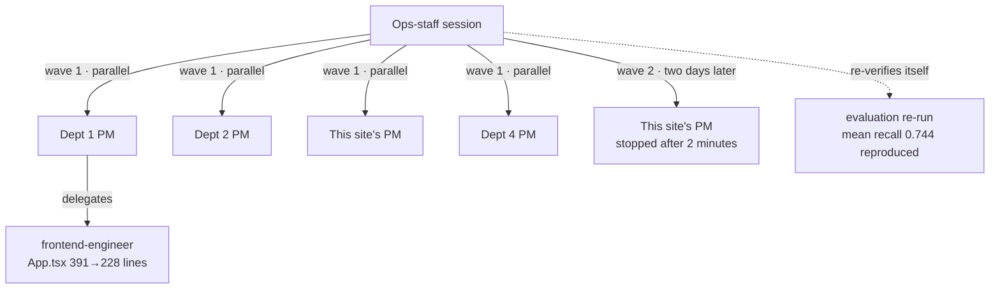

# 7. Verification and evaluation

::: lead
Reports are re-checked against the actual output, and screens in a real browser. The organization itself is audited from real records, and cost is read together with the execution graph.
:::

## Reports are checked again {#reverify}

A department's "done" is not trusted until checked. The PM checks members' results against actual commits and tool calls; the ops staff checks
the PM's report against the actual output. The ops staff's re-verification means opening the PR itself, re-running the checks, and comparing
the numbers in the result files with the report. The date of the check goes into that Definition-of-Done row's "Verified" column.

Many items are still marked done without independent re-verification, and that share is being reduced. As of 2026-10-26, 23 of 60 done items
across all departments (38%) had been independently re-verified. It is a status, not a score.

<Cite ids="op-reverify,portfolio-report" />

## Screens are checked in a real browser {#real-browser}

A feature used through a screen is not called done on unit tests, type checks and a build alone. It is done once its interaction is checked in
a real browser, with the script and screenshots kept in the product repository. The rule follows whether the user exercises the feature through
a screen, not how the item is categorized. This site's collapsing, expand-all and print checks follow it too.

::: point Details — a screen that did not work for 54 days (background · problem · solution)
**Background.** Screen work, too, was judged done on unit tests, type checks and a build.

**Problem.** One department's core editing feature never worked in a real browser for 54 days, while every check passed: the test environment did
not render that part of the screen. The operator found it by looking in a browser.

**Solution.** Screen work is done only with a real-browser check. Later, another evaluation found two items used through a screen but filed as
"functional", which had therefore never been browser-checked. The rule was rewritten to key on how a feature is used, not on its category.

<Cite ids="round4,pm-run-start,real-browser-by-use" />
:::

## Audits: from real records {#audit}

Whether the organization works by its own rules is checked by audits. Each audit item has an id `AUD-N`, and there are four kinds.

| Kind | Asks | When | Evidence | Ends |
|---|---|---|---|---|
| Regression | Did a core change break known behavior? | When a file it guards changes | Synthetic input, aise-core alone | When its subject is gone |
| Rule | Was a rule followed in operation? | On the operator's request, per wave of work | Real records and transcripts | Never; rules are maintained like unit tests |
| Watch | Is this a problem? Does this change work? | On the operator's request | Real records and transcripts | When the same conclusion holds twice |
| Assessment | Is the organization's shape sound? | At a department's milestones | The department's whole record | A final verdict when the department closes |

An item is registered only from a real incident or from the concrete risk of a change being made now, never from "could this also be a
problem?" The items' definitions live in aise-core; the results of auditing this organization live in this deployment's records. Another
organization that takes aise-core gets the items, not this organization's evidence.

<Cite ids="audit-readme,audits-replace" />

::: point Details — what has not happened is not judged (background · problem · solution)
**Background.** Some problems show only in real operation: two or more departments moving at once, a department closing.

**Problem.** At first such problems went on a watchlist to wait for their condition. The loop became register, wait, analyze, change status. 15
of 19 cases were operational monitoring, and the regression checks guarding core changes were not run again over dozens of changes. Criteria
and endings varied.

**Solution.** It was rebuilt under one name (audit) with four kinds, each ending in its own way; a new item's kind follows four factual
questions. A change notice lists the regression items covering the changed files. The principle stays: judge from what actually happened.

<Cite ids="audits-replace,operator-watch" />
:::

::: point Details — the observed do not know what is watched
For a time, work instructions also carried "what is being watched this time". The ops staff passed the criteria on to PMs, so the observed knew
what was observed. The one real violation (a credential in a push URL) came from a transcript audit, not from the requested self-report. Now work
instructions carry only the work, never the audit criteria, and a run whose instruction named the observed behavior does not count.

<Cite ids="observed-not-told" />
:::

## The execution graph {#graph}

The execution graph is not drawn from guesses. `/aise:usage` rebuilds the nesting of delegations from a session's actual transcript by following
each sub-agent's parent. Below is one ops-staff session of 2026-09-15 rebuilt that way. With one instruction ("continue each department's
backlog") it launched four departments' PMs.

<figure>

<figcaption>Figure 7-1. One real execution graph (2026-09-15). The chart (depth 2) is unchanged; for that day's work four departments ran in parallel, and only one delegated once more inside.</figcaption>
</figure>

| Node | What this run did | Tokens (incl. children) |
|---|---|---:|
| Dept 1 PM | Designed splitting a screen file grown to 391 lines into three components, delegated it, re-verified the result itself (236 tests passed, 228 lines) | 144,126 (186,261) |
| └ frontend-engineer | Extraction with no behavior change | 42,135 |
| Dept 2 PM | Carried out the corpus-scope decision; re-evaluation 0.694 → 0.744 ([chapter 6](/en/story/operation#eval-case)) | 223,486 |
| This site's PM | Re-checked a merged PR itself and verified rendering of 44 KOR·EN requests | 86,298 |
| Dept 4 PM | Re-verified two blockers from scratch; no new delegation | 129,606 |

- **The top did not pass results along as they were.** After the reports, the ops staff re-ran the evaluation script itself and reproduced the
  same numbers.
- **A branch that did not get through is visible too.** Wave 2 is a PM run launched when the same session reopened two days later; it was stopped
  after two minutes and left nothing. It does not show in the department records; only the rebuilt transcript reveals it.
- **The numbers remain.** The whole session used 11.69 million tokens (the top-level session 10.96 million, all sub-agents 0.73 million).

<Cite ids="usage-cmd,backlog-ledger" />

## Cost read as the flow of work and judgment {#tokens}

With delegation, how many tokens went into which work had to be measured, the way a company hires people, pays salaries and sets development
budgets. `/aise:usage` shows the tokens each agent used, per unit of work and per execution graph. The figures are computed from recorded usage,
not estimated, and sum every depth of delegation.

::: point Details — delegation was not chosen to save tokens (background · problem · solution)
**Background.** Token tracking began while building handoff: measuring the amount of context needed a record of token usage.

**Problem.** When an upper level delegates down, and the next level delegates further, how much went into which work is no longer visible. Tokens
are limited.

**Solution.** Usage is anticipated, tracked and monitored, and fed back into improving aise-core. The management staff came about with these
functions. Delegation was chosen because it fits the vertical structure and a real company's structure; token monitoring exists to reduce that
structure's fixed cost. No claim is made that "the organizational way costs more": what has been measured so far is per-run totals, never the
organizational overhead set against the tokens spent on the work itself. The aim is not only fixed cost but seeing how a project flows and what
judgments a PM makes.

<Cite ids="operator-tokens" />
:::

## Evaluation output {#assessment}

A department assessment reads the department's whole record along several axes and leaves a verdict and its evidence per axis. Below are the
per-axis verdicts of one department's round-4 assessment (2026-10-01). Verdicts are "verified (positive/negative)" or "provisional", and an
axis whose conclusion flipped from the previous rounds is marked.

<figure>
<svg viewBox="0 0 640 330" role="img" aria-label="Per-axis verdicts of one department's round-4 assessment. 1 requirements met: provisional. 2 quality: verified negative, flipped. 3 openness to restructuring: verified positive. 4 usability and context weight: verified positive. 5 real payoff of delegation overhead: verified negative. 6 domain-accuracy risk: verified positive. 7 dependency on operator involvement: verified negative, flipped. 8 whether HR staff stepped in: provisional. Total: verified 6 (positive 3, negative 3), provisional 2">
  <text x="20" y="24" font-size="13" font-weight="600">Department assessment, round 4 — per-axis verdicts</text>
  <text x="620" y="24" text-anchor="end" font-size="10" opacity="0.75">evidence: records and repository history only</text>
  <line x1="20" y1="36" x2="620" y2="36" stroke="currentColor" stroke-width="1" />
  <text x="30" y="56" font-size="11" font-weight="600">Axis</text>
  <text x="360" y="56" font-size="11" font-weight="600">Verdict</text>
  <text x="520" y="56" font-size="11" font-weight="600">vs. earlier rounds</text>
  <line x1="20" y1="64" x2="620" y2="64" stroke="currentColor" stroke-width="0.6" opacity="0.5" />
  <text x="30" y="86" font-size="12">1. Requirements met</text>
  <text x="360" y="86" font-size="12" opacity="0.8">provisional</text>
  <text x="30" y="114" font-size="12">2. Quality</text>
  <text x="360" y="114" font-size="12" fill="#c1652a" font-weight="600">verified · negative</text>
  <text x="520" y="114" font-size="12" fill="#c1652a" font-weight="600">flipped</text>
  <text x="30" y="142" font-size="12">3. Openness to restructuring</text>
  <text x="360" y="142" font-size="12">verified · positive</text>
  <text x="30" y="170" font-size="12">4. Usability · context weight</text>
  <text x="360" y="170" font-size="12">verified · positive</text>
  <text x="30" y="198" font-size="12">5. Payoff of delegation overhead</text>
  <text x="360" y="198" font-size="12" fill="#c1652a">verified · negative</text>
  <text x="30" y="226" font-size="12">6. Domain-accuracy risk</text>
  <text x="360" y="226" font-size="12">verified · positive</text>
  <text x="30" y="254" font-size="12">7. Dependency on the operator</text>
  <text x="360" y="254" font-size="12" fill="#c1652a" font-weight="600">verified · negative</text>
  <text x="520" y="254" font-size="12" fill="#c1652a" font-weight="600">flipped</text>
  <text x="30" y="282" font-size="12">8. Whether HR staff stepped in</text>
  <text x="360" y="282" font-size="12" opacity="0.8">provisional</text>
  <line x1="20" y1="296" x2="620" y2="296" stroke="currentColor" stroke-width="1" />
  <text x="30" y="318" font-size="11" opacity="0.85">Total: verified 6 (positive 3 · negative 3) · provisional 2</text>
</svg>
<figcaption>Figure 7-2. An example of evaluation output. The quality axis was positive in the two earlier rounds and flipped to negative in this one, when the editing feature broken for 54 days came to light. The proxy the earlier rounds used (counts of fix and revert commits) could not see that defect.</figcaption>
</figure>

An assessment is not scoring but leaving evidence. Under each verdict sits the location of the records that produced it (lines of the
department record, commits, the directive inbox's history). For a flipped axis, it also says why the earlier rounds missed the problem.

<Cite ids="round4" />

<SourceTable />

**Next.** → [8. Distribution and many tools](/en/story/distribution)
