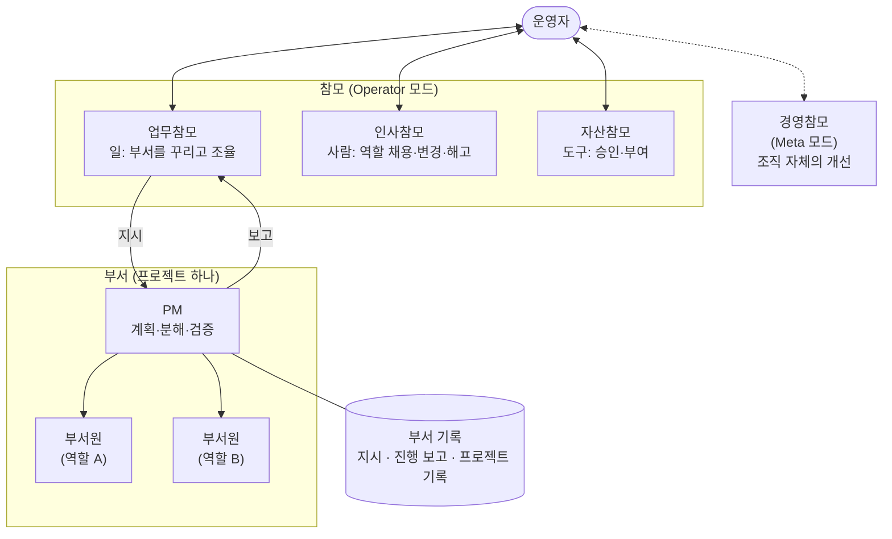

# 2. 해법: 회사의 구조를 빌린다

::: lead
행동 하나하나를 통제하는 대신 판단은 AI에게 맡기고, 누가 무엇에 책임지는지를 회사의 구조로 묶는다.
:::

## 세밀한 통제의 한계 {#control}

1장의 두 프레임워크는 에이전트의 행동을 프롬프트로 묶으려 했다. 워크플로우에 단계를 정해 두어도 에이전트는 그 단계를
건너뛰었다. "절대 하지 마", "반드시 해야 한다" 같은 문장을 시스템 프롬프트에 넣어도 통제되지 않았다.

::: point 자세히 — 단계를 건너뛴 이유 (배경 · 문제 · 해결 방향)
**배경.** 워크플로우마다 단계와 금지 사항을 시스템 프롬프트에 적었다. 당시에 쓰던 모델은 지금보다 성능이 낮았다.

**문제.** 건너뛴 이유를 물으면 "불필요하다고 판단했다", "그렇게 하라는 뜻으로 이해했다", "다른 방법이 더 나아 보였다" 같은
답이 돌아왔다. 문장을 더 세게 쓰는 미세 조정은 효과가 없었다. 무엇을 에이전트로 만들고 무엇을 프로그램으로 만들지를
세세하게 고민하는 일도, 소프트웨어 공학을 위한 도구를 만든다는 목적과 맞지 않았다.

**해결 방향.** 방향을 반대로 잡았다. 모델의 성능을 최대한 쓰고, 실행 계획을 세우고 실행하는 일을 맡긴다. 무엇을
프로그램으로 만들지도 모델이 판단하게 한다.

<Cite ids="op-fine-control" />
:::

## 판단은 맡기고 책임은 묶는다 {#accountability}

판단을 맡긴다고 통제를 포기하는 것은 아니다. 결과의 품질은 일정 수준으로, 운영자가 원하는 방향으로 나와야 한다.
aise-core는 행동 하나하나 대신 **누가 무엇에 책임지는지**를 묶는다. 명령하고, 책임을 묻고, 결과를 확인하는 구조다.

정책은 운영자가 정한다. 그 정책을 어떻게 구현할지, 왜 그 자리에 강제 장치가 필요한지는 Claude Code가 제안한다. 운영자는
선택지 가운데서 고른다. 사례는 [5장](/story/how-it-is-kept#hooks)에 있다.

<Cite ids="op-fine-control,hooks-reorg" />

## 회사의 책임 분리 {#company}

방향을 잡아 줄 구조로 회사를 골랐다. 특정 회사가 아니라, 회사라는 구조가 이익을 만들고 사람을 관리하고 도구를 관리하는
방식이다. 빌려 온 것은 책임 분리다. 소프트웨어로 말하면 단일 책임 원칙(SRP)이다.

| 회사 | aise-core |
|---|---|
| 프로젝트를 맡는 부서와 PM | 부서 하나가 프로젝트 하나. PM이 계획하고 나누고 확인한다 |
| 일을 배정하고 부서 사이를 조율하는 조직 | 업무참모 |
| 사람을 채용하고 직무를 정의하는 인사 조직 | 인사참모 |
| 도구를 심사하고 지급하는 자산 조직 | 자산참모 |
| 조직 자체를 발전시키는 경영 | 경영참모와 Meta 모드 |
| 사내 규정 | 헌법과 거버넌스 |

회사의 모양을 빌린 결과, 일이 끝난 뒤에도 무언가가 남는다. 혼자 쓰는 AI 세션은 끝나면 그 세션에서 알아낸 것이 사라진다.
aise-core의 부서는 일하는 동안 부서 기록을 남기고, 다음 세션은 그 기록을 읽고 시작한다.

<figure>
<svg viewBox="0 0 720 380" role="img" aria-label="두 그림의 비교. 왼쪽 혼자 쓰는 AI 세션: 사용자가 질문하고 세션이 해결하고, 세션이 끝나면 아무것도 남지 않는다. 오른쪽 aise-core: 사용자가 지시하면 업무참모가 부서에 맡기고, 부서는 부서 기록을 남기며, 다음 세션은 그 기록에서 시작한다">
  <defs>
    <marker id="ag-arrow" viewBox="0 0 10 10" refX="8" refY="5" markerWidth="7" markerHeight="7" orient="auto-start-reverse">
      <path d="M 0 0 L 10 5 L 0 10 z" fill="currentColor" />
    </marker>
  </defs>
  <line x1="360" y1="10" x2="360" y2="370" stroke="currentColor" stroke-width="1" stroke-dasharray="3 5" opacity="0.35" />
  <text x="180" y="28" text-anchor="middle" font-size="13" font-weight="600">혼자 쓰는 AI 세션</text>
  <circle cx="180" cy="55" r="14" fill="none" stroke="currentColor" stroke-width="1.5" />
  <line x1="180" y1="69" x2="180" y2="95" stroke="currentColor" stroke-width="1.5" />
  <text x="180" y="112" text-anchor="middle" font-size="11">사용자</text>
  <line x1="180" y1="120" x2="180" y2="150" stroke="currentColor" stroke-width="1.5" marker-end="url(#ag-arrow)" />
  <text x="196" y="138" font-size="10">질문</text>
  <rect x="100" y="155" width="160" height="50" rx="6" fill="none" stroke="currentColor" stroke-width="1.5" />
  <text x="180" y="185" text-anchor="middle" font-size="12">AI 세션</text>
  <line x1="180" y1="205" x2="180" y2="235" stroke="currentColor" stroke-width="1.5" marker-end="url(#ag-arrow)" />
  <text x="196" y="223" font-size="10">해결</text>
  <rect x="100" y="240" width="160" height="40" rx="6" fill="none" stroke="currentColor" stroke-width="1.5" />
  <text x="180" y="265" text-anchor="middle" font-size="12">작업 완료</text>
  <line x1="180" y1="280" x2="180" y2="315" stroke="currentColor" stroke-width="1.5" stroke-dasharray="4 4" marker-end="url(#ag-arrow)" />
  <text x="180" y="335" text-anchor="middle" font-size="11" opacity="0.7">세션 종료</text>
  <text x="180" y="350" text-anchor="middle" font-size="11" font-weight="600" opacity="0.7">— 아무것도 남지 않음</text>
  <text x="540" y="28" text-anchor="middle" font-size="13" font-weight="600">aise-core</text>
  <circle cx="540" cy="55" r="14" fill="none" stroke="currentColor" stroke-width="1.5" />
  <line x1="540" y1="69" x2="540" y2="95" stroke="currentColor" stroke-width="1.5" />
  <text x="540" y="112" text-anchor="middle" font-size="11">사용자</text>
  <line x1="540" y1="120" x2="540" y2="150" stroke="currentColor" stroke-width="1.5" marker-end="url(#ag-arrow)" />
  <text x="556" y="138" font-size="10">지시</text>
  <rect x="460" y="155" width="160" height="40" rx="6" fill="none" stroke="currentColor" stroke-width="1.5" />
  <text x="540" y="180" text-anchor="middle" font-size="12">업무참모 → 부서</text>
  <line x1="540" y1="195" x2="540" y2="225" stroke="currentColor" stroke-width="1.5" marker-end="url(#ag-arrow)" />
  <text x="556" y="213" font-size="10">기록</text>
  <rect x="450" y="230" width="180" height="45" rx="6" fill="none" stroke="#c1652a" stroke-width="2" />
  <text x="540" y="258" text-anchor="middle" font-size="12" font-weight="600" fill="#c1652a">부서 기록</text>
  <path d="M 450 252 C 340 252, 340 175, 458 172" fill="none" stroke="#c1652a" stroke-width="1.5" marker-end="url(#ag-arrow)" />
  <text x="360" y="150" text-anchor="middle" font-size="10" fill="#c1652a">다음 세션이</text>
  <text x="360" y="163" text-anchor="middle" font-size="10" fill="#c1652a">여기서 시작</text>
  <text x="540" y="300" text-anchor="middle" font-size="11" opacity="0.7">세션은 끝나도</text>
  <text x="540" y="315" text-anchor="middle" font-size="11" font-weight="600" opacity="0.7">부서의 기록은 남음</text>
</svg>
<figcaption>그림 2-1. 끝난 뒤에 남는 것. 왼쪽은 세션이 끝나면 아무것도 남지 않는 일반적인 사용, 오른쪽은 부서 기록이 다음 세션의 출발점이 되는 aise-core. 기록의 구성은 6장.</figcaption>
</figure>

<Cite ids="op-company,constitution-why" />

::: point 자세히 — 하네스도 소프트웨어다
에이전트에게 지시를 내리는 시스템 프롬프트와 그 주변 장치(흔히 "하네스")를 만드는 일은 소프트웨어를 설계하고 구현하는
일과 다르지 않다. 그래서 소프트웨어 설계 원칙과 개발 방법론을 그대로 적용한다. 원칙은 [3장](/story/principles)에 있다.

<Cite ids="op-company" />
:::

## 전체 구조 {#structure}

운영자는 참모와만 이야기한다. 업무참모는 일을 부서에 맡기고, 부서의 PM은 일을 나눠 부서원에게 맡긴 뒤 결과를 확인해
위로 보고한다. 선은 위아래로만 이어진다.

<figure>

<figcaption>그림 2-2. 전체 구조. 운영자에서 PM으로, PM에서 다른 부서의 PM으로 가는 선은 없다. 실행 책임의 줄(운영자 — 부서 — 부서원)은 두 단계를 넘지 않고, 참모는 그 줄에 세지 않는다. 각 자리의 이유는 4장.</figcaption>
</figure>

| 자리 | 하는 일 | 하지 않는 일 |
|---|---|---|
| 운영자 | 모드를 정하고 참모에게 지시. 운영자가 승인자인 결정(PM이 올린 결정, 부서 종료, 영향이 큰 도구, 정책·거버넌스 변경)을 내림 | PM이나 부서원에게 직접 지시하지 않음 |
| 업무참모 | 지시를 해석해 부서에 배정, 부서를 꾸림, 부서 사이 조율, PM 보고를 실제 산출물로 재검증 | 부서의 기록을 고치지 않음(지시 파일만 씀), 직접 개발하지 않음 |
| 인사참모 | 역할(직무 정의)의 채용·정의 변경·해고, 합류하는 역할의 도메인 조사 | 프로젝트 일을 하지 않음 |
| 자산참모 | 도구(스킬, MCP 서버 등)의 승인 목록과 그 구현, 역할마다 쓸 수 있는 도구 결정 | 어떤 역할이 있을지 정하지 않음 |
| 경영참모 | Meta 모드에서 조직 자체(규칙, 구조, 메커니즘)를 진단하고 고침 | 프로젝트 일을 하지 않음 |
| PM | 부서의 계획·완료 기준·방법론, 일의 분해와 위임, 결과 검증과 통합, 부서 기록 작성 | 부서의 종료를 스스로 정하지 않음, 완료 기준을 혼자 바꾸지 않음 |
| 부서원 | 한 분야의 단일 책임으로 실제 실행(코드, 설정, 점검) | 다른 에이전트를 부르지 않음, 부서 밖과 직접 소통하지 않음 |

<Cite ids="constitution-staff,constitution-depth,op-matrix" />

## 지시에서 보고까지, 다섯 문장 {#five-sentences}

::: point 1. 운영자는 먼저 세션의 모드를 정한다. 조직으로 일하는 Operator 모드인지, 조직 자체를 고치는 Meta 모드인지.
선언은 `/aise:op` 또는 `/aise:meta` 명령으로 한다. 선언이 없으면 보호된 핵심 문서에 쓰기가 막힌다. 두 모드는
[4장](/story/structure#modes)에 있다.

<Cite ids="mode-policy" />
:::

::: point 2. Operator 모드에서 운영자는 업무참모 한 명에게만 말한다. 업무참모는 어느 부서의 일인지 판단해 그 부서에 지시를 적고, 맞는 부서가 없으면 새로 꾸린다.
업무참모가 부서 안에 쓰는 파일은 지시 파일(`directive.md`) 하나다. 부서의 기록은 그 부서의 PM만 쓴다. 운영자가 PM에게
직접 지시하는 경로는 없다.

<Cite ids="constitution-staff,op-directive" />
:::

::: point 3. 부서의 PM은 부서 기록을 읽고 계획을 세운 뒤, 일을 나눠 부서원에게 맡긴다. 필요한 역할이나 도구가 없으면 업무참모를 거쳐 인사참모나 자산참모에게 요청한다.
PM은 세션 사이의 기억이 없다. 매번 부서 기록 세 파일(지시, 진행 보고, 프로젝트 기록)을 읽고 시작한다. 서로 기다려야
하는 일은 공유 결정을 먼저 정한 다음 병렬로 나눈다. 자세한 흐름은 [6장](/story/operation)에 있다.
:::

::: point 4. PM은 부서원의 결과를 직접 확인하고 합친 뒤, 기록을 남기고 결과물을 PR로 올려 업무참모에게 보고한다.
PM은 부서원의 "다 됐다"를 그대로 믿지 않고 실제 커밋이나 도구 호출과 대조한다. 운영자가 할 일(병합, 범위 변경 승인,
자격 증명 제공)은 진행 보고의 "운영자 결정" 표에 남는다.
:::

::: point 5. 업무참모는 PM의 보고도 실제 산출물로 다시 확인한 뒤 운영자에게 보고한다. 운영자에게는 운영자가 승인자인 결정만 올라간다.
다른 결정은 그 승인자(업무참모, 인사참모, 자산참모)가 바로 내리고, 운영자는 결과를 보고로 듣는다. 재검증은
[7장](/story/verification#reverify)에 있다.

<Cite ids="op-matrix" />
:::

## 수직 구조를 고른 이유 {#vertical}

aise-core는 같은 층의 에이전트가 토론해 결론을 내는 방식 대신, 책임을 한 곳에 고정하는 수직 구조를 골랐다. 배경으로,
AI 에이전트는 사람처럼 감정과 관계를 고려하지 않아도 된다. 수직 구조를 고른 근거는 아래 네 가지다. 수평 구조의 버전을
만들어 비교한 적은 없으므로, 수직 구조가 더 낫다는 주장은 아니다.

::: point ① 결론을 결과물로 만드는 상위 계층은 어느 구조에나 필요하다.
에이전트를 수평으로 두어도, 그들의 결론을 검증하고 소프트웨어 공학의 흐름에 맞게 조합하는 일은 누군가의 몫이다. 그 아래에서
하위 에이전트가 토론하게 할 수도 있고, 각자 맡은 일을 병렬로 하고 상위가 합치게 할 수도 있다. aise-core는 뒤쪽을 골랐다.

실제 예로, 한 부서의 PM이 같은 역할의 부서원 셋에게 일을 나눠 각자의 브랜치에서 병렬로 맡기고, 결과를 확인한 뒤 하나로
합쳤다.

<Cite ids="op-vertical,wiki-parallel" />
:::

::: point ② 책임의 경계가 분명하고, 기록마다 쓰는 주체가 하나다.
프로젝트 안은 PM이, 부서 사이는 업무참모가 맡는다. 부서의 기록은 그 부서의 PM만 쓰고, 업무참모는 부서 안에 지시 파일
하나만 쓴다. 이 경계는 도구가 막는다. 같은 역할의 에이전트끼리 같은 주제를 토론하게 하면 역할 정의의 의미가 사라지고
책임 경계가 무너진다.

<Cite ids="op-directive,op-vertical" />
:::

::: point ③ 글로 쓴 규칙은 어겨진다. 꼭 지켜야 하는 소수의 지점만 도구가 강제한다.
글로 쓴 금지가 다음 날 어겨진 사례와 그 뒤의 대응은 [5장](/story/how-it-is-kept#hooks)에 있다.
:::

::: point ④ 운영자의 통제가 쉽고, 운영자의 역량이 aise-core에 의존하지 않는다.
- 운영자는 참모하고만 이야기한다. 기술적으로는 PM이나 그 아래 에이전트에 닿을 방법이 있지만, 마이크로 매니징을 막으려고
  구조로 막았다. 특정 사안이 궁금하면 업무참모를 통해 자세한 보고를 요구하거나 상세 지시를 내린다.
- 개입 지점을 목록으로 고정하지 않았다. PM이 판단하고, 결정이 필요한 것은 보고로 올라온다.
- 구조상 운영자를 거치는 결정은 몇 개뿐이다. PM이 올린 결정, 부서의 종료, 영향이 큰 도구의 승인, 정책과 거버넌스의 변경이다.
  역할의 채용·변경·해고는 인사참모가 정하고 운영자에게는 보고된다.

<Cite ids="op-vertical,op-matrix,constitution-staff" />
:::

::: point 자세히 — 포기한 것: 같은 층의 토론 (배경 · 문제 · 해결 방법) {#given-up}
**배경.** 에이전트끼리 토의해서 스스로 결과를 내게 하는 방식이 많이 쓰인다.

**문제.** aise-core는 소프트웨어 공학을 위한 소프트웨어를 만들고, 위에서 내려오는 지시를 처리하려는 목적으로 만들어졌다.
최상위 리더인 운영자가 모든 정보를 알고 있어야 하고, 결과는 운영자의 기대에 맞아야 한다.

**해결 방법.** 같은 층의 에이전트끼리 토론하게 하지 않는다. 에이전트 도구의 가능성을 제한하는 정책일 수 있다. 다만 이것은
자물쇠가 아니라 소프트웨어 구조로 동작을 제한한 것이라, 아키텍처를 평가하고 다시 설계할 수 있게 열어 두었다. 이 밖에
포기한 것들은 [9장](/story/growth-and-limits#given-up)에 있다.

<Cite ids="op-vertical" />
:::

## 실제 요청 하나: upstream 변경 전파 {#example}

2026-10-01의 실제 요청 하나를 처음부터 끝까지 따라간다. 모든 단계가 기록으로 남아 있다.

::: point ① 운영자의 지시. aise-core가 크게 재구성됐으니, 이것을 쓰는 세 부서가 얼마나 잘 흡수하는지 보고, 더 싸게 흡수할 방법을 각 PM에게서 받는다.
같은 날 aise-core의 규칙 문서가 다시 쓰이고 결정 기록 124개 파일이 주제별 30개 파일로 옮겨졌다. 세 부서(이 사이트, 위키
플랫폼, 검색 플랫폼)가 이 내용을 콘텐츠나 데이터로 쓰고 있었다.
:::

::: point ② 업무참모. 세 부서의 지시 파일에 사실과 요청만 적었다. 무엇을 어떻게 고칠지는 처방하지 않았다.
운영자의 목적이 "각 PM이 스스로 얼마나 잘 흡수하나"를 보는 것이었기 때문이다. 바뀐 커밋, 옛 파일명과 새 인용의 대응표,
점검 도구 이름을 전달했다.
:::

::: point ③ 각 부서의 PM. 영향을 직접 조사하고 계획하고 고쳤다. 한 부서는 일을 세 갈래로 나눠 부서원 셋에게 병렬로 맡겼다.
- 이 사이트 부서: 풀리지 않는 결정 인용 167건과 경로 6건, 바뀐 규칙 서술을 찾아 7쪽 × 두 언어를 고쳤다.
- 위키 플랫폼 부서: 9쪽을 세 묶음으로 나눠 같은 역할의 부서원 셋에게 각자의 브랜치에서 맡기고, 결과를 확인한 뒤 합쳤다.
- 검색 플랫폼 부서: 검색 데이터를 청크 단위로 대조해 죽은 경로를 가리키는 청크를 찾고 다시 동기화했다. 이 run은 사용량
  한도로 끊겼다가 같은 에이전트로 이어서 끝났다.
:::

::: point ④ PM의 보고. 결과와 함께 다음에 더 싸게 흡수할 방법을 각자 제안했다.
예를 들어 이 사이트 부서는 사이트가 마지막으로 대조한 aise-core 커밋을 기록하고 점검을 스크립트로 만들었다. aise-core에는
바뀐 개념 목록을 함께 보내 달라고 제안했고, 이 제안의 일부는 aise-core의 변경 알림 문서로 반영됐다.
:::

::: point ⑤ 업무참모의 재검증. PM의 보고를 믿지 않고, 브랜치를 직접 받아 점검을 다시 돌렸다.
이 사이트 부서의 경우, 같은 점검 스크립트를 다시 실행해 깨진 참조 0건, 깨진 인용 0건을 확인하고, 브라우저 점검 결과
파일의 숫자를 PM 보고와 대조했다. 확인하지 못한 것(한국어 글꼴이 없어 한국어 화면을 눈으로 확인하지 못함)도 그대로 적었다.
:::

::: point ⑥ 운영자의 결정. PR을 병합하고 공개했다. 그 뒤 PM이 공개된 사이트를 실제 브라우저로 다시 확인했다.
:::

운영자가 한 일은 지시 한 번과 병합이었다. 계획, 분해, 병렬 위임, 검증은 각 층이 자기 몫만 했다.

<Cite ids="coordination-upstream,wiki-parallel" />

<SourceTable />

**다음으로.** → [3. 원칙](/story/principles)
