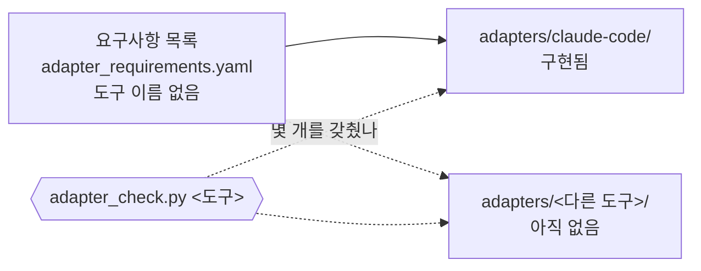

# 8. 배포와 여러 도구

::: lead
배포하는 것은 조직이 아니라 정책·훅·도구이고, 조직은 쓰는 사람이 꾸린다. 여러 도구에서 쓰는 설계는 돼 있지만, 지금은 Claude Code에서만 구현됐고 다른 도구에서는 검증 전이다.
:::

## 조직이 아니라 정책을 배포한다 {#policy}

aise-core를 만든 이유 가운데 하나는 다른 사람도 쓸 수 있게 하는 것이다. 그런데 AI 에이전트는 시스템 프롬프트를 어떻게 짜도 늘
같은 답을 주지 않는다. 그래서 같아야 하는 것, 곧 정책을 지키는 일은 훅과 훅이 실행하는 스크립트와 정책 문서로 강제한다. 그 안에서
어떤 조직을 꾸릴지는 쓰는 사람에게 맡긴다.

- 조직의 실제 데이터(어떤 부서와 역할이 있고 무엇을 했는지)는 aise-core와 분리된 저장소에 둔다.
- 새 배포는 빈 조직으로 시작한다. 처음 Operator 모드로 들어갈 때 꼭 필요한 기본 파일만 만들어지고, 역할과 회고는 빈 채로
  시작한다([4장](/story/structure#schema-instance)).
- 조직 자체도 배포할 가치가 있지만 배포 대상에서는 뺐다. 대신 "조직 없이 시작"과 "기존 조직을 다시 쓰기"의 두 경우로 나눠,
  쓰는 사람이 자기 선호에 맞게 바꿔 갈 수 있게 열어 두었다.

<Cite ids="op-distribution,instance-location,instance-skeleton" />

::: point 자세히 — 아직 남에게 배포해 본 적은 없다 {#not-yet-distributed}
지금 이 조직을 쓰는 사람은 운영자 한 명이다. 새 사람이 빈 조직으로 시작하는 절차도 아직 다 갖춰지지 않았다. 상태: **설계됨 ·
일부 구현됨 · 다른 사용자로는 검증 전**.
:::

## 요구사항과 어댑터 {#adapters}

규칙은 특정 도구의 어휘 없이 쓴다. 도구가 해야 할 일, 곧 무엇을 점검하고 막고 알리고 기록하고 답해야 하는지는 도구 중립적인
요구사항 목록 하나에 모여 있다. 도구마다의 어댑터가 그것을 구현하고, 점검 스크립트가 어댑터가 몇 개를 갖췄는지 알려 준다.
정책이 요구사항이 되어 어댑터로 내려가는 과정은 [5장](/story/how-it-is-kept#requirements)에 있다.

<figure>

<figcaption>그림 8-1. 요구사항 하나, 어댑터 여럿. 새 도구는 규칙을 다시 쓰지 않고 어댑터를 하나 더한다. 지금은 Claude Code의 어댑터 하나뿐이다.</figcaption>
</figure>

| 상태 | 내용 |
|---|---|
| 설계됨 | 규칙은 도구 중립. 도구 고유의 장치는 어댑터에만 둔다 |
| Claude Code에서 구현됨 | 요구사항 39개 가운데 37개를 갖췄다. 하나는 이 도구에 해당하지 않고, 하나(비밀 정보 입력)는 "처음 필요할 때 만든다"로 미뤘다 (2026-10-27 점검) |
| 다른 도구에서는 검증 전 | 다른 도구로 aise-core를 돌려 본 적이 없다 |

<Cite ids="adapter-requirements,adapter-check" />

::: point 자세히 — 새 도구에서 처음 열 때
저장소 맨 앞의 도구 중립 안내(`AGENTS.md`)는 어떤 AI 도구든 다른 일보다 먼저 어댑터 점검을 돌리게 한다. 어댑터가 없거나 첫
실행 전에 필요한 항목이 빠져 있으면, 그 도구는 일을 시작하기 전에 운영자에게 그것부터 만들자고 제안한다. 규칙을 읽을 수는 있어도
강제할 장치가 없는 도구는 규칙을 조용히 어길 수 있기 때문이다.

<Cite ids="agents-md" />
:::

::: point 자세히 — 예전 프레임워크의 경험
예전 두 프레임워크는 다른 도구에서도 써 봤고, 그때 한계와 문제점을 파악해 두었다. aise-core는 그 경험으로 가능한 문제를 미리
짚고 해결책을 준비하고 있다. 어댑터라는 구조와 어댑터가 구현할 요구사항 목록이 그 예다.

<Cite ids="op-multi-tool" />
:::

::: point 다른 도구에서 실험해 보고 찾은 것 — **(실험 뒤 채울 자리)**
실제로 다른 도구에서 돌려 보면 그 결과를 여기에 적는다. 지금은 짐작으로 문제나 해결책을 쓰지 않는다.
:::

## 이 사이트도 진행 중 {#in-progress}

aise-core는 아직 끝이나 유지보수 단계에 가지 않았다. 순서로는 이 사이트를 만들기에 이르지만, 함께 진행해도 된다고 판단해
시작했다. "시작만 있고 끝은 모르는" 상태에서 확장할 수 있게 설계한다는 [3장](/story/principles#stance)의 판단과 같다. 그래서 이
사이트의 내용도 aise-core가 바뀌면 함께 바뀐다. 사이트는 마지막으로 대조한 aise-core 커밋을 기록해 두고, 그 뒤 바뀐 규칙 문서와
깨진 인용을 스크립트로 찾는다.

<Cite ids="op-multi-tool" />

<SourceTable />

**다음으로.** → [9. 성장, 성과, 한계](/story/growth-and-limits)
