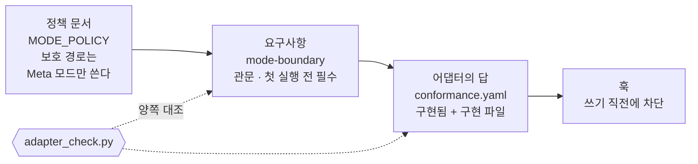
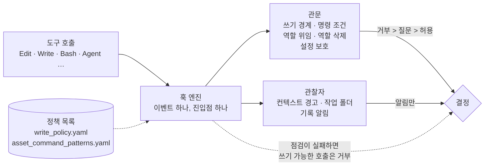

# 5. 어떻게 유지하나

::: lead
규칙은 세 층에서 유지된다. 헌법이 원칙을 정하고, 거버넌스가 운영 정책을 정하고, 어댑터의 훅이 꼭 지킬 것만 강제한다.
:::

## 규칙의 세 층 {#layers}

aise-core의 규칙은 세 층으로 나뉜다. 헌법(`CONSTITUTION.md`)은 존재 이유와 원칙, 조직의 모양을 정한다.
거버넌스(`governance/`)는 그 원칙을 운영 정책으로 구체화한다. 어댑터(`adapters/<도구>/`)는 정책 가운데 도구가 직접
확인하거나 막아야 하는 부분을 그 도구의 장치로 구현한다. 위의 두 층에는 특정 도구의 문법이 없다. 도구에 매인 것은
모두 어댑터에 있다.

<figure>
<svg viewBox="0 0 560 300" role="img" aria-label="세 층의 그림. 맨 위 헌법은 존재 이유, 원칙, 조직의 모양을 담는다. 가운데 거버넌스는 모드, 기록, 중복, 어댑터, 자산, 비밀 정책을 담는다. 맨 아래 어댑터는 훅, 명령, 에이전트 정의를 담는다. 위의 두 층은 도구와 무관하고, 맨 아래 층은 도구마다 하나씩 있다">
  <defs>
    <marker id="kp-arrow" viewBox="0 0 10 10" refX="8" refY="5" markerWidth="7" markerHeight="7" orient="auto-start-reverse">
      <path d="M 0 0 L 10 5 L 0 10 z" fill="currentColor" />
    </marker>
  </defs>
  <rect x="20" y="15" width="380" height="70" rx="8" fill="none" stroke="currentColor" stroke-width="1.5" />
  <text x="36" y="42" font-size="14" font-weight="600">헌법 — CONSTITUTION.md</text>
  <text x="36" y="66" font-size="12">존재 이유 · 원칙 · 조직의 모양</text>
  <line x1="210" y1="85" x2="210" y2="110" stroke="currentColor" stroke-width="1.5" marker-end="url(#kp-arrow)" />
  <text x="222" y="102" font-size="11" opacity="0.8">구체화</text>
  <rect x="20" y="113" width="380" height="70" rx="8" fill="none" stroke="currentColor" stroke-width="1.5" />
  <text x="36" y="140" font-size="14" font-weight="600">거버넌스 — governance/</text>
  <text x="36" y="164" font-size="12">모드 · 기록 · 중복 · 어댑터 · 자산 · 비밀 정책</text>
  <line x1="210" y1="183" x2="210" y2="208" stroke="#c1652a" stroke-width="1.5" marker-end="url(#kp-arrow)" />
  <text x="222" y="200" font-size="11" fill="#c1652a">강제할 부분만</text>
  <rect x="20" y="211" width="380" height="70" rx="8" fill="none" stroke="#c1652a" stroke-width="2" />
  <text x="36" y="238" font-size="14" font-weight="600" fill="#c1652a">어댑터 — adapters/&lt;도구&gt;/</text>
  <text x="36" y="262" font-size="12" fill="#c1652a">훅 · 명령 · 에이전트 정의</text>
  <line x1="420" y1="20" x2="420" y2="180" stroke="currentColor" stroke-width="1" stroke-dasharray="3 4" />
  <text x="432" y="92" font-size="12" font-weight="600">도구와 무관</text>
  <text x="432" y="112" font-size="11" opacity="0.8">모든 도구가</text>
  <text x="432" y="128" font-size="11" opacity="0.8">같은 문서를 읽는다</text>
  <line x1="420" y1="214" x2="420" y2="278" stroke="#c1652a" stroke-width="1" stroke-dasharray="3 4" />
  <text x="432" y="240" font-size="12" font-weight="600" fill="#c1652a">도구마다 하나</text>
  <text x="432" y="260" font-size="11" fill="#c1652a">지금은 Claude Code</text>
</svg>
<figcaption>그림 5-1. 규칙의 세 층. 위로 갈수록 오래 바뀌지 않고, 아래로 갈수록 도구에 가깝다.</figcaption>
</figure>

::: point 자세히 — 왜 층을 나눴나
**배경.** 훅, 슬래시 명령, 서브에이전트 정의 형식은 모두 도구마다 다르다. 이런 것이 규칙 문서 안에 섞이면, 도구를
바꿀 때 규칙까지 다시 써야 한다.

**문제.** 도구를 바꿔도 조직의 철학과 일하는 방식은 그대로여야 한다. 규칙이 한 도구의 문법으로 쓰이면 이 요구를
지킬 수 없다.

**해결 방법.** 판별 기준을 하나 두었다. "도구를 바꾸면 바뀌거나 멈추는가." 그렇다면 그것은 어댑터에 둔다. 그렇지 않으면
헌법이나 거버넌스에 둔다. 판단이 애매하면 만들기 전에 운영자에게 먼저 확인한다. 도구 고유의 장치를 하나 만들 때마다
그 확인을 거친다.

<Cite ids="standing-core-neutral,adapter-test" />
:::

## 거버넌스의 구성 {#governance}

`governance/`에는 사람이 읽는 정책 문서와 프로그램이 읽는 목록이 함께 있다. 대부분은 어느 배포에서나 같은 이식 가능한
정책이다. 도구 제약처럼 이 조직만의 사정을 담은 정책은 따로 표시돼 있다. 거버넌스 전체는 Meta 모드에서만 고칠 수 있다.

<figure>
<svg viewBox="0 0 560 360" role="img" aria-label="거버넌스 구성을 두 축으로 나눈 그림. 가로는 사람이 읽는 정책 문서와 프로그램이 읽는 목록, 세로는 이식 가능한 정책과 이 배포만의 정책이다. 이식 가능한 문서: STANDING_RULES, MODE_POLICY, CONTINUITY_POLICY, DUPLICATION_POLICY, ADAPTER_POLICY, SECRETS_POLICY, DEPLOYMENT_READINESS. 이식 가능한 목록: adapter_requirements.yaml. 이 배포만의 문서: ASSET_POLICY. 이 배포만의 목록: asset_command_patterns.yaml">
  <text x="225" y="22" text-anchor="middle" font-size="13" font-weight="600">사람이 읽는 정책 문서</text>
  <text x="458" y="22" text-anchor="middle" font-size="13" font-weight="600">프로그램이 읽는 목록</text>
  <text x="14" y="140" font-size="12" font-weight="600" transform="rotate(-90 14 140)" text-anchor="middle">이식 가능</text>
  <text x="14" y="302" font-size="12" font-weight="600" transform="rotate(-90 14 302)" text-anchor="middle" fill="#c1652a">이 배포만</text>
  <rect x="30" y="34" width="390" height="210" rx="8" fill="none" stroke="currentColor" stroke-width="1.5" />
  <text x="46" y="62" font-size="13">STANDING_RULES — 상시 운영 규칙</text>
  <text x="46" y="88" font-size="13">MODE_POLICY — 두 모드와 쓰기 경계</text>
  <text x="46" y="114" font-size="13">CONTINUITY_POLICY — 기록과 이어 가기</text>
  <text x="46" y="140" font-size="13">DUPLICATION_POLICY — 사실은 한 곳에</text>
  <text x="46" y="166" font-size="13">ADAPTER_POLICY — 도구 고유의 판별</text>
  <text x="46" y="192" font-size="13">SECRETS_POLICY — 자격 증명</text>
  <text x="46" y="218" font-size="13">DEPLOYMENT_READINESS — 배포 전 점검</text>
  <rect x="432" y="34" width="118" height="210" rx="8" fill="none" stroke="currentColor" stroke-width="1.5" />
  <text x="491" y="130" text-anchor="middle" font-size="12">adapter_</text>
  <text x="491" y="148" text-anchor="middle" font-size="12">requirements</text>
  <text x="491" y="166" text-anchor="middle" font-size="12">.yaml</text>
  <rect x="30" y="256" width="390" height="92" rx="8" fill="none" stroke="#c1652a" stroke-width="2" />
  <text x="46" y="307" font-size="13" fill="#c1652a">ASSET_POLICY — 이 조직의 도구 제약</text>
  <rect x="432" y="256" width="118" height="92" rx="8" fill="none" stroke="#c1652a" stroke-width="2" />
  <text x="491" y="297" text-anchor="middle" font-size="12" fill="#c1652a">asset_command_</text>
  <text x="491" y="315" text-anchor="middle" font-size="12" fill="#c1652a">patterns.yaml</text>
</svg>
<figcaption>그림 5-2. 거버넌스의 구성. 다른 조직이 aise-core를 쓰면 아래 줄(주황)만 자기 사정에 맞게 다시 쓴다.</figcaption>
</figure>

| 파일 | 담는 것 |
|---|---|
| `STANDING_RULES.md` | 조직을 만들고 운영하는 상시 규칙. git 규율, 도구 고유 기능은 만들기 전에 매번 확인, 핵심은 도구 중립, OCP 우선, 저장소만으로 동작 재현, 이미 적힌 사실은 다시 쓰지 않고 인용 |
| `MODE_POLICY.md` | Operator 모드(조직으로 일하기)와 Meta 모드(조직 자체를 고치기)의 구분, 각 모드가 쓸 수 있는 경로, 모드 선언 |
| `CONTINUITY_POLICY.md` | 컨텍스트가 사라지기 전에 남길 기록(핸드오프)과, 기록마다 놓일 자리 |
| `DUPLICATION_POLICY.md` | 같은 사실이 여러 문서에 있을 때 나타나는 다섯 가지 모양과 각각의 처리 |
| `ADAPTER_POLICY.md` | 무엇이 도구 고유인지의 판별, 어댑터가 갖출 것, 어댑터 점검 |
| `SECRETS_POLICY.md` | 자격 증명. 필요하다는 사실은 기록하고, 값은 저장소 밖에만 둔다 |
| `DEPLOYMENT_READINESS.md` | 개발 단계를 벗어나 배포할 때 확인할 항목 |
| `ASSET_POLICY.md` | 이 조직의 도구 제약. 외부 MCP 서버 금지, 외부 유출 위험이 있는 도구 금지, 스킬도 같은 심사 |
| `adapter_requirements.yaml` | 어댑터가 제공해야 할 요구사항 목록. 도구 이름 없이 쓴다 |
| `asset_command_patterns.yaml` | 승인된 도구에 붙은 명령 조건. 예: 임의의 외부 네트워크 호출 금지, 강제 push와 보호 브랜치 직접 push 금지 |

<Cite ids="mode-policy,asset-policy" />

::: point 자세히 — 왜 문서와 목록을 나눴나 (배경 · 문제 · 해결 방법)
**배경.** 같은 조건이 여러 문서에 따로 적혀 있었다. 한 번의 점검에서 push 조건 하나가 여섯 파일에 다시 적혀 있었고, 그중
둘은 강제 코드가 더는 구현하지 않는 옛 정책을 설명하고 있었다.

**문제.** 글로 다시 적은 값은 실제로 강제되는 값과 연결돼 있지 않다. 값이 바뀌면 누군가 모든 문서를 다시 읽기 전에는
어긋난 곳을 찾을 수 없다.

**해결 방법.** 프로그램이 지키는 값은 기계가 읽는 목록 한 곳에 둔다. 문서는 그 값을 다시 적지 않고 파일을 인용한다.
훅도 같은 목록을 읽는다. 예를 들어 명령 조건은 `asset_command_patterns.yaml`에만 있고, 훅과 역할 정의가 모두 이 파일에서
조건을 가져온다.

<Cite ids="duplication-policy,asset-patterns" />
:::

## 정책에서 어댑터까지 {#requirements}

정책 가운데 도구가 직접 확인·차단·알림·기록·응답해야 하는 부분은 `adapter_requirements.yaml`에 요구사항으로 적는다.
요구사항마다 종류와 우선순위가 있다. 어댑터는 요구사항마다 구현했는지와 구현 파일을 `conformance.yaml`에 답한다.
`adapter_check.py`가 두 목록을 양쪽에서 대조한다.

<figure>

<figcaption>그림 5-3. 정책 하나가 강제되기까지. 보호 경로 규칙은 요구사항 <code>mode-boundary</code>가 되고, Claude Code 어댑터는 이를 쓰기 직전에 실행되는 훅으로 구현한다.</figcaption>
</figure>

| 종류 | 하는 일 |
|---|---|
| 관문 | 동작이 일어나기 전에 막는다. 막지 않으면 규칙이 깨진다 |
| 관찰자 | 알아차리고 알리거나 기록한다. 막지는 않는다 |
| 자동 절차 | 정해진 순간(모드 진입, 편집, 위임)에 저절로 일어난다 |
| 진입 명령 | 운영자나 세션이 실행하는 명령(모드 선언, 핸드오프) |
| 실행 중 질의 | 도구가 답해야 하는 질문(모델 등급, 위임의 활동 상태, 컨텍스트 사용량, 토큰 사용량) |
| 개념 연결 | 핵심 개념을 도구의 장치에 대응시킨다 |

우선순위는 둘이다. **첫 실행 전 필수**는 이것 없이 그 도구로 조직을 운영하면 안전하지 않은 항목이다. **처음 필요할 때**는
실제로 필요해졌을 때 만든다. 미리 만들지 않는다.

<Cite ids="adapter-requirements,adapter-conformance" />

::: point 자세히 — 왜 요구사항 목록이 따로 있나 (배경 · 문제 · 해결 방법)
**배경.** 새 규칙이 생길 때마다 도구에게 무언가를 시켜야 하는 일이 함께 생긴다. 어떤 규칙은 막아야 하고, 어떤 규칙은
알리기만 하면 된다.

**문제.** 강제 장치를 어댑터 안에서만 관리하면, 한 도구에서는 강제되고 다른 도구에서는 조용히 빠진 채로 규칙이 퍼질
수 있다. 무엇을 갖춰야 하는지가 한 곳에 없으면, 새 도구를 붙일 때 대신 만들어야 할 목록도 없다.

**해결 방법.** 도구의 어휘 없이 쓴 요구사항 목록을 단일 출처로 둔다. 규칙이 도구에게 무언가를 요구하게 되면, 같은
변경에서 요구사항과 어댑터의 답을 함께 추가한다. 점검은 두 방향으로 실패한다. 어댑터가 답하지 않은 요구사항이 있어도,
어떤 요구사항에도 속하지 않는 구현 파일이 있어도 실패한다. 새 도구에서 aise-core를 처음 열면 이 점검이 먼저 돌고, 첫 실행
전 필수 항목이 빠져 있으면 다른 일보다 그것을 만드는 제안이 먼저 나온다.

<Cite ids="adapter-requirements,agents-md" />
:::

## 훅: 꼭 지킬 것만 {#hooks}

훅은 도구가 특정 동작의 직전이나 직후에 실행하는 스크립트다. aise-core는 정말 지켜야 하는 소수의 지점만 훅으로
강제하고, 나머지는 모델의 판단에 맡긴다. 모드에 맞지 않는 보호 경로 쓰기, 승인된 도구에 붙은 조건을 어기는 명령,
역할 정의를 거치지 않은 위임이 그런 지점이다.

훅은 하나의 엔진으로 돈다. 도구는 이벤트마다 훅 하나만 부르고, 엔진이 그 이벤트와 도구에 등록된 점검을 정해진 순서로 실행해
결과를 합친다. 점검은 두 종류다. **관문**은 막거나 사람에게 물을 수 있고, **관찰자**는 알리거나 기록만 한다. 누가 어느 경로에 쓸 수
있는지 같은 정책 값은 코드가 아니라 거버넌스의 목록에서 읽는다.

<figure>

<figcaption>그림 5-4. 훅의 구성. 점검 결과는 하나로 합쳐지고(거부가 질문보다, 질문이 허용보다 앞선다), 관문이 실행되지 못하면 쓰기가 가능한 호출을 거부한다. 이 장치를 끄는 길은 운영자가 직접 설정을 바꾸는 것뿐이다.</figcaption>
</figure>

<Cite ids="hook-engine" />

::: point 자세히 — 글로 쓴 금지가 다음 날 어겨졌다 (배경 · 문제 · 해결 방법)
**배경.** PM의 역할 정의에는 "일반 목적 에이전트에게 역할극 프롬프트로 대신 맡기지 않는다"는 문장이 있었다.

**문제.** 그 문장이 들어간 다음 날, 한 부서의 PM이 그 run의 작업 다섯 조각을 모두 승인된 역할이 아닌 일반 목적
에이전트에게 맡겼다. run의 기록에는 승인된 역할을 썼다고 적혀 있었다. 며칠 뒤 위임 구조를 재구성하는 도구로
서브에이전트의 메타데이터를 보다가 발견됐다.

**해결 방법.** 글을 더 쓰지 않았다. 글이 이미 있었으므로 글을 더하는 것은 믿을 만한 해결이 아니었다. 만들어 두고
연결하지 않았던 위임 점검 훅을 연결했다. 연결하기 전에 실제 사건의 프롬프트로 시험했고, 첫 패턴은 그 사건을 잡지
못했다. 프롬프트가 "당신은 (부서 이름과 설명) 부서의 backend-engineer입니다" 모양이어서, "당신은"과 역할 이름 사이에
81자가 끼어 있었다. 패턴을 넓히고, 실제 사건의 프롬프트를 회귀 시험 데이터로 넣고, 실제 도구 호출 형태로 차단과 정상
위임의 통과를 확인한 뒤 연결했다.

<Cite ids="hooks-delegation" />
:::

::: point 자세히 — 정책은 운영자가 정하고, 구현은 Claude Code가 제안한다
운영자는 정책을 정하고 선택지 가운데서 고른다. 어떻게 구현할지와 왜 그 자리에 훅이 필요한지는 Claude Code가 제안한다.

기존 역할 파일을 고칠 때의 승인 게이트가 그 예다.

- 실제로 고칠 일이 생기기 전까지는 만들지 않았다. 시험해 볼 대상이 없었기 때문이다.
- 실제 사례가 생겼을 때 만들었다.
- 승인 신호로 새 명령을 만들자는 안은 기각됐다. 모드를 선언하는 명령과 한 번의 승인은 인터페이스 층이 다르다는
  운영자의 판단이었다. 대신 훅이 사람에게 직접 묻는 방식을 골랐다.
- 같은 모양의 코드가 세 번째로 반복되자 공통 모듈로 뺐다.

그 뒤 "조직개편" 개념이 없어지면서 이 게이트의 대상도 바뀌었다.

<Cite ids="hooks-reorg,operator-policy" />
:::

::: point 자세히 — 관문 주위에 구조물을 더 세우지 않는다 (배경 · 문제 · 해결 방법)
**배경.** 역할이 부서를 넘는 공유 클래스가 되자, 한 부서가 필요해서 받은 도구 승인이 그 클래스를 나중에 쓰는 모든 부서에 따라붙게 됐다.
"이 역할은 이 폴더만은 못 읽게 하고 싶다"는 질문도 나왔다.

**문제.** 부서마다 권한 파일을 하나씩 두는 안을 검토했다. 같은 자산참모가 같은 판단으로 그 파일을 채울 뿐이라 안전이 늘지 않았다.
폴더 단위의 차단도 애플리케이션 층의 훅으로는 최선의 노력에 그친다.

**해결 방법.** 새 장치를 만들지 않고, 판단이 그어야 할 선을 문서에 적었다. 거친 역량 승인("이 도구를 써도 되는가")은 도구 승인이
다루고, 세밀한 범위와 자격 증명은 도구 승인의 일이 아니다. 그런 요청은 카탈로그 항목이 너무 거칠다는 신호로 읽는다. 더 강한 경계가
필요해지면 OS·인프라 층에서 만든다. 우회할 수 없는 관문에 구조물을 덧대도 그 뒤의 판단은 날카로워지지 않는다.

<Cite ids="grant-scope,folder-access" />
:::

<SourceTable />

**다음으로.** → [6. 운영](/story/operation)
