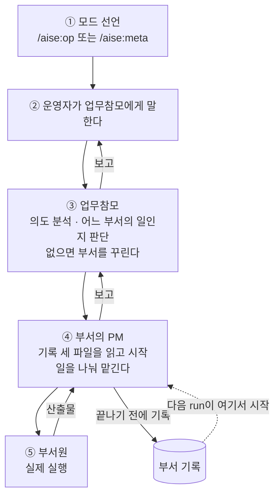
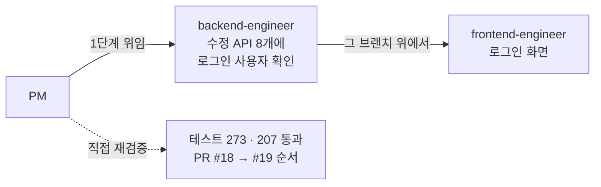
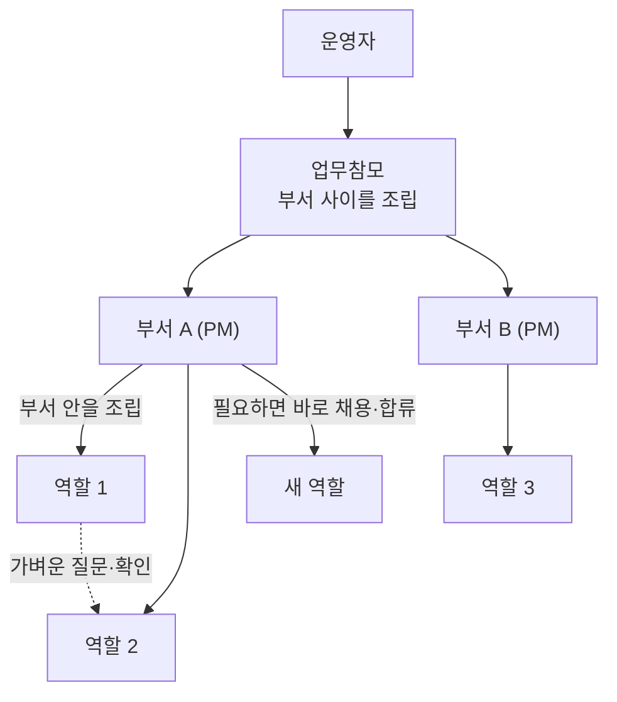
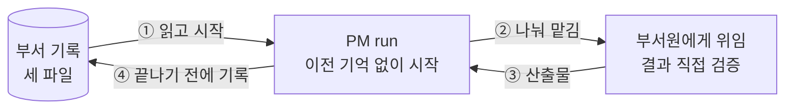
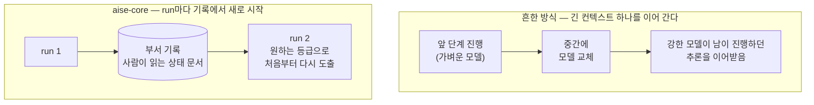

# 6. 운영: 일이 흐르는 방식

::: lead
운영자는 모드를 정하고 업무참모에게 말한다. 그다음은 조직이 자기 규칙대로 처리하고, 기억은 사람이 아니라 부서 기록 세 파일에 남는다.
:::

## 일을 맡기는 흐름 {#flow}

한 번의 지시는 위에서 아래로 내려가고, 결과는 같은 길로 올라온다. 건너뛰는 선은 없다.

<figure>

<figcaption>그림 6-1. 일을 맡기는 흐름. 운영자가 직접 하는 동작은 ①과 ②, 그리고 보고를 받은 뒤의 결정뿐이다.</figcaption>
</figure>

| 시점 | 운영자가 하는 일 |
|---|---|
| 시작 | `/aise:op` 또는 `/aise:meta` 중 하나를 고른다 |
| 지시 | 업무참모에게 하고 싶은 일을 말한다. 부서를 지목할 필요는 없다 |
| 착수 | 업무참모가 "실제 착수를 승인하는가"를 물으면 답한다 |
| 결정 | 운영자가 승인자인 결정(PM이 올린 결정, 부서 종료, 영향이 큰 도구, 정책 변경)과 되돌리기 어려운 동작(공개 배포, `main` 병합)을 정한다 |
| 판정 | 산출물이 의도를 충족하는지 판정한다. 이것은 AI가 대신하지 않는다 |

나머지, 곧 어느 역할을 쓸지, 어떤 순서로 나눌지, 무엇을 기록할지는 조직 안에서 처리된다. 각 자리의 역할은
[2장](/story/at-a-glance#structure)의 표에 있고, 지금 무엇을 입력하면 되는지는 [Quick Guide](/quick-guide)에 있다.

<Cite ids="cmd-op,op-matrix" />

## 모드 선언 {#mode}

`/aise:op`나 `/aise:meta`는 세션의 모드를 기록하는 데서 끝나지 않는다. 진입 도구를 실행하고(역할 정의 재생성, 진입 점검,
모델 등급 확인), 그 세션이 맡을 참모의 문서를 전문으로 읽는다. Operator 모드의 최상위 세션이 곧 업무참모이고, Meta 모드의
최상위 세션이 곧 경영참모다.

::: point 자세히 — 참모가 자기 문서를 읽은 적이 없었다 (배경 · 문제 · 해결 방법)
**배경.** 다른 역할은 역할 정의가 에이전트 정의로 만들어져 실행될 때 함께 들어간다. 업무참모와 경영참모는 "모드를 선언한
최상위 세션이 곧 그들"이라는 관례로만 있었다.

**문제.** 업무참모의 문서에 새 규칙 두 개를 넣었는데, 다음 Operator 모드 세션에서 한 번도 지켜지지 않았다. 그 세션의 실제 도구
호출을 보니 참모 문서를 한 번도 읽지 않았다. 세션은 부서 기록에 밴 관례를 흉내 내며 일했고, 그래서 오래된 규칙은 살아남고 새
규칙만 조용히 빠졌다.

**해결 방법.** 모드 선언 명령에 참모 문서를 전문으로 읽는 단계를 넣었다. 참고 자료가 아니라 그 세션이 따를 운영 매뉴얼로
읽게 했다. "규칙을 적었다"와 "규칙이 지켜졌다"가 다르다는 것을 세션 기록을 직접 보고 확인하는 방식도 이때 굳었다.

<Cite ids="persona-never-read,cmd-op" />
:::

## 업무참모 한 명에게만 {#one-staff}

운영자가 말을 거는 상대는 언제나 업무참모 한 명이다. 사소한 일이라도 담당 부서에 직접 말하지 않는다. 사소한 요청은 바로
가게 하자는 안도 검토됐지만, 그러면 업무참모가 조직 전체의 상태를 보지 못하게 된다는 이유로 기각됐다. 한 층 아래도 같다.
PM이 부서원에게 일을 나누고, 운영자가 부서원에게 직접 말하는 경로는 없다. 이 선택의 이유는 [2장](/story/at-a-glance#vertical)에
있다.

<Cite ids="line-staff,constitution-staff" />

## 부서가 꾸려지는 과정 {#forming}

업무참모는 요청이 어느 부서의 일인지 판단하고, 맞는 부서가 없으면 새로 꾸린다. 부서를 꾸리는 일은 채용이 아니므로 인사참모의
승인이 필요 없다. 새 부서는 보통 `draft`로 시작한다. `draft`에서도 조사와 시험(PoC)은 할 수 있다. 의도가 이미 분명하고 규모가
가늠되면 바로 `active`로 시작한다.

::: point 자세히 — 자동 전환 대신 "물어보는 자리" (배경 · 문제 · 해결 방법)
**배경.** 첫 부서를 `draft`로 운영하는 동안 배경 조사, 범위 정리, 시험 구현, 역할 두 개 채용까지 끝났다.

**문제.** 그동안 정식 착수 승인을 받은 적이 없다는 것을 아무도 알아채지 못했다. "채용이 일어나면 자동으로 `active`로 올린다"는
규칙은 기각했다. 탐색 목적의 채용도 `draft`에서 정당하게 일어나고, 자동화하면 사람이 반드시 판단하는 유일한 자리가 사라진다.
운영자가 판단을 잘못한 것이 아니라, 판단할 자리가 있다는 것을 알려 주는 장치가 없었다.

**해결 방법.** 상태 전환 규칙은 두고 물어보는 의무만 더했다. PM이 탐색이 아니라 실제 산출물을 위한 채용이 필요하다고 판단하는
순간, 업무참모는 운영자에게 착수 여부를 묻는다. 조용히 `draft`에 머무는 것도, 스스로 `active`로 올리는 것도 하지 않는다.

<Cite ids="activation-prompt,schema-lifecycle" />
:::

## 부서 안의 위임과 병렬 {#within}

부서에 일이 오면 PM은 먼저 부서 기록 세 파일을 읽는다. 그다음 일을 조각으로 나눠 부서원에게 맡긴다. 부서원이 "다 됐다"고 해도
그대로 믿지 않고, 실제 커밋이나 도구 호출과 대조한 뒤에 위로 보고한다. 서로의 결정을 기다려야 하는 일은 공유 결정을 먼저 정한
다음 나눈다.

<figure>

<figcaption>그림 6-2. 한 부서 안의 위임(2026-08-20, 로그인 기능). 프론트엔드가 백엔드의 계약에 의존하므로 병렬이 아니라 순차로 맡겼고, PM이 두 쪽의 테스트를 직접 다시 돌렸다.</figcaption>
</figure>

이 사례에서 PM은 순서를 먼저 정했다. 프론트엔드 위임이 사용량 한도로 중간에 끊기자, 남은 변경을 체크포인트 커밋으로 살린 뒤
"이미 끝난 부분은 다시 만들지 말 것"을 적어 다시 맡겼다. 실패하던 E2E 5건이 이번 변경과 무관하게 `dev`에서도 실패한다는 것도
재현해 확인했다.

<Cite ids="sfr-auth" />

::: point 자세히 — 병렬로 맡겼는데 서로 멈췄다 (배경 · 문제 · 해결 방법)
**배경.** 한 부서에서 프론트엔드와 백엔드를 병렬로 맡겼다.

**문제.** 두 역할의 일이 공유 인터페이스에 걸릴 때마다 서로의 결정을 기다리며 멈췄다. 사람이 매번 하나씩 풀었다. 의존관계가
많은 일은 병렬로 돌리고 맞춰지길 바라는 방식으로 풀리지 않는다.

**해결 방법.** "부서원 사이의 협업은 PM이 조립한다"는 헌법 규칙을 실행할 수 있게 구체화했다. 두 역할이 공유 결정(인터페이스,
계약, 전제)에 걸려 있으면 PM이 그 결정을 먼저 짧게 순차로 정하고, 그다음 독립된 일을 병렬로 맡긴다. 같은 층끼리 직접 대화하는
새 경로는 만들지 않았다.

<Cite ids="interface-first,constitution-assembly" />
:::

::: point 자세히 — 파일이 겹치지 않아도 독립은 아니다 (배경 · 문제 · 해결 방법)
**배경.** PM이 공유 결정이 전혀 없는 일까지 순차로 맡기고 있었다.

**문제.** 실제 저장소에서 두 역할이 같은 작업 폴더를 동시에 건드리면 git 상태 경합, 반쯤 쓴 파일, 서로의 빌드 깨뜨리기가
생긴다. 처음 쓴 격리 수단은 호출한 쪽 자신의 저장소만 격리했고, 실제로 부서원이 엉뚱한 저장소에 커밋하는 일도 있었다.

**해결 방법.** 논리적 의존과 다른 실패, 곧 물리적 충돌로 정리했다. 같은 저장소의 병렬 위임은 각자 자기 브랜치의 작업
폴더(`git worktree`)를 만들어 그 안에서만 일하게 한다. 이 사이트 부서에서도 콘텐츠 쪽과 다국어 뼈대 쪽은 파일이 겹치지
않았지만, 콘텐츠의 다이어그램 문법이 뼈대의 렌더링 지원 없이는 동작하지 않았다. "파일이 겹치는가" 대신 "한쪽 결과가 다른 쪽
없이 의도대로 동작하는가"를 묻는다.

<Cite ids="isolation" />
:::

## 부서 사이의 협업 {#across}

부서 사이의 협업은 업무참모가 조립한다. 같은 층끼리 가벼운 질문과 확인은 자유롭지만, 실제로 일을 넘기는 것은 늘 그 층의
관리자(부서 안은 PM, 부서 사이는 업무참모)가 실행 그래프에 반영한다.

<figure>

<figcaption>그림 6-3. 협업의 세 층위. 부서 안, 부서 사이, 그리고 필요한 역량을 그 자리에서 더하는 동적 협업.</figcaption>
</figure>

실제 부서 사이에서 오간 것은 세 가지였다.

- **역할 정의의 재사용.** `backend-engineer`와 `frontend-engineer`는 한 부서의 시험 구현을 위해 처음 채용됐고, 다른 두 부서가
  그대로 가져다 썼다. 같은 `devops-engineer`를 두고 한 부서는 "CI/CD 요구가 없다"며 쓰지 않았고 이 사이트는 "Pages 배포가 실제
  요구"라 썼다. 판단이 갈린 이유가 양쪽 기록에 남아 있다.
- **도구의 소비.** 검색 플랫폼 부서가 만든 검색 서비스를 이 사이트는 근거를 찾는 데, 위키 부서는 수집 에이전트의 검색 도구로
  썼다. 접근 키 요청은 모두 업무참모를 거쳤다.
- **결과물이 다른 부서의 평가를 흔든 일.** 아래 사례다.

<Cite ids="constitution-assembly,portfolio-roles" />

::: point 자세히 — 평가 점수가 떨어진 이유 (배경 · 문제 · 해결 방법) {#eval-case}
**배경.** 검색 플랫폼 부서가 12문항으로 검색 품질을 채점하자 평균 재현율이 0.694였고, 두 문항(q3, q10)은 0이었다.

**문제.** 가장 쉬운 추측은 "정답 문서가 빠졌다"였다. PM은 정답 문서가 모두 들어가 있음을 먼저 확인해 그 가설을 지웠다. 두
문항을 다시 검색해 순위를 대조하니, 원인은 다른 부서에 있었다. 코퍼스에 들어 있던 위키 부서의 요약본 9개가 12문항과 거의
1:1로 대응해 모든 문항에서 상위 5위 안에 들었다. 정답이 5–6개인 문항은 요약본이 자리를 다 차지해 0점이 됐다.

**해결 방법.** 코퍼스 범위는 두 부서에 걸친 판단이라 PM이 정하지 않고 올렸고, 운영자가 "요약본을 코퍼스에서 뺀다"로 정했다.
목록에서 빼고 다시 넣는 것만으로는 이미 들어간 청크 117개가 지워지지 않는다는 것을 직접 확인해 따로 지웠다. 재평가에서 평균
재현율은 0.744, q3은 0.600으로 올랐다. q10은 0 그대로였고, 따로 구분해 둔 임베딩 약점이 예측대로 남은 것이라 그대로 기록했다.
같은 날 업무참모가 평가 스크립트를 다시 돌려 같은 수치를 재현했다([7장](/story/verification#reverify)).

<Cite ids="ragcurl-eval" />
:::

## 부서 기록 세 파일 {#records}

부서의 연속성은 대화 이력이 아니라 부서 폴더 안의 세 파일이다. 파일마다 쓰는 주체가 하나다.

| 파일 | 쓰는 쪽 → 읽는 쪽 | 담는 것 |
|---|---|---|
| `directive.md` | 업무참모 → PM | 아직 흡수되지 않은 지시와 결정, 재검증 결과 |
| `execution.md` | PM → 업무참모 | 지금의 상태 보고. 완료 기준(DoD), 운영자 결정 표, 최근 run |
| `project-record.md` | PM → PM | 부서의 본 기록. 과제, 계획, 불변 조건, 결정, 이력(Ledger), 다음 단계 |

<figure>

<figcaption>그림 6-4. PM run의 순환. 기억이 사람이 아니라 파일에 있으므로, 실행하는 쪽이 매번 새로 시작해도 잃는 것이 없다.</figcaption>
</figure>

<Cite ids="record-files,schema-storage" />

::: point 자세히 — 규칙만으로는 지켜지지 않아 관문을 달았다 (배경 · 문제 · 해결 방법)
**배경.** 처음에 부서 기록은 큰 파일 하나였고, PM과 업무참모와 인사참모가 모두 그 안에 썼다.

**문제.** 업무참모가 부서의 본 기록에 직접 쓰는 일이 되풀이됐다. 운영자와 대화하다 결정이 났는데 PM run이 살아 있지 않으면 적을
곳이 거기밖에 없어 보였다. 실제 회사의 참모는 팀의 작업 문서를 직접 고치지 않는다. 원인은 한 번의 부주의가 아니라 여럿이 쓰는
큰 문서 하나라는 구조였다.

**해결 방법.** 쓰는 주체가 하나씩인 세 파일로 나눴다. 업무참모가 부서 안에 쓰는 파일은 지시함 하나다. 지시함에는 보관 이력을
두지 않고, PM이 흡수할 때 원문을 인용한 Ledger 한 줄을 남긴다. 그런데 규칙을 만든 바로 그날 업무참모가 다른 부서의 본 기록에
또 직접 썼다. 규칙 문장은 멀쩡했지만 몸에 밴 습관이 몇 분 전에 만든 규칙을 이겼다. 그래서 규칙을 다시 강조하는 대신, PM이
아닌 쪽의 쓰기를 거부하는 관문을 달았다.

<Cite ids="record-split" />
:::

::: point 자세히 — 조직의 기억은 저장소 안에 (배경 · 문제 · 해결 방법)
**배경.** 초기에는 운영 규칙을 AI 도구의 개인 메모리 기능에 적었다.

**문제.** 개인 메모리는 특정 사람의 특정 컴퓨터에만 있다. 다른 컴퓨터, 다른 운영자에게 옮겨도 같게 동작해야 한다는 목표와
부딪쳤다. 개인 메모리의 위치를 프로젝트 설정으로 바꾸는 것은 보안상 의도적으로 무시되게 돼 있었다.

**해결 방법.** 사람에 관한 사실은 개인 메모리에, aise-core를 만들고 운영하는 방법은 저장소에 커밋된 파일에 둔다. 기준은 하나다.
저장소를 복제하는 것만으로 재구성되지 않는 것이 조직의 동작을 좌우한다면 잘못된 자리에 있다. 자격 증명만이 의도된 예외다.

<Cite ids="memory-local" />
:::

## 매번 새로 시작 {#stateless}

PM run은 이전 run의 사고 과정을 물려받지 않는다. 기록 세 파일을 읽고 처음부터 다시 도출한다. 기록에 적힌 "완료"도 그대로 믿지
않고, 실제 저장소 상태(브랜치, 커밋, PR)를 먼저 확인한다. 기록과 실제가 다르면 실제가 맞다.

<figure>

<figcaption>그림 6-5. 이어받기와 새로 시작하기. aise-core의 run은 추론 궤적이 아니라 상태 문서에서 시작하므로, 모델 등급을 run마다 새로 고를 수 있다.</figcaption>
</figure>

::: point 자세히 — 매번 새로 시작하는 쪽의 이점 (배경 · 문제 · 해결 방법)
**배경.** 어려운 구간에는 강한 모델을, 기계적인 구간에는 가벼운 모델을 쓰는 것이 합리적이다.

**문제.** 일하는 도중에 모델을 바꿔도 되는가. 널리 쓰이는 방식은 역할마다 모델을 시작 시점에 정하고 중간에 바꾸지 않는다. 결정
기록이 인용한 연구에 따르면, 강한 모델이 약한 모델의 진행 중인 추론을 이어받으면 처음부터 강한 모델로 돌렸을 때의 이점을 절반도
회복하지 못한다. 남이 세운 반쯤 지은 계획과 틀렸을지 모르는 중간 결론에 묶이기 때문이다.

**해결 방법.** aise-core는 이 문제를 이미 피하고 있었다. run은 추론을 물려받지 않고 사람이 읽으라고 쓴 기록에서 새로 시작한다.
따로 만든 대책이 아니라, 도구는 바뀔 수 있는 구성원이고 기억은 기록에 둔다는 원칙에서 따라온 성질이다. 대신 앞 run이 남긴 문제
서술도 정답으로 받지 않고 다시 도출해야 한다는 단서가 붙는다. 다른 방식과 품질을 비교해 잰 것은 아니다.

<Cite ids="stateless-pm" />
:::

::: point 자세히 — 기록이 실제와 어긋났던 경우들
- **편집은 끝났는데 커밋이 없었다.** 한 PM run이 네 쪽의 작업을 마치고 계획에 "완료"라고 적은 직후 사용량 한도로 끊겼다. 다음
  run이 보니 커밋이 하나도 없었다. 그 뒤로 이 부서는 커밋 해시가 함께 적힌 "완료"만 믿는다. 같은 검증에서, 부서원의 산출물에
  "커밋 전 제거"라고 적힌 임시 블록과 그사이 바뀐 헌법 조항과 어긋난 다이어그램이 나왔다. 자기보고만 믿었다면 그대로 공개됐을
  것이다.
- **체크포인트가 실제보다 늦었다.** 기록에는 "PR 병합 대기"라고 적혀 있었는데 저장소를 보면 이미 병합돼 있던 일이 네 번 있었다.
  그래서 run 시작 절차는 실제 상태를 먼저 확인한다.
- **기록은 자기 자신을 실행하지 못한다.** 운영자의 피드백이 지시함에 들어갔는데 닷새 동안 아무 일도 일어나지 않았다. 지시함은
  온전했지만, 그 지시를 읽고 끝까지 간 PM run이 없었다. 기록은 "다음 실행이 무엇을 알아야 하는가"는 보존하지만 "다음 실행이 언제
  일어나는가"는 보장하지 않는다.

<Cite ids="site-ledger" />
:::

## 핸드오프 {#handoff}

세션은 컨텍스트 사용량을 마지막 응답의 사용량 기록으로 계산하고, 일정 수준을 넘으면 알린다. 이어 갈 기록은 `/aise:handoff`로
쓴다. Operator 모드에서는 그 부서의 지시함에, Meta 모드에서는 별도의 인수인계 기록에 쓴다. 구현은 Claude Code 어댑터에 있다.

<Cite ids="adapter-continuity,handoff-cmd" />

::: point 자세히 — 핸드오프가 생긴 이유 (배경 · 문제 · 해결 방법)
**배경.** 컨텍스트 압축의 위험 때문에, 세션 하나에 쓰는 컨텍스트를 30% 안으로 의식하며 일했다.

**문제.** 그 안에서 단위 업무를 끝내기는 어려웠다. 논의가 생기면 그 자리에서 끝내야 논의가 모두 반영된 수정이 됐다. 무엇보다
맡은 일 자체가 한 세션에서 끝나는 일이 아니었다.

**해결 방법.** 끝난 일은 중요한 사실만 기록하고, 못 한 일은 다음 세션이 같은 지식으로 이어 가게 기록한다. 이것이 핸드오프다.

<Cite ids="operator-handoff" />
:::

::: point 자세히 — 요약 대신 걸러내기 (배경 · 문제 · 해결 방법)
**배경.** 초기의 인수인계 절차는 대화 전체를 요약하게 했다.

**문제.** 한 인수인계 기록을 원본 대화와 대조해 보니 내용을 조용히 잃어 있었다. 앞선 논의가 통째로 압축돼 사라졌고, 좁은 항목이
나중에 나온 더 큰 주제에 같은 이름으로 덮어써져 있었다. 요약은 컨텍스트가 바닥난 가장 나쁜 순간에, 자기 압축을 검증할 수 없는
지친 실행자가 한 번에 한다. 어떤 세션이든 언젠가 같은 실패를 낸다.

**해결 방법.** 요약을 버리고 걸러내기로 바꿨다. 이미 결정되고 적용된 것은 커밋이나 결정 기록을 가리키기만 하고, 전문은 다른
기록이 없는 것(열린 질문, 단서가 붙은 완료)에만 쓴다. 열린 항목마다 고정된 이름을 붙여 덮어쓰기를 막는다. 마무리 전에 실제
대화를 다시 읽어 초안과 대조한다. 신호가 오면 기록 쓰기를 다른 일보다 먼저 한다.

<Cite ids="handoff-filter" />
:::

::: point 자세히 — "기억"의 두 종류
"기억"이라는 말은 오래 쌓이는 조직의 역량과 진행 중인 작업 상태를 함께 가리킨다. 운영자는 둘을 한 단어로 부르면 그 모호함이
조직의 용어에 그대로 남는다고 지적했다. 그래서 쌓이는 역량은 `knowledge/`에, 진행 중인 작업 상태(인수인계 기록)는
`continuity/`에 둔다. 인수인계 기록이 나중에 되풀이되는 교훈으로 판명되면 그때 결정 기록이나 회고로 옮긴다.

<Cite ids="knowledge-continuity" />
:::

## 멈춘 위임 깨우기 {#revive}

멈춘 것처럼 보여도 죽은 것은 아닐 수 있다. 에이전트는 도구의 가장 긴 대기 시간만큼 말이 없을 수 있으므로, 파일 변화를 보는
대신 어댑터에 위임의 활동 상태를 묻는다. 멈춘 위임은 새로 띄우지 않고 같은 에이전트를 다시 깨운다. 같은 작업 폴더에 새 에이전트를
띄우면 두 에이전트가 같은 파일을 동시에 고칠 수 있다. 사용량 한도로 PM run이 중간에 끊겼을 때도 같은 에이전트를 깨워 끝냈다.

<Cite ids="coordination-wave,revive-resume" />

## 조직 기록 검색 {#search}

이 조직의 기록을 찾을 때 쓰는 검색은, 조직의 한 부서가 만든 개인용 범용 검색 서비스를 이 조직에 적용한 것이다. 이 서비스는
검색까지만 하고 답변은 만들지 않는다. aise-core와 조직 기록을 묶은 "AISE 조직 코퍼스"가 그 배포 하나이고, 이 사이트도 이
검색으로 근거를 찾았다. 데이터를 최신으로 유지하는 일은 그 부서가 맡는다.

<Cite ids="ragcurl-task" />

<SourceTable />

**다음으로.** → [7. 검증과 평가](/story/verification)
