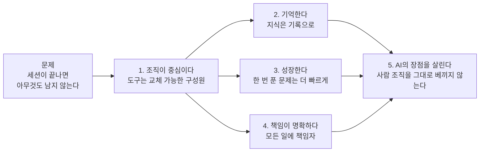
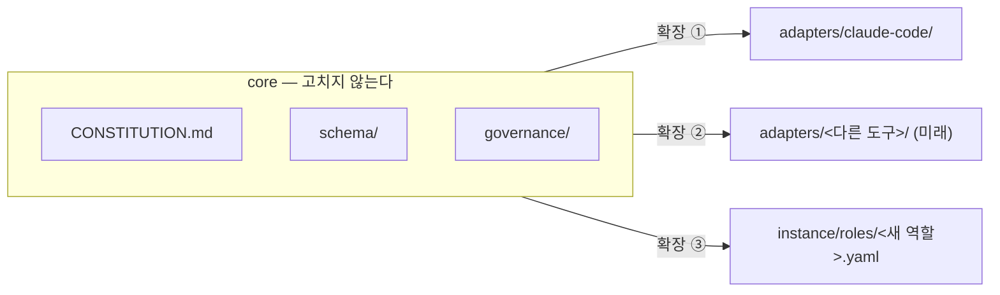
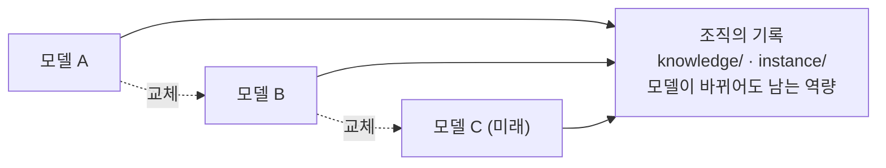
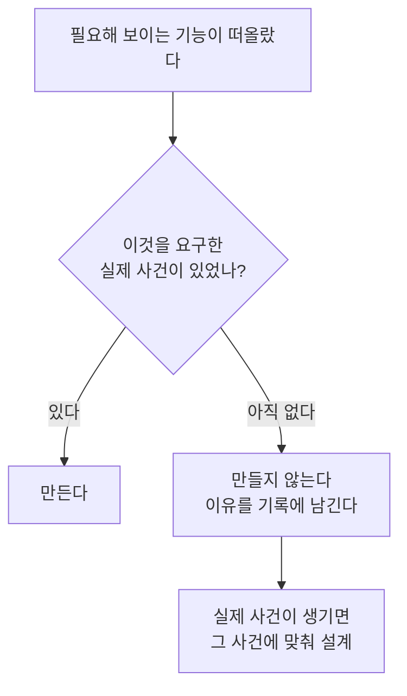

# 3. 원칙

::: lead
원칙과 경계는 먼저 정하고 기능은 열어 둔다. 중심축은 SRP와 OCP이고, 나머지 원칙은 의도한 것과 자연스럽게 맞아떨어진 것을 나눠 적는다.
:::

## 설계 자세 {#stance}

"원칙과 경계는 먼저 정하고, 기능은 열어 둔다." 일찍 정하는 것은 원칙, 책임의 경계, 아키텍처상의 위험과 요구사항의
위험이다. 열어 두는 것은 세부 기능의 구현이다. aise-core는 시작은 있지만 끝을 알 수 없는 프로젝트이고, 회사를 모델로
삼은 뒤로는 회사가 문을 닫기 전까지 유지보수되고 발전해야 하는 소프트웨어가 됐다.

::: point 자세히 — "90% 정한다"와 "많이 열어 둔다" (배경 · 문제 · 해결 방법)
**배경.** 운영자는 원칙과 가치, 설계를 거의 90% 정하고 진행하는 아키텍트로 일해 왔다. 설계 초반에 아키텍처 위험과
요구사항 위험을 먼저 뽑아 설계안을 만든다.

**문제.** 소프트웨어는 시작만 주어지고 끝은 주어지지 않는 경우가 많았다. 많은 경우 나중에 기능 확장을 요구받았다.
"90% 정한다"와 "많이 열어 둔다"는 서로 부딪쳐 보인다.

**해결 방법.** 정하는 것은 원칙이고 열어 두는 것은 세부 기능이다. 설계 원칙이 무너지지 않고 책임 경계를 벗어나지 않는
한 확장할 수 있게 설계한다. 이것은 경험에서 나온 방식이다.

<Cite ids="op-stance" />
:::

## 헌법의 다섯 원칙 {#five}

헌법(`CONSTITUTION.md`) §2의 다섯 원칙은 "세션이 끝나면 AI는 조직에 남지 않는다"는 문제에서 갈라져 나온다.

<figure>

<figcaption>그림 3-1. 다섯 원칙의 흐름. 조직을 만들기로 하면(1), 조직이라 부를 조건(2–4)이 따라오고, 그것을 사람 흉내로 하지 않으려는 방향(5)이 붙는다.</figcaption>
</figure>

| 원칙 | 뜻 | 구조로 나타난 곳 |
|---|---|---|
| 1. 조직이 중심이다 | AI 도구는 언제든 바뀔 수 있는 구성원이다. 바뀌지 않아야 하는 것은 조직의 철학과 운영 방식이다 | 어댑터 분리([5장](/story/how-it-is-kept#layers), [8장](/story/distribution)) |
| 2. 조직은 기억한다 | 반복해서 쓰는 지식과 경험은 지식 자산으로 남긴다 | 부서 기록과 핸드오프([6장](/story/operation#records)) |
| 3. 조직은 성장한다 | 한 번 푼 문제는 다음에 더 빠르고 정확하게 푼다 | 회고와 포트폴리오([9장](/story/growth-and-limits#growth)) |
| 4. 책임이 명확하다 | 모든 일에 책임자가 있다. 협업은 자유롭되 책임은 흐려지지 않는다 | 라인과 참모, 두 종류의 책임([4장](/story/structure#staff)) |
| 5. AI의 장점을 살린다 | 사람 조직의 장점은 지키고, 사람의 제약은 없앤다 | [이 장의 "AI라서 다르게 한 것"](#ai-native) |

::: point 자세히 — "책임자"의 뜻
AI 에이전트는 법적 책임이나 최종 책임의 주체가 될 수 없다. 여기서 "책임자"는 감사 추적의 라벨이다. 산출물에 문제가 생기면
어떤 역할이 검토했어야 했는지를 되짚는 표시다. 최종 책임은 조직을 운영하는 사람에게 있다.

<Cite ids="constitution-accountability" />
:::

<Cite ids="constitution-philosophy" />

## 두 개의 중심축: SRP와 OCP {#axes}

SOLID 원칙이 모두 중요하지만, aise-core에서는 SRP와 OCP가 중심축이다. 둘 다 운영자가 여러 사람과 함께 설계하고 개발하면서
가장 직접 맞닥뜨린 문제였다. 일반 법칙이 아니라 경험에서 나온 판단이다.

<Cite ids="op-solid" />

## SRP: 책임은 하나씩 {#srp}

누가 무엇을 맡는지가 섞이지 않게 한다. 업무참모는 일, 인사참모는 사람(역할), 자산참모는 도구, 경영참모는 조직 자체의
개선을 맡고, PM은 부서 안의 일만 맡는다. 기록마다 쓰는 주체가 하나이고, 도구가 그 경계를 막는다. 인사참모를 따로 둔
것도 사람 관리에 SRP를 적용한 결과다([4장](/story/structure#staff)).

::: point 자세히 — SRP를 지키려고 한 리팩토링 (배경 · 문제 · 해결 방법)
**배경.** 규칙 문서, 스키마, 어댑터, 참모 문서가 늘어나면서 같은 책임이 여러 곳에 흩어졌다.

**문제.** 2026-09-30에 저장소 전체를 대상으로 한 중복 감사에서, 책임과 출처가 하나로 모이지 않아 생긴 결함이 드러났다
(아래 [SSOT](#ssot)).

**해결 방법.** 2026-10-01에 규칙 문서·스키마·어댑터를 다시 쓰고 참모 문서를 공통 형식으로 맞췄다. 결정 기록 124개 파일은
주제별 30개 파일로 옮겼다. 참모의 파일은 한 폴더로 모았고, 기록을 쓰는 주체가 자기 단위를 직접 커밋하게 바꿨다.

<Cite ids="ssot-audit,refactor-commits" />
:::

## OCP: 확장에는 열고 변경에는 닫는다 {#ocp}

끝을 알 수 없는 프로젝트라서 OCP를 가장 중요한 설계 원칙으로 삼았다. 열어 둔 것은 새 도구(승인 목록에 추가), 새
역할(채용), 새 도구 환경(어댑터)이다. 닫아 둔 것은 거버넌스와 책임 경계다.

<figure>

<figcaption>그림 3-2. core와 확장 지점. 새 도구는 어댑터를 하나 더하고, 새 역할은 역할 파일을 하나 더한다. core는 고치지 않는다.</figcaption>
</figure>

OCP를 적용한 대상은 둘이다. 조직의 발전과 사람의 발전이다. 조직은 새 도구에 열려 있되 거버넌스는 강하게 적용하고, 프로젝트가
끝날 때마다 얻은 인사이트를 Meta 모드에서 조직의 기능으로 키운다. 사람의 발전이 실제로 어떻게 모델링됐는지는
[9장](/story/growth-and-limits#growth)에 있다.

::: point 자세히 — 공통 모듈은 세 번째 반복에서 뽑는다
같은 모양의 코드가 두 번 반복될 때는 공통 모듈을 미리 만들지 않았다. 세 번째로 같은 모양이 나왔을 때 뽑았다. 확장은
자유롭게 하되, 구조를 성급하게 미리 깔지 않는다. 같은 사례가 [5장](/story/how-it-is-kept#hooks)에 있다.

<Cite ids="hooks-reorg" />
:::

<Cite ids="constitution-ocp,op-ocp" />

## 나머지 SOLID {#solid}

나머지 원칙은 의도해서 적용한 것과 결과적으로 맞아떨어진 것을 나눠 적는다.

| 원칙 | 적용 | aise-core에서 | 근거의 강도 |
|---|---|---|---|
| I — 인터페이스 분리 | 의도함 | 각 역할은 자기에게 필요한 도구만 받는다. 역할 정의마다 `provisioning` 목록이 있고(예: backend-engineer는 일곱 가지), 도구마다 사용 조건이 붙는다 | 중간–강함 |
| D — 의존성 역전 | 의도함 | 규칙은 도구의 어휘 없이 쓴 추상(어댑터 요구사항 목록)에 두고, 도구마다의 어댑터가 그것을 구현한다. 운영자가 도구를 바꿔 쓰는 상황에 대처하라고 거듭 지시했다 | 구조로는 강함. 어댑터는 아직 하나 |
| L — 리스코프 치환 | 결과적으로 맞음 | 어댑터가 요구사항을 만족하는지 기계적으로 점검하므로, 요구사항을 만족하는 어댑터는 다른 어댑터를 대신할 수 있다. 구현이 하나뿐이라 실제로 바꿔 끼워 본 적은 없다 | 약함–중간 |

<Cite ids="op-solid,role-provisioning,adapter-requirements" />

::: point 자세히 — 역할 템플릿은 템플릿 메서드 패턴이다 {#template}
공통 기본(부서원의 기본 템플릿, PM의 템플릿)이 뼈대와 공통 규칙을 정하고, 역할마다의 정의가 그 위에서 달라지는 부분을
채운다. 추상 기반과 구체 정의의 관계다.

원래 계획은 기본 속성을 추상 템플릿에 두고 도메인 지식을 전략으로 만드는 것이었다. 설계는 다른 쪽으로 갔다. 역할
정의에는 특정 부서의 도메인 배경을 넣지 않는다. 역할이 어떤 부서에 처음 합류할 때 인사참모가 그 부서에 맞는 도메인
프로필을 조사해 그 부서의 기록에 남긴다. 바꿔 끼우는 전략이라기보다 부서마다 맥락을 주입하는 쪽에 가깝다.

<Cite ids="op-template,member-template" />
:::

## SSOT: 사실은 한 곳에 {#ssot}

같은 내용이 여러 곳에 있다가 서로 어긋나는 일을 없앤다. 이미 적힌 사실은 다시 쓰지 않고 인용한다. 프로그램이 지키는
값은 기계가 읽는 목록 한 곳에 둔다([5장](/story/how-it-is-kept#governance)).

::: point 자세히 — 중복 감사가 찾은 기능 결함 (배경 · 문제 · 해결 방법)
**배경.** 2026-09-30에 저장소 전체를 일곱 갈래로 나눠 읽는 중복 감사를 했다.

**문제.** 약 250건이 나왔다. 중복을 합치니 실제로 강제가 잘못 동작하던 기능 결함 12건, 운영자 결정이 필요한 사안 약
20건, 낡은 서술이나 끊어진 참조 같은 분명한 수정 약 140건이 남았다. 정리가 아니라 결함이었다.

**해결 방법.** 결함을 고치고, 결정 기록을 주제별 파일로 옮기고, 같은 값을 다시 적지 않는 규칙을 거버넌스에 두었다.

<Cite ids="ssot-audit,duplication-policy" />
:::

## 레이어드 아키텍처 {#layered}

수직 계층은 레이어드 아키텍처를 모델로 삼았다. 조직을 모델링했기 때문만이 아니라, 관심사를 분리하고 유지보수성과 가독성을
얻으려는 선택이다.

| 레이어드 아키텍처 | aise-core |
|---|---|
| 인접한 계층하고만 통신 | 운영자 ↔ 참모 ↔ PM ↔ 부서원. 건너뛰지 않는다 |
| 상위는 하위의 내부를 모르고 인터페이스만 안다 | PM이 부서의 유일한 창구 |
| 계층 수 제한 | 실행 책임의 줄은 두 단계까지 |
| 위로 갈수록 넓은 관심사 | 부서 → 부서 사이 → 조직 전체 |

이름도 조직의 말로 붙였다(참모, 부서, PM, 채용, 해고). 처음 보는 사람도 구조를 짐작하기 쉽게 하려는 설계 의도다. 사용자
조사로 확인한 결과는 아니다. 이 사이트는 그래서 aise-core의 실제 이름 옆에 쉬운 말을 함께 적는다([용어집](/glossary)).

<Cite ids="op-layered,constitution-depth" />

## AI라서 다르게 한 것 {#ai-native}

사람 조직의 원칙을 따르는 것과 사람 조직의 한계까지 물려받는 것은 다르다. 헌법 §7은 아래 능력을 제한하지 않고 적극적으로
쓴다고 정한다.

- **병렬 협업.** 여러 역할이 동시에 다른 일을 처리한다.
- **동적 조직 구성.** 필요한 순간에 팀이 만들어지고, 필요 없어지면 흩어진다.
- **서브에이전트 활용.** 큰 일을 쪼개 위임하고, 끝나면 결과만 거둔다.
- **실시간 지식 공유.** 한 역할이 알아낸 것을 다른 역할이 바로 참고한다.
- **지속적인 조직 학습.** 회고가 포트폴리오와 템플릿으로 이어진다.
- **조직 기억의 영속성.** 세션이 끝나도 부서 기록이 남는다.
- **AI 도구 독립성.** 특정 모델이나 도구에 조직의 정체성을 걸지 않는다.

<figure>

<figcaption>그림 3-3. 모델 교체와 남는 역량. 모델은 바뀌어도 조직의 기록에 쌓인 결정과 경험은 남는다.</figcaption>
</figure>

<Cite ids="constitution-ai,constitution-goal" />

::: point 자세히 — 모델은 지급하는 자산이 아니다 (배경 · 문제 · 해결 방법) {#model}
**배경.** 처음에는 자산참모가 지급하는 자산으로 "도구·MCP·모델·스킬" 네 가지를 나열했다.

**문제.** 실행 중인 세션이 자기 모델을 바꿀 수 있는 수단이 있는지 시험해 보니 없었다. 모델 선택은 도구 자신의 설정에서
일어나는 일이라, aise-core 안의 누구도 결정하고 실행할 수 없었다. 가장 가까운 능력은 새로 만드는 서브에이전트에게 모델을
지정하는 것뿐이었다.

**해결 방법.** 모델을 지급 목록에서 뺐다. 대신 위임하는 쪽(업무참모 → PM, PM → 부서원)이 위임할 때 모델 등급을 고르는
것을 관리 행위로 정했다. 등급은 둘이다. 기본 등급은 위임하는 쪽의 모델을 물려받고, 상향 등급은 세션 모델보다 한 단계
위의 계열이다. PM은 계획과 프로젝트 관리를 위해 상향 등급으로 실행될 수 있지만, 부서원은 단위 작업을 하므로 기본 등급을
넘지 않는다. 처음에는 등급을 특정 모델 이름에 고정했다가, 쓸 수 있는 모델이 바뀌자 세션 모델을 기준으로 정하는 방식으로
바꿨다.

<Cite ids="model-not-asset,model-tiers" />
:::

## 일반적인 방식과 다른 점 {#different}

같은 원칙에서 출발해도, 무엇을 만들지 않기로 했는지에서 흔한 방식과 갈린다. 아래 일곱 축의 비교 대상은 지어낸 것이 아니라
aise-core가 그 결정을 내리면서 결정 기록에 직접 적어 둔 비교다.

| 축 | 흔한 방식 | aise-core |
|---|---|---|
| 1. 조직의 기억 | 사람의 머리, 흩어진 대화 기록, 도구의 개인 메모리 | 저장소에 커밋된 파일. 저장소만으로 재구성되지 않으면 잘못된 자리 |
| 2. 조직도를 그리는 때 | 도메인을 정하고 역할을 미리 설계해 자리를 채운다 | 빈 채로 시작. 실제 일이 빈자리를 드러낼 때만 채용 |
| 3. 구성원의 정체성 | 사람 한 명이 자리 하나를 차지한다 | 역할은 클래스. 부서에 묶이지 않고 여러 곳에서 동시에 쓴다 |
| 4. 경험이 쌓이는 곳 | 개인이 숙련된다 | 조직에 쌓는다. 개인 숙련 장치는 두 번 검토하고 두 번 보류 |
| 5. 보고선 | 급한 일은 담당자에게 직접 | 예외 없이 참모를 거친다 |
| 6. 권한 | 세분화된 접근 제어 표 | 거친 단위의 승인과 판단. 강한 경계는 OS·인프라 층 |
| 7. 세션을 잇는 법 | 진행 중인 컨텍스트를 그대로 물려준다 | 물려주지 않는다. 매번 기록에서 다시 도출한다 |

일곱 축 가운데 넷(2, 4, 6, 7)은 무언가를 만들지 않기로 한 결정이다. 필요해 보이는 기능이 떠올라도, 그것을 요구한 실제
사건이 없으면 만들지 않고 이유를 남긴다.

<figure>

<figcaption>그림 3-4. 기능이 떠올랐을 때의 판단. 각 축의 사례는 4장(빈 조직도, 클래스), 5장(권한), 6장(매번 새로 시작), 9장(개인 숙련)에 있다.</figcaption>
</figure>

<Cite ids="constitution-why,memory-local,recruit-on-demand,role-class,role-proficiency,line-staff,grant-scope,folder-access,stateless-pm" />

<SourceTable />

**다음으로.** → [4. 구조](/story/structure)
