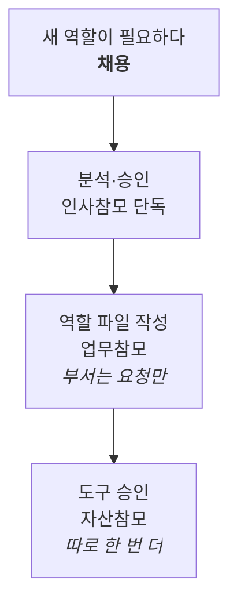
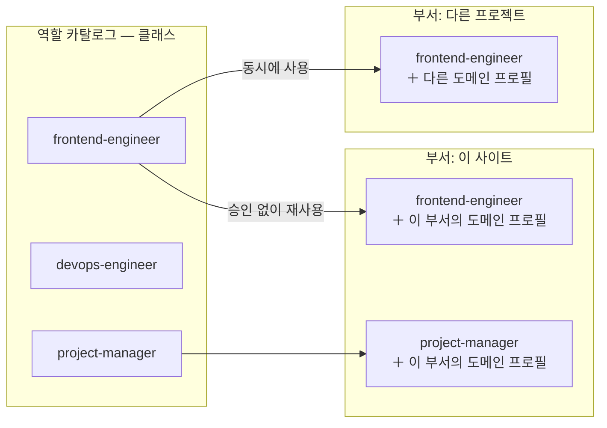

# 4. 구조

::: lead
실행 책임의 줄은 운영자 — 부서 — 부서원의 두 단계이고, 참모는 그 줄 밖에서 각자 한 가지 질문만 맡는다. 역할은 클래스, 부서는 프로젝트 하나, 조직의 모양과 지금의 구성은 따로 관리한다.
:::

## 조직도와 실행 그래프 {#chart}

그림을 두 장으로 나눈다. **조직도**는 역할, 책임, 권한, 보고선을 정하는 고정된 책임 구조다. 누가 누구에게 책임지는지만
정하고, 실제로 어떻게 협업할지는 정하지 않는다. **실행 그래프**는 일을 처리하면서 그때그때 만들어지는 협업 구조다. 병렬
작업, 임시 서브에이전트, 부서를 넘나드는 협업이 여기서 일어난다.

<figure>
<svg viewBox="0 0 640 380" role="img" aria-label="운영자 아래 부서 A와 부서 B가 있고 각 부서 아래 부서원 두 명씩이 있는 깊이 2의 조직도(실선), 그 위에 서로 다른 부서 부서원 사이의 협업과 임시 서브에이전트로 이뤄진 실행 그래프(점선)가 겹쳐 있다">
  <defs>
    <marker id="st-arrow" viewBox="0 0 10 10" refX="8" refY="5" markerWidth="6" markerHeight="6" orient="auto-start-reverse">
      <path d="M 0 0 L 10 5 L 0 10 z" fill="currentColor" />
    </marker>
  </defs>
  <circle cx="320" cy="30" r="14" fill="none" stroke="currentColor" stroke-width="1.5" />
  <text x="320" y="62" text-anchor="middle" font-size="12" font-weight="600">운영자</text>
  <line x1="320" y1="68" x2="320" y2="78" stroke="currentColor" stroke-width="1.5" />
  <line x1="320" y1="78" x2="172" y2="94" stroke="currentColor" stroke-width="1.5" marker-end="url(#st-arrow)" />
  <line x1="320" y1="78" x2="468" y2="94" stroke="currentColor" stroke-width="1.5" marker-end="url(#st-arrow)" />
  <rect x="100" y="95" width="140" height="40" rx="6" fill="none" stroke="currentColor" stroke-width="1.5" />
  <text x="170" y="120" text-anchor="middle" font-size="12">부서 A — PM</text>
  <rect x="400" y="95" width="140" height="40" rx="6" fill="none" stroke="currentColor" stroke-width="1.5" />
  <text x="470" y="120" text-anchor="middle" font-size="12">부서 B — PM</text>
  <line x1="170" y1="135" x2="112" y2="173" stroke="currentColor" stroke-width="1.5" marker-end="url(#st-arrow)" />
  <line x1="170" y1="135" x2="228" y2="173" stroke="currentColor" stroke-width="1.5" marker-end="url(#st-arrow)" />
  <line x1="470" y1="135" x2="412" y2="173" stroke="currentColor" stroke-width="1.5" marker-end="url(#st-arrow)" />
  <line x1="470" y1="135" x2="528" y2="173" stroke="currentColor" stroke-width="1.5" marker-end="url(#st-arrow)" />
  <rect x="60" y="175" width="100" height="40" rx="6" fill="none" stroke="currentColor" stroke-width="1.5" />
  <text x="110" y="200" text-anchor="middle" font-size="11">부서원 A1</text>
  <rect x="180" y="175" width="100" height="40" rx="6" fill="none" stroke="currentColor" stroke-width="1.5" />
  <text x="230" y="200" text-anchor="middle" font-size="11">부서원 A2</text>
  <rect x="360" y="175" width="100" height="40" rx="6" fill="none" stroke="currentColor" stroke-width="1.5" />
  <text x="410" y="200" text-anchor="middle" font-size="11">부서원 B1</text>
  <rect x="480" y="175" width="100" height="40" rx="6" fill="none" stroke="currentColor" stroke-width="1.5" />
  <text x="530" y="200" text-anchor="middle" font-size="11">부서원 B2</text>
  <path d="M 280 195 C 320 235, 320 235, 360 195" fill="none" stroke="#c1652a" stroke-width="1.5" stroke-dasharray="4 4" marker-end="url(#st-arrow)" />
  <text x="320" y="248" text-anchor="middle" font-size="10" fill="#c1652a">부서를 넘는 협업</text>
  <line x1="110" y1="215" x2="110" y2="250" stroke="#c1652a" stroke-width="1.5" stroke-dasharray="4 4" marker-end="url(#st-arrow)" />
  <rect x="40" y="250" width="140" height="40" rx="6" fill="none" stroke="#c1652a" stroke-width="1.5" stroke-dasharray="4 4" />
  <text x="110" y="275" text-anchor="middle" font-size="11" fill="#c1652a">서브에이전트(임시)</text>
  <text x="320" y="335" text-anchor="middle" font-size="11" opacity="0.7">실선 = 조직도(고정된 책임 구조)</text>
  <text x="320" y="353" text-anchor="middle" font-size="11" fill="#c1652a">점선 = 실행 그래프(그때그때 조립되는 협업)</text>
</svg>
<figcaption>그림 4-1. 조직도와 실행 그래프. 깊이 2의 조직도(실선) 위에, 일에 따라 실행 그래프(점선)가 겹친다. 실제 실행 그래프 하나는 7장에 있다.</figcaption>
</figure>

<Cite ids="constitution-chart" />

## 깊이 2 {#depth}

실행 책임을 지는 라인 조직은 두 단계를 넘지 않는다. 운영자 — 부서 — 부서원이다. 운영자 한 사람이 조직 전체를 한눈에 보고
판단할 수 있어야 하기 때문이다. 깊어질수록 사람이 검토할 층이 늘어난다.

부서는 PM과 부서원으로 이뤄진다. PM은 부서원 각자의 역할과 책임과 역량을 알고, 큰 일을 부서원이 감당할 크기로 나눠 맡긴다.
부서원은 한 분야의 단일 책임을 가진 전문가다.

<Cite ids="constitution-depth" />

## 라인과 참모 {#staff}

운영자와 PM 사이에 참모가 있다. 참모는 실행 책임을 지지 않고, 깊이에 세지 않는다. 실제 회사에서 참모 조직이나 비서실이
위계의 깊이에 들어가지 않는 것과 같다. 참모 셋은 동급이고, 서로 보고하지 않는다.

| 참모 | 맡는 질문 | 하는 일 |
|---|---|---|
| 업무참모 | 무슨 일이 일어나는가 | 운영자의 의도를 실행할 수 있는 일로 바꾸고, 부서를 꾸리고, 부서 사이를 조율한다 |
| 인사참모 | 누가 존재하는가 | 역할 카탈로그를 전담한다. 채용, 정의 변경, 해고 |
| 자산참모 | 무엇을 쓸 수 있는가 | 역할이 쓸 수 있는 도구·MCP·스킬의 승인(provisioning)을 전담한다 |

Meta 모드에는 경영참모가 따로 있다. 조직 자체(헌법, 스키마, 거버넌스)의 진화를 분석하고 제안하며, 조직의 자기 진단(감사)을
맡는다. Operator 모드의 일에는 관여하지 않고, 실제 변경은 운영자의 확인을 거친다.

<figure>
<svg viewBox="0 0 640 300" role="img" aria-label="왼쪽은 운영자 아래 부서와 부서원으로 이어지는 깊이 2의 라인 조직. 오른쪽 위는 깊이에 세지 않는 업무참모, 인사참모, 자산참모 세 명의 동급 참모. 오른쪽 아래는 Meta 모드에서만 활동하는 경영참모">
  <defs>
    <marker id="st-arrow2" viewBox="0 0 10 10" refX="8" refY="5" markerWidth="6" markerHeight="6" orient="auto-start-reverse">
      <path d="M 0 0 L 10 5 L 0 10 z" fill="currentColor" />
    </marker>
  </defs>
  <text x="160" y="18" text-anchor="middle" font-size="12" font-weight="600">라인(깊이 2)</text>
  <circle cx="160" cy="34" r="12" fill="none" stroke="currentColor" stroke-width="1.5" />
  <text x="160" y="65" text-anchor="middle" font-size="11">운영자</text>
  <line x1="160" y1="70" x2="160" y2="83" stroke="currentColor" stroke-width="1.5" marker-end="url(#st-arrow2)" />
  <rect x="100" y="85" width="120" height="40" rx="6" fill="none" stroke="currentColor" stroke-width="1.5" />
  <text x="160" y="110" text-anchor="middle" font-size="12">부서(PM)</text>
  <line x1="160" y1="125" x2="160" y2="158" stroke="currentColor" stroke-width="1.5" marker-end="url(#st-arrow2)" />
  <rect x="100" y="158" width="120" height="40" rx="6" fill="none" stroke="currentColor" stroke-width="1.5" />
  <text x="160" y="183" text-anchor="middle" font-size="12">부서원</text>
  <text x="495" y="18" text-anchor="middle" font-size="12" font-weight="600">참모 — 깊이 밖</text>
  <rect x="392" y="65" width="86" height="40" rx="6" fill="none" stroke="currentColor" stroke-width="1.5" />
  <text x="435" y="90" text-anchor="middle" font-size="11">업무참모</text>
  <rect x="486" y="65" width="86" height="40" rx="6" fill="none" stroke="currentColor" stroke-width="1.5" />
  <text x="529" y="90" text-anchor="middle" font-size="11">인사참모</text>
  <rect x="580" y="65" width="52" height="40" rx="6" fill="none" stroke="currentColor" stroke-width="1.5" />
  <text x="606" y="90" text-anchor="middle" font-size="10">자산<tspan x="606" dy="11">참모</tspan></text>
  <line x1="478" y1="85" x2="486" y2="85" stroke="currentColor" stroke-width="1.5" stroke-dasharray="2 3" />
  <line x1="572" y1="85" x2="580" y2="85" stroke="currentColor" stroke-width="1.5" stroke-dasharray="2 3" />
  <text x="512" y="122" text-anchor="middle" font-size="10" opacity="0.7">동급 · 실행 책임 없음 · 서로 보고하지 않음</text>
  <path d="M 435 105 C 400 135, 260 130, 222 108" fill="none" stroke="#c1652a" stroke-width="1.5" stroke-dasharray="4 4" marker-end="url(#st-arrow2)" />
  <text x="330" y="150" text-anchor="middle" font-size="10" fill="#c1652a">부서를 꾸리고 지시</text>
  <rect x="452" y="200" width="178" height="52" rx="6" fill="none" stroke="#c1652a" stroke-width="1.5" stroke-dasharray="4 4" />
  <text x="541" y="221" text-anchor="middle" font-size="11" fill="#c1652a">경영참모</text>
  <text x="541" y="238" text-anchor="middle" font-size="9" fill="#c1652a">Meta 모드 전용 · 깊이 밖</text>
</svg>
<figcaption>그림 4-2. 라인과 참모. 왼쪽은 실행 책임을 지는 깊이 2의 라인, 오른쪽 위는 깊이 밖의 동급 참모 셋, 오른쪽 아래는 Meta 모드에서만 일하는 경영참모.</figcaption>
</figure>

책임도 두 종류로 나눈다. **실행 책임**은 부서(PM과 부서원)가 진다. 결과물의 기술적 정확성에 대한 책임이다. **운영 책임**은
참모가 각자 영역에서 진다. 업무참모는 맞는 부서를 골랐는지, 병목을 잡았는지, 보고가 정확한지를, 인사참모는 채용·정의
변경·해고 판단이 옳았는지를, 자산참모는 도구 승인이 조직의 실제 제약에 맞는지를 책임진다. 둘을 섞으면 문제가 생겼을 때
"누구 책임인가"가 다시 흐려진다. 참모가 부서보다 윗사람인 것은 아니다. 위아래가 아니라 다른 종류의 책임이다.

<Cite ids="constitution-staff,constitution-two-accountability,constitution-mg" />

::: point 자세히 — 참모가 셋이 된 이유 (배경 · 문제 · 해결 방법) {#three-staff}
**배경.** 처음에는 참모가 하나였다. 그 하나가 일을 배분하고, 역할을 만들고, 도구 권한도 정했다. 운영자는 회사의 리더처럼
관리하고 감독하는 자리로 자신을 모델링했고, 채용과 해고 같은 조직의 변화까지 담아야 한다고 봤다.

**문제.** 참모 하나가 조직 구성을 마음대로 바꿀 수 있으면 곤란하다. 그렇다고 채용할 때마다 운영자가 승인하면 승인 피로가
온다. 채용과 그 밖의 변경을 파일 변경 내역으로 자동 구분하려 했지만, 파일을 새로 만들고 옛 파일을 지우거나 이름만 바꾸는
식으로 계속 빠져나갔다. "이 작업에 추가 확인이 필요한가"는 경로 매칭으로 풀 수 없는 의미의 판단이었다. 도구도 같은 문제가
있었다. 역할이 실제로 쓸 수단(도구·MCP·스킬)은 회사가 노트북을 지급하는 것처럼 개인이 아니라 조직에 속한다. 이것을 평범한
부서에 맡기면 "그 부서 자신의 도구는 누가 승인하나"라는 순환이 생긴다.

**해결 방법.** 탐지 대신 구조로 풀었다.

- 사람 관리는 일의 책임과 다르다(SRP). 그래서 인사참모를 따로 두고 역할 카탈로그를 전담하게 했다. 채용은 분석·승인(인사참모)과
  실행(업무참모가 역할 파일 작성)을 나눴다. 부서는 새 역할을 요청할 수만 있다.
- 기업이 영향이 큰 도구를 들일 때 심사와 승인을 거친다는 점에서 자산참모를 두었다. 신입이 기본 규율은 인사팀에서, 쓸 도구는
  자산팀에서 받는 것과 같다. 순환을 끊으려고 채용되는 부서가 아니라 헌법이 정한 참모로 만들었다. 무엇을 승인하는지는
  배포마다 다르므로, 기능은 헌법에, 구체적인 제약은 그 배포의 거버넌스(`ASSET_POLICY.md`)에 둔다.
- 채용 승인이 도구 승인을 뜻하지 않는다. 셋은 서로 독립된 관문이다.

<figure>

<figcaption>그림 4-3. 채용 경로. 채용은 인사참모의 분석·승인과 업무참모의 역할 파일 작성으로 나뉘고, 도구 승인은 자산참모가 따로 한 번 더 한다.</figcaption>
</figure>

<Cite ids="hr-split,as-split,op-hr,op-assets" />
:::

::: point 자세히 — 역할 변경과 해고: "조직개편"을 없앴다 (배경 · 문제 · 해결 방법) {#role-change}
**배경.** 한때 기존 역할 파일을 고치는 일은 모두 운영자 결재가 필요한 "조직개편"으로 다뤘다.

**문제.** 같은 파일에 도구 승인 결과를 적는 일도 있어서 결재 요청이 수정할 때마다 떴다. 더 근본적으로, 조직개편이라는 말은
역할이 부서에 속한다고 가정했다. 역할은 모든 부서가 쓰는 공유 클래스다. 실제로 해가 되는 경우는 다른 부서가 쓰고 있는 역할을
바꾸는 것 하나였다.

**해결 방법.** 조직개편 개념을 없앴다. 채용, 정의 변경, 해고는 모두 인사참모의 권한이고 운영자 결재는 없다. 위험한 경우만
기계적으로 막는다. 역할을 좁히거나 해고하는 것은 요청한 부서 말고는 그 역할을 쓰는 부서가 없을 때만 허용된다. "쓰고 있는가"는
부서 목록 파일의 부서별 `roles:` 목록에서 읽는다. 좁히기인지는 기계가 판정할 수 없으므로, 모든 역할 정의 변경을 업무참모의
보고에 실어 운영자 눈에 보이게 한다.

<Cite ids="reorg-abolished,constitution-role-change" />
:::

## PM은 채용되는 역할 {#pm}

PM은 네 번째 참모가 아니라 카탈로그에서 채용되는 역할이다. 부서가 프로젝트 단위가 되면서 부서장이라는 고정 좌석을 둘 이유가
없어졌다. PM에게는 "이 부서를 대표하는 유일한 창구"라는 권한이 있고, 부서원은 PM이 위임할 때만 생긴다. 업무참모가 부서에
닿는 경로는 PM 하나뿐이다.

::: point 자세히 — 건너뛰기를 구조로 막는다 (배경 · 문제 · 해결 방법)
**배경.** 업무참모가 PM을 건너뛰고 부서원에게 직접 일을 시키는 문제를 막아야 했다.

**문제.** 처음에는 부서원 파일을 부서장 폴더 아래에 넣는 디렉터리 구조로 막으려 했다. 대상의 이름을 이미 아는 쪽에게는
그대로 뚫렸다.

**해결 방법.** 역할의 성질로 풀었다. PM을 부서의 유일한 창구로 정하고, 부서원은 PM의 실행 범위 안에서만 생기게 했다.
업무참모가 부서에 닿는 경로가 PM 하나뿐이므로 건너뛰기가 일어날 길이 없다. 적어 둔 예의가 아니라 구조적 보장이다.

<Cite ids="pm-recruited" />
:::

## 역할은 클래스 {#roles}

역할 파일 하나는 클래스다. 부서 소속도, 쉬면서 기억하는 개체도 없다. 같은 클래스를 여러 부서가 동시에 쓰고, 부서마다 다른
점은 역할이 그 부서에 처음 합류할 때 인사참모가 붙이는 도메인 프로필이다. 이미 채용된 클래스를 새 부서가 쓰는 데는 승인이
필요 없다.

<figure>

<figcaption>그림 4-4. 역할 카탈로그. 같은 클래스가 두 부서에 동시에 놓여도 서로 간섭하지 않는다. 차이는 부서에 합류할 때 붙는 도메인 프로필이 만든다.</figcaption>
</figure>

::: point 자세히 — 인스턴스 대신 클래스 (배경 · 문제 · 해결 방법)
**배경.** 같은 역할이 여러 부서에 동시에 필요했다. 처음 떠오른 그림은 사람 조직 그대로였다. 역할 타입(클래스)과, 부서에
배속돼 경험을 쌓으며 옮겨 다니는 개체(인스턴스)를 나누는 "인재 풀"이다.

**문제.** 실제 실행 방식에 대 보니 맞지 않았다. 서브에이전트 호출은 매번 클래스 정의를 새로 실행하는 것이고, 배정과 배정
사이에 기억을 유지하는 개체는 없다. 인스턴스를 흉내 내려면 대기·배정 상태 같은 장부를 새로 발명해야 했다.

**해결 방법.** 클래스만 남겼다. 역할 파일에서 부서 소속을 나타내던 필드를 지웠다. 경험은 개체가 아니라 조직의 회고와
포트폴리오에 쌓는다([9장](/story/growth-and-limits#growth)). 아무것도 "대여 중"이 되지 않으니 동시성 문제도 사라졌다.

<Cite ids="role-class" />
:::

::: point 자세히 — 빈 조직도로 시작 (배경 · 문제 · 해결 방법)
**배경.** 시작하려면 출발 조직도가 있어야 할 것 같았다. 그런데 운영자의 실제 업무 범위는 임베디드 소프트웨어부터 일반
소프트웨어 공학, CI/CD와 서비스 개발까지 넓었다.

**문제.** 어느 한 도메인을 골라 조직도를 그리면, 그 선택이 틀렸을 때 운영자가 나중에 전부 되돌려야 한다. 추측에 맞춘 구조다.

**해결 방법.** 역할 목록을 비운 채 시작했다. 역할은 실제 일이 조직에 없는 역량을 드러낼 때만 생긴다. 지금의 역할 다섯 개가
모두 그렇게 생겼다. 채용 절차가 도표가 아니라 실제로 쓰이는 기능이 됐다.

<Cite ids="recruit-on-demand,constitution-recruitment" />
:::

## 부서 하나는 프로젝트 하나 {#departments}

프로젝트마다 부서를 하나씩 둔다. 프로젝트는 종류도 성격도 다양해서 서로 독립돼야 한다. 프로젝트 안의 일은 PM이, 프로젝트
사이의 조율은 업무참모가 맡고, 위로 갈수록 더 넓게 본다. 부서는 `draft → active → ended → closed`의 생애를 가진다.

<figure>
<svg viewBox="0 0 560 130" role="img" aria-label="부서 하나의 생애: draft에서 active, ended를 거쳐 closed로 이어진다. active로 가는 것은 의도가 분명해졌을 때, ended는 운영자의 결정, closed는 회고와 승격 검토 뒤">
  <defs>
    <marker id="st-arrow3" viewBox="0 0 10 10" refX="8" refY="5" markerWidth="6" markerHeight="6" orient="auto-start-reverse">
      <path d="M 0 0 L 10 5 L 0 10 z" fill="currentColor" />
    </marker>
  </defs>
  <rect x="10" y="30" width="110" height="40" rx="6" fill="none" stroke="currentColor" stroke-width="1.5" />
  <text x="65" y="55" text-anchor="middle" font-size="12">draft</text>
  <line x1="120" y1="50" x2="150" y2="50" stroke="currentColor" stroke-width="1.5" marker-end="url(#st-arrow3)" />
  <rect x="150" y="30" width="110" height="40" rx="6" fill="none" stroke="#c1652a" stroke-width="2" />
  <text x="205" y="55" text-anchor="middle" font-size="12" fill="#c1652a">active</text>
  <line x1="260" y1="50" x2="290" y2="50" stroke="currentColor" stroke-width="1.5" marker-end="url(#st-arrow3)" />
  <rect x="290" y="30" width="110" height="40" rx="6" fill="none" stroke="currentColor" stroke-width="1.5" />
  <text x="345" y="55" text-anchor="middle" font-size="12">ended</text>
  <line x1="400" y1="50" x2="430" y2="50" stroke="currentColor" stroke-width="1.5" marker-end="url(#st-arrow3)" />
  <rect x="430" y="30" width="110" height="40" rx="6" fill="none" stroke="currentColor" stroke-width="1.5" />
  <text x="485" y="55" text-anchor="middle" font-size="12">closed</text>
  <text x="65" y="95" text-anchor="middle" font-size="10" opacity="0.8">의도를 다듬는 중</text>
  <text x="205" y="95" text-anchor="middle" font-size="10" opacity="0.8">위임과 실행</text>
  <text x="345" y="95" text-anchor="middle" font-size="10" opacity="0.8">운영자의 종료 결정</text>
  <text x="485" y="95" text-anchor="middle" font-size="10" opacity="0.8">회고 · 승격 검토 뒤</text>
</svg>
<figcaption>그림 4-5. 부서 하나의 생애. 종료는 운영자가 정하고, 회고와 포트폴리오 승격 검토, 인사참모의 역할 검토까지 끝나야 닫힌다.</figcaption>
</figure>

이렇게 책임을 나누면 부서원은 자기 단일 업무만 처리하므로, 불필요하거나 혼란을 줄 수 있는 정보가 전달되지 않는다. PM은
직접 개발하지 않으니 개발의 시행착오를 겪지 않고, 산출물을 조합해 최종 결과물을 만드는 일과 실행 계획에 집중한다. 근거는
결과의 품질이 아니라 책임 분리, 곧 유지보수성과 예측 가능성이다.

<Cite ids="op-department,schema-lifecycle,op-close" />

::: point 자세히 — "부서"라는 말의 뜻이 바뀌었다 (배경 · 문제 · 해결 방법)
**배경.** 처음에 부서는 영속적인 조직 단위였다.

**문제.** 두 가지 마찰이 생겼다. 업무참모가 보고선을 건너뛰고 부서원에게 직접 연락하는 경향, 그리고 부서 하나가 한 번에 일
하나만 처리할 수 있다는 제약이다. 뒤의 것은 AI가 병렬로 일할 수 있다는 원칙과 부딪쳤다. 옛 모델에서 부서를 끝내는 일은 예외적이고
운영자 결재가 필요한 조직개편이었다.

**해결 방법.** 이름과 규칙은 그대로 두고 부서로 존재한다는 것의 뜻만 바꿨다. 부서는 어떤 역할이 실제로 실행돼야 하는 순간
만들어지고, 일이 끝나면 끝난다. 형성과 해산은 일상적인 실행 그래프 조립이다. "부서 두 개를 합친다"는 개념도 사라졌다.

<Cite ids="department-project" />
:::

## 두 모드 {#modes}

운영자는 하루에도 두 역할을 오간다. 조직으로 일하는 **Operator 모드**와 조직 자체를 고치는 **Meta 모드**다. Operator 모드는
조직의 모양을 그대로 두고 그 안의 구성(채용, 역할 변경, 도구 승인)만 바꾼다. Meta 모드는 헌법, 스키마, 거버넌스, 어댑터를
고친다. 세션마다 모드를 먼저 선언하고, 선언 없이 핵심 문서에 쓸 수 있는 기본값은 없다.

<figure>
<svg viewBox="0 0 720 300" role="img" aria-label="왼쪽 Operator 모드: 깊이 2 피라미드의 모양은 그대로 두고 안의 구성원만 바뀐다(새 채용은 구성의 변경). 오른쪽 Meta 모드: 피라미드의 모양 자체가 바뀌며 항상 운영자 확인을 거친다">
  <line x1="360" y1="10" x2="360" y2="290" stroke="currentColor" stroke-width="1" stroke-dasharray="3 5" opacity="0.35" />
  <text x="180" y="24" text-anchor="middle" font-size="13" font-weight="600">Operator 모드</text>
  <path d="M 180 55 L 110 175 L 250 175 Z" fill="none" stroke="currentColor" stroke-width="1.5" />
  <line x1="156.7" y1="95" x2="203.3" y2="95" stroke="currentColor" stroke-width="1" opacity="0.6" />
  <line x1="133.3" y1="135" x2="226.7" y2="135" stroke="currentColor" stroke-width="1" opacity="0.6" />
  <text x="266" y="72" font-size="9" opacity="0.7">운영자</text>
  <text x="266" y="112" font-size="9" opacity="0.7">부서</text>
  <text x="266" y="152" font-size="9" opacity="0.7">부서원</text>
  <circle cx="205" cy="163" r="9" fill="none" stroke="#c1652a" stroke-width="1.5" stroke-dasharray="3 3" />
  <text x="205" y="166" text-anchor="middle" font-size="9" fill="#c1652a">+1</text>
  <text x="180" y="200" text-anchor="middle" font-size="9" fill="#c1652a">새 채용 = 구성의 변경</text>
  <text x="180" y="270" text-anchor="middle" font-size="11" opacity="0.8">모양(스키마)은 그대로,</text>
  <text x="180" y="286" text-anchor="middle" font-size="11" font-weight="600" opacity="0.8">안의 구성만 바뀐다</text>
  <text x="540" y="24" text-anchor="middle" font-size="13" font-weight="600">Meta 모드</text>
  <path d="M 540 55 L 470 175 L 610 175 Z" fill="none" stroke="#c1652a" stroke-width="1.5" stroke-dasharray="5 4" />
  <path d="M 450 175 L 630 175 L 650 215 L 430 215 Z" fill="none" stroke="#c1652a" stroke-width="1.5" stroke-dasharray="5 4" />
  <text x="540" y="235" text-anchor="middle" font-size="9" fill="#c1652a">새 층 = 스키마 자체가 바뀜</text>
  <text x="540" y="270" text-anchor="middle" font-size="11" fill="#c1652a">모양 자체가 바뀐다 —</text>
  <text x="540" y="286" text-anchor="middle" font-size="11" font-weight="600" fill="#c1652a">항상 운영자 확인 뒤</text>
</svg>
<figcaption>그림 4-6. 두 모드. Operator 모드는 조직의 모양을 두고 구성만 바꾸고, Meta 모드는 모양 자체를 바꾼다.</figcaption>
</figure>

Meta 모드도 Operator 모드의 상위 권한은 아니다. Meta 모드는 이 배포의 구성 기록(역할 파일, 부서 기록, 참모 기록)에 쓸 수 없다.
조직의 이식 가능한 모양을 바꾸는 일과 지금 조직의 상태를 바꾸는 일을 서로 섞지 않기 위해서다.

<Cite ids="mode-policy,constitution-schema-instance" />

::: point 자세히 — Meta 모드가 생긴 이유
회사에는 프로젝트로 이익을 내는 축 말고, 최고 경영자가 조직 자체를 발전시키는 경영의 축이 있다. 건물을 사거나, AI 같은 도구를
들이거나, 회사를 합병하는 일이다. 업무참모 한 사람의 역할로는 이것을 담을 수 없었다. 그래서 Meta 모드를 만들었다. 처음에는 Meta
모드를 별도의 역할 없이 쓰다가, 토큰 사용 추적과 조직 진단이 필요해지면서 경영참모를 새로 두었다([7장](/story/verification#tokens)).

<Cite ids="op-meta" />
:::

## 스키마와 인스턴스 {#schema-instance}

aise-core는 조직의 **모양**과 지금 조직의 **구성**을 다른 곳에 둔다. 모양은 `schema/`에 있는 템플릿과 규칙이다. 깊이 2,
라인과 참모, 역할 템플릿, 부서 기록의 양식이 여기 있다. 구성은 `instance/`에 있는 이 배포의 데이터다. 지금 있는 역할, 부서와
그 기록, 참모의 기록, 포트폴리오가 여기 있다. `instance/`는 aise-core와 함께 배포되지 않고, 배포마다 자기 저장소에 둔다.

<figure>
<svg viewBox="0 0 640 330" role="img" aria-label="왼쪽 schema/의 템플릿: PM 템플릿과 부서원 템플릿, 부서 기록 양식, 참모 템플릿, 인스턴스 뼈대. 오른쪽 instance/의 실제 데이터: 역할 파일, 부서별 기록 세 파일, 참모 기록, 포트폴리오와 부서 목록. 화살표는 템플릿이 실제 파일의 모양을 정한다는 뜻이고, 뼈대는 첫 Operator 모드 진입 때 빈 파일로 만들어진다. 왼쪽은 Meta 모드만, 오른쪽은 Operator 모드만 쓴다">
  <defs>
    <marker id="st-arrow4" viewBox="0 0 10 10" refX="8" refY="5" markerWidth="6" markerHeight="6" orient="auto-start-reverse">
      <path d="M 0 0 L 10 5 L 0 10 z" fill="currentColor" />
    </marker>
  </defs>
  <text x="150" y="22" text-anchor="middle" font-size="13" font-weight="600">schema/ — 모양(템플릿)</text>
  <text x="150" y="40" text-anchor="middle" font-size="10" opacity="0.75">aise-core와 함께 배포 · Meta 모드만 씀</text>
  <text x="490" y="22" text-anchor="middle" font-size="13" font-weight="600" fill="#c1652a">instance/ — 구성(실제 데이터)</text>
  <text x="490" y="40" text-anchor="middle" font-size="10" fill="#c1652a">배포마다 따로 · Operator 모드만 씀</text>
  <rect x="20" y="55" width="260" height="44" rx="6" fill="none" stroke="currentColor" stroke-width="1.5" />
  <text x="150" y="82" text-anchor="middle" font-size="12">PM · 부서원 템플릿</text>
  <rect x="360" y="55" width="260" height="44" rx="6" fill="none" stroke="#c1652a" stroke-width="1.5" />
  <text x="490" y="82" text-anchor="middle" font-size="12" fill="#c1652a">역할 파일 roles/&lt;역할&gt;.yaml</text>
  <line x1="280" y1="77" x2="356" y2="77" stroke="currentColor" stroke-width="1.5" marker-end="url(#st-arrow4)" />
  <rect x="20" y="115" width="260" height="44" rx="6" fill="none" stroke="currentColor" stroke-width="1.5" />
  <text x="150" y="142" text-anchor="middle" font-size="12">부서 기록 양식</text>
  <rect x="360" y="115" width="260" height="44" rx="6" fill="none" stroke="#c1652a" stroke-width="1.5" />
  <text x="490" y="135" text-anchor="middle" font-size="12" fill="#c1652a">workspace/&lt;부서&gt;/</text>
  <text x="490" y="151" text-anchor="middle" font-size="10" fill="#c1652a">지시 · 진행 보고 · 프로젝트 기록</text>
  <line x1="280" y1="137" x2="356" y2="137" stroke="currentColor" stroke-width="1.5" marker-end="url(#st-arrow4)" />
  <rect x="20" y="175" width="260" height="44" rx="6" fill="none" stroke="currentColor" stroke-width="1.5" />
  <text x="150" y="202" text-anchor="middle" font-size="12">참모 정의와 템플릿</text>
  <rect x="360" y="175" width="260" height="44" rx="6" fill="none" stroke="#c1652a" stroke-width="1.5" />
  <text x="490" y="202" text-anchor="middle" font-size="12" fill="#c1652a">staff/ 참모의 기록</text>
  <line x1="280" y1="197" x2="356" y2="197" stroke="currentColor" stroke-width="1.5" marker-end="url(#st-arrow4)" />
  <rect x="20" y="235" width="260" height="44" rx="6" fill="none" stroke="currentColor" stroke-width="1.5" stroke-dasharray="5 4" />
  <text x="150" y="262" text-anchor="middle" font-size="12">인스턴스 뼈대</text>
  <rect x="360" y="235" width="260" height="44" rx="6" fill="none" stroke="#c1652a" stroke-width="1.5" />
  <text x="490" y="255" text-anchor="middle" font-size="12" fill="#c1652a">부서 목록 · 포트폴리오</text>
  <text x="490" y="271" text-anchor="middle" font-size="10" fill="#c1652a">처음엔 빈 파일</text>
  <line x1="280" y1="257" x2="356" y2="257" stroke="currentColor" stroke-width="1.5" stroke-dasharray="4 4" marker-end="url(#st-arrow4)" />
  <text x="318" y="300" text-anchor="middle" font-size="10" opacity="0.75">실선 = 템플릿이 모양을 정한다 · 점선 = 첫 Operator 모드 진입 때 빈 파일로 생성</text>
</svg>
<figcaption>그림 4-7. 템플릿(schema/)과 인스턴스(instance/). 왼쪽이 바뀌면 조직이 가질 수 있는 모양이 바뀌고, 오른쪽이 바뀌면 지금의 조직이 바뀐다.</figcaption>
</figure>

새 배포는 빈 조직으로 시작한다. 처음 Operator 모드로 들어갈 때 인스턴스 뼈대가 빈 파일로 만들어지고, 부서와 역할은 실제 일이
생길 때 채워진다. 그래서 배포되는 것은 조직이 아니라 정책과 도구다([8장](/story/distribution)).

<Cite ids="constitution-schema-instance,instance-skeleton,instance-location" />

<SourceTable />

**다음으로.** → [5. 어떻게 유지하나](/story/how-it-is-kept)
