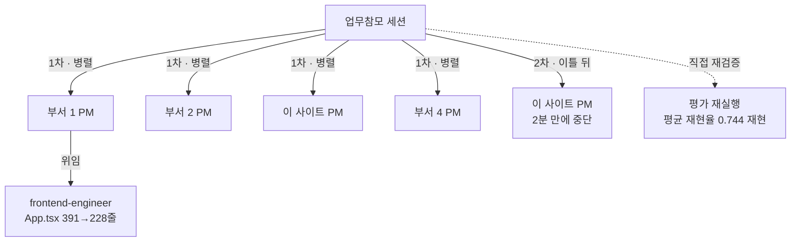

# 7. 검증과 평가

::: lead
보고는 실제 산출물로 다시 확인하고, 화면은 실제 브라우저로 확인한다. 조직 자체는 실제 기록을 근거로 감사하고, 비용은 실행 그래프와 함께 본다.
:::

## 보고는 다시 확인한다 {#reverify}

부서의 "다 됐다"는 확인하기 전까지 믿지 않는다. PM은 부서원의 결과를 실제 커밋과 도구 호출로, 업무참모는 PM의 보고를 실제
산출물로 다시 확인한다. 업무참모의 재검증은 PR을 직접 열고, 점검을 다시 돌리고, 결과 파일의 숫자를 보고와 대조하는 일이다.
확인한 날짜는 그 완료 기준 행의 "Verified" 칸에 들어간다.

그래도 완료 표시가 독립 재검증 없이 붙은 경우가 많아, 그 비율을 줄이는 중이다. 2026-10-26 기준으로 전체 부서의 완료 항목
60개 중 23개(38%)가 독립적으로 재검증됐다. 점수가 아니라 현재 상태다.

<Cite ids="op-reverify,portfolio-report" />

## 화면은 실제 브라우저로 {#real-browser}

화면을 거쳐 쓰는 기능은 단위 시험, 타입 검사, 빌드만으로 완료라고 하지 않는다. 실제 브라우저로 상호작용을 점검하고, 그 스크립트와
스크린샷을 제품 저장소에 남겨야 완료다. 이 기준은 항목의 분류(화면/기능)가 아니라 사용자가 그 기능을 화면으로 쓰는지로 정한다.
이 사이트의 접기, 모두 펼치기, 인쇄 점검도 이 규칙을 따른다.

::: point 자세히 — 54일 동안 동작하지 않은 화면 (배경 · 문제 · 해결 방법)
**배경.** 화면 작업도 단위 시험, 타입 검사, 빌드로 완료를 판정했다.

**문제.** 한 부서의 핵심 편집 기능이 54일 동안 실제 브라우저에서는 한 번도 동작하지 않았다. 그동안 모든 점검이 통과했다. 시험
환경이 화면의 그 부분을 그리지 않았기 때문이다. 운영자가 직접 브라우저로 보다가 발견했다.

**해결 방법.** 화면 작업은 실제 브라우저 점검이 있어야 완료다. 뒤에, 화면으로 쓰는 기능인데 "기능" 항목으로 분류돼 브라우저
점검을 거치지 않은 두 항목이 다른 평가에서 발견됐다. 그래서 기준을 분류가 아니라 쓰는 방식으로 고쳐 썼다.

<Cite ids="round4,pm-run-start,real-browser-by-use" />
:::

## 감사: 실제 기록을 근거로 {#audit}

조직이 자기 규칙대로 동작하는지는 감사로 확인한다. 감사 항목마다 `AUD-N` 번호가 있고, 종류는 넷이다.

| 종류 | 묻는 것 | 언제 | 근거 | 끝나는 때 |
|---|---|---|---|---|
| 회귀 감사 | 핵심 변경이 알려진 동작을 깨뜨렸나 | 그 항목이 지키는 파일이 바뀔 때 | 합성 입력, aise-core만으로 | 지키는 대상이 사라질 때 |
| 규칙 감사 | 운영에서 규칙이 지켜졌나 | 운영자가 요청할 때, 작업 묶음마다 | 실제 기록과 대화 기록 | 끝나지 않는다. 규칙은 단위 시험처럼 유지한다 |
| 확인 감사 | 이것이 문제인가, 이 변경이 효과가 있나 | 운영자가 요청할 때 | 실제 기록과 대화 기록 | 같은 결론이 두 번 나올 때 |
| 부서 평가 | 조직의 모양이 건전한가 | 부서의 단계마다 | 부서의 기록 전체 | 부서가 닫힐 때 최종 판정 |

감사 항목은 실제 사건이나 지금 하려는 변경의 구체적인 위험에서만 만든다. "이것도 문제일 수 있지 않을까" 같은 가정으로는 만들지
않는다. 항목의 정의는 aise-core에 두고, 이 조직을 감사한 결과는 이 배포의 기록에 둔다. 다른 조직이 aise-core를 가져가면 항목은
가져가되 이 조직의 증거는 가져가지 않는다.

<Cite ids="audit-readme,audits-replace" />

::: point 자세히 — 일어나지 않은 일은 판단하지 않는다 (배경 · 문제 · 해결 방법)
**배경.** 두 부서 이상이 동시에 움직일 때, 부서가 닫힐 때처럼 실제 운영에서만 볼 수 있는 문제가 있다.

**문제.** 처음에는 이런 문제를 감시 목록에 올려 두고 조건이 생기기를 기다렸다. 그런데 등록하고, 기다리고, 분석하고, 상태를
바꾸는 고리만 돌았다. 19건 가운데 15건이 운영 감시였고, 핵심 변경을 지키는 회귀 점검은 수십 번의 변경 동안 다시 돌지 않았다.
기준도 끝나는 때도 제각각이었다.

**해결 방법.** 하나의 이름(감사)과 네 종류로 다시 짰다. 종류마다 끝나는 방식을 정했고, 새 항목의 종류는 사실을 묻는 네 질문으로
정한다. 회귀 감사는 바뀐 파일에 걸린 항목이 변경 알림에 함께 실린다. 원칙은 그대로다. 실제로 일어난 일을 근거로 판단한다.

<Cite ids="audits-replace,operator-watch" />
:::

::: point 자세히 — 관찰되는 쪽은 무엇을 보는지 모른다
한때 작업 지시에 "이번에 무엇을 지켜보는지"가 함께 실렸다. 그러자 업무참모가 그 기준을 PM에게 전달했고, 관찰되는 쪽이 무엇이
관찰되는지 알게 됐다. 실제 위반 하나(push URL에 들어간 자격 증명)는 요청한 자기보고가 아니라 대화 기록 감사에서 나왔다. 이제 작업
지시에는 일만 담고, 감사 기준은 담지 않는다. 운영자의 지시가 관찰 대상 행동을 직접 언급한 run은 판정에 세지 않는다.

<Cite ids="observed-not-told" />
:::

## 실행 그래프 {#graph}

실행 그래프는 짐작해서 그리지 않는다. `/aise:usage`는 세션의 실제 대화 기록에서 서브에이전트마다의 부모를 따라 위임의 중첩을
복원한다. 아래는 2026-09-15의 업무참모 세션 하나를 그렇게 재구성한 것이다. 같은 지시("각 부서의 백로그를 이어서 진행하라")로
네 부서의 PM을 띄웠다.

<figure>

<figcaption>그림 7-1. 실제 실행 그래프 하나(2026-09-15). 조직도(깊이 2)는 그대로인데, 그날의 일에 따라 네 부서가 병렬로, 그중 한 부서만 안에서 한 번 더 위임했다.</figcaption>
</figure>

| 노드 | 이 run이 한 일 | 토큰(하위 포함) |
|---|---|---:|
| 부서 1 PM | 391줄로 불어난 화면 파일을 세 컴포넌트로 나누는 설계 후 위임, 결과를 직접 재검증(시험 236 통과, 228줄) | 144,126 (186,261) |
| └ frontend-engineer | 동작 변경 없는 추출 | 42,135 |
| 부서 2 PM | 평가 코퍼스 범위 결정의 실행, 재평가 0.694 → 0.744([6장](/story/operation#eval-case)) | 223,486 |
| 이 사이트 PM | 병합된 PR을 직접 재확인하고 KOR·EN 44개 요청 렌더 검증 | 86,298 |
| 부서 4 PM | 막힌 두 항목을 처음부터 재검증, 새 위임 없음 | 129,606 |

- **맨 위가 결과를 그대로 전달하지 않았다.** 업무참모는 보고를 받은 뒤 평가 스크립트를 직접 다시 돌려 같은 수치를 재현했다.
- **끝까지 가지 못한 가지도 보인다.** 2차는 이틀 뒤 같은 세션이 다시 열렸을 때 띄운 PM run인데, 2분 만에 중단돼 아무것도 남기지
  못했다. 부서 기록만 읽으면 보이지 않고, 대화 기록을 재구성해야 드러난다.
- **숫자도 남는다.** 이 세션 전체는 1,169만 토큰이었다(최상위 세션 1,096만, 모든 서브에이전트 73만).

<Cite ids="usage-cmd,backlog-ledger" />

## 비용은 일과 판단의 흐름으로 {#tokens}

위임이 생기면서 어떤 일에 토큰이 얼마나 들었는지를 재야 했다. 회사가 사람을 채용해 급여를 주고 개발비와 예산을 잡는 것과 같다.
`/aise:usage`는 일의 단위와 실행 그래프별로 각 에이전트가 쓴 토큰을 보여 준다. 수치는 추정이 아니라 기록된 사용량에서 계산하고,
위임의 모든 깊이를 합친다.

::: point 자세히 — 위임은 토큰을 아끼려고 고른 것이 아니다 (배경 · 문제 · 해결 방법)
**배경.** 토큰 추적은 핸드오프를 만들면서 시작됐다. 컨텍스트 양을 재려다 보니 토큰 사용량의 기록이 필요했다.

**문제.** 상위가 일을 아래로, 아래가 다시 더 아래 역할로 위임하면 어떤 일에 얼마가 들었는지 보이지 않는다. 쓸 수 있는 토큰은
한정돼 있다.

**해결 방법.** 사용량을 예상하고, 추적하고, 모니터링해서 aise-core를 고치는 피드백으로 쓴다. 이 기능들과 함께 경영참모가 생겼다.
위임은 수직 구조와 실제 회사 구조에 맞아서 골랐고, 토큰 모니터링은 그 구조의 고정 비용을 줄이려고 있다. "조직 방식이 더
비싸다"고 말하지 않는다. 지금까지 잰 것은 run마다의 합계이고, 조직을 거치는 부담과 실제 일에 쓴 양을 나눠 비교한 적은 없다.
목적은 고정 비용만이 아니라, 프로젝트가 어떤 흐름으로 가고 PM이 어떤 판단을 내리는지를 함께 보는 것이다.

<Cite ids="operator-tokens" />
:::

## 평가 산출물 {#assessment}

부서 평가는 부서의 기록 전체를 여러 축으로 읽고, 축마다 판정과 근거를 남긴다. 아래는 한 부서의 4회차 평가(2026-10-01)의 축별
판정이다. 판정은 "확인됨(긍정/부정)"과 "잠정"으로 나뉘고, 앞 회차와 결론이 뒤집힌 축은 따로 표시한다.

<figure>
<svg viewBox="0 0 640 330" role="img" aria-label="한 부서의 4회차 평가 축별 판정 표. 1 요구 충족: 잠정. 2 품질: 확인됨 부정, 앞 회차와 뒤집힘. 3 재구성에 열려 있음: 확인됨 긍정. 4 사용성과 컨텍스트 부담: 확인됨 긍정. 5 위임 부담의 실제 대가: 확인됨 부정. 6 도메인 정확성 위험: 확인됨 긍정. 7 운영자 개입 의존: 확인됨 부정, 앞 회차와 뒤집힘. 8 인사참모 개입 여부: 잠정. 합계: 확인됨 6(긍정 3, 부정 3), 잠정 2">
  <text x="20" y="24" font-size="13" font-weight="600">부서 평가 4회차 — 축별 판정</text>
  <text x="620" y="24" text-anchor="end" font-size="10" opacity="0.75">근거: 부서 기록과 저장소 이력만</text>
  <line x1="20" y1="36" x2="620" y2="36" stroke="currentColor" stroke-width="1" />
  <text x="30" y="56" font-size="11" font-weight="600">축</text>
  <text x="360" y="56" font-size="11" font-weight="600">판정</text>
  <text x="520" y="56" font-size="11" font-weight="600">앞 회차 대비</text>
  <line x1="20" y1="64" x2="620" y2="64" stroke="currentColor" stroke-width="0.6" opacity="0.5" />
  <text x="30" y="86" font-size="12">1. 요구 충족</text>
  <text x="360" y="86" font-size="12" opacity="0.8">잠정</text>
  <text x="30" y="114" font-size="12">2. 품질</text>
  <text x="360" y="114" font-size="12" fill="#c1652a" font-weight="600">확인됨 · 부정</text>
  <text x="520" y="114" font-size="12" fill="#c1652a" font-weight="600">뒤집힘</text>
  <text x="30" y="142" font-size="12">3. 재구성에 열려 있음</text>
  <text x="360" y="142" font-size="12">확인됨 · 긍정</text>
  <text x="30" y="170" font-size="12">4. 사용성 · 컨텍스트 부담</text>
  <text x="360" y="170" font-size="12">확인됨 · 긍정</text>
  <text x="30" y="198" font-size="12">5. 위임 부담의 실제 대가</text>
  <text x="360" y="198" font-size="12" fill="#c1652a">확인됨 · 부정</text>
  <text x="30" y="226" font-size="12">6. 도메인 정확성 위험</text>
  <text x="360" y="226" font-size="12">확인됨 · 긍정</text>
  <text x="30" y="254" font-size="12">7. 운영자 개입 의존</text>
  <text x="360" y="254" font-size="12" fill="#c1652a" font-weight="600">확인됨 · 부정</text>
  <text x="520" y="254" font-size="12" fill="#c1652a" font-weight="600">뒤집힘</text>
  <text x="30" y="282" font-size="12">8. 인사참모 개입 여부</text>
  <text x="360" y="282" font-size="12" opacity="0.8">잠정</text>
  <line x1="20" y1="296" x2="620" y2="296" stroke="currentColor" stroke-width="1" />
  <text x="30" y="318" font-size="11" opacity="0.85">합계: 확인됨 6 (긍정 3 · 부정 3) · 잠정 2</text>
</svg>
<figcaption>그림 7-2. 평가 산출물 예시. 품질 축은 앞의 두 회차에서 긍정이었지만, 이 회차에서 54일 동안 동작하지 않은 편집 기능이 드러나 부정으로 뒤집혔다. 앞 회차들이 쓴 대리 지표(수정·되돌림 커밋 수)는 이 결함을 볼 수 없었다.</figcaption>
</figure>

평가는 점수를 매기는 일이 아니라 근거를 남기는 일이다. 각 판정 아래에 그 판정을 만든 기록의 위치(부서 기록의 줄, 커밋, 지시함의
이력)가 적힌다. 판정이 뒤집힌 축은 왜 앞 회차가 그 문제를 보지 못했는지도 함께 적는다.

<Cite ids="round4" />

<SourceTable />

**다음으로.** → [8. 배포와 여러 도구](/story/distribution)
